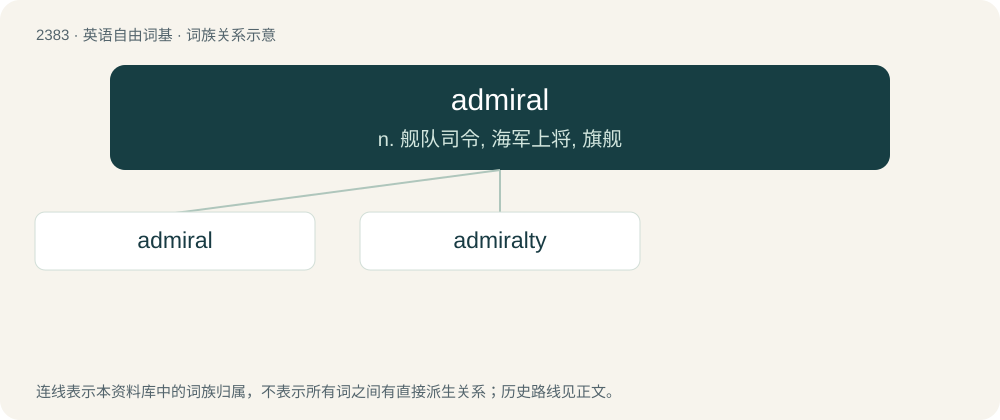

# 2490 · admiral — n. 舰队司令, 海军上将, 旗舰

[总目录](../00_总目录_按常用程度.md)

**类型**：英语自由词基　｜　**来源语言**：见词源记录

## 核心含义与来源

- 核心含义：n. 舰队司令, 海军上将, 旗舰
- 英文含义：The commander of a naval squadron or fleet, regardless of formal rank.
- 词形：admiral

**来源记录 1**（名词；The commander of a naval squadron or fleet, regardless of formal rank.）

From Middle English admiral etc., from Anglo-Norman and Old French admiral etc., from Medieval Latin admiralis, admirallus, and admiralius, from irregular modification of amiralis etc. under the influence of the prefix ad- and particularly admiror (“to admire, respect”), from Arabic أَمِير (ʔamīr, “commander”) + -alis (“-al”). The ending is frequently but mistakenly folk etymologized to derive from the article ال (al-), particularly in Arabic أَمِير اَلبَحْر (ʔamīr al-baḥr, “commander of the sea”), first attested as a Fatimid office, or in Arabic أَمِير الْمُؤْمِنِين (ʔamīr al-muʔminīn, “Commander of the Believers, caliph”). It seems instead to have been borrowed from modification of only the first term in Arabic أَمِير الْأُمَرَاء (ʔamīr al-ʔumarāʔ, “emir of emirs, commander-in-chief”) as used as a title for important commanders in Norman Sicily in the mid-12th century. First attested as an English rank in reference to Gervase Alard of Winchelsea as "admiral of the fleet of the Cinque Ports". Doublet of emir, amir, Amir, and amira.

## 词族图

## 单词速览（常用到不常用）

| 单词 | 音标 | 释义 |
|---|---|---|
| [admiral](#w-1) | 英 /ˈædməɹəl/；美 /ˈædməɹəl/ | n. 舰队司令, 海军上将, 旗舰 |
| [admiralty](#w-2) | /ˈæd.mɪ.ɹəl.ti/ | 【英文】The office or jurisdiction of an admiral. |

## 逐词详解

### 1. admiral

**词性**：名词　｜　**音标**：英 /ˈædməɹəl/；美 /ˈædməɹəl/

**中文释义**：n. 舰队司令, 海军上将, 旗舰

**英文义项**：The commander of a naval squadron or fleet, regardless of formal rank. / The appointed commander of a navy, regardless of formal title.

**词源与演化**：

From Middle English admiral etc., from Anglo-Norman and Old French admiral etc., from Medieval Latin admiralis, admirallus, and admiralius, from irregular modification of amiralis etc. under the influence of the prefix ad- and particularly admiror (“to admire, respect”), from Arabic أَمِير (ʔamīr, “commander”) + -alis (“-al”). The ending is frequently but mistakenly folk etymologized to derive from the article ال (al-), particularly in Arabic أَمِير اَلبَحْر (ʔamīr al-baḥr, “commander of the sea”), first attested as a Fatimid office, or in Arabic أَمِير الْمُؤْمِنِين (ʔamīr al-muʔminīn, “Commander of the Believers, caliph”). It seems instead to have been borrowed from modification of only the first term in Arabic أَمِير الْأُمَرَاء (ʔamīr al-ʔumarāʔ, “emir of emirs, commander-in-chief”) as used as a title for important commanders in Norman Sicily in the mid-12th century. First attested as an English rank in reference to Gervase Alard of Winchelsea as "admiral of the fleet of the Cinque Ports". Doublet of emir, amir, Amir, and amira.

**例句**：

> Lord Nelson suffered greatly from seasickness all his life, even as a famous admiral.

### 2. admiralty

**词性**：名词　｜　**音标**：/ˈæd.mɪ.ɹəl.ti/

**英文义项**：The office or jurisdiction of an admiral. / The department or officers having authority over naval affairs generally.

**构词拆分**：admiral + -ty

**词源与演化**：

From French amirauté, for an older amiralté (“office of admiral”), from Late Latin admīrālitās. See admiral. Analyzable as admiral + -ty.

**例句**：

> His plan was approved by the Admiralty in April 1915.
