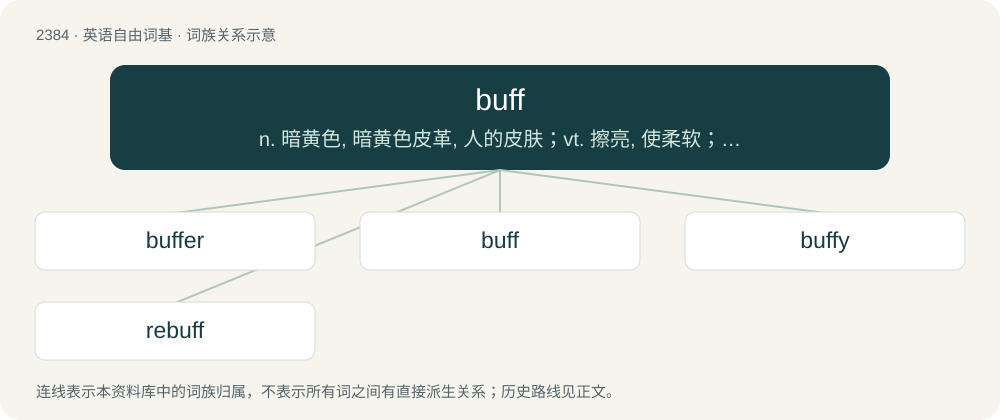

# 2491 · buff — n. 暗黄色, 暗黄色皮革, 人的皮肤；vt. 擦亮, 使柔软；a. 暗黄色的

[总目录](../00_总目录_按常用程度.md)

**类型**：英语自由词基　｜　**来源语言**：见词源记录

## 核心含义与来源

- 核心含义：n. 暗黄色, 暗黄色皮革, 人的皮肤；vt. 擦亮, 使柔软；a. 暗黄色的
- 英文含义：Undyed leather from the skin of buffalo or similar animals.
- 词形：buff

**多个词源／构词路径**：同一拼写可能有不同来源；以下按词性和含义分别列出。

**来源记录 1**（名词；Undyed leather from the skin of buffalo or similar animals.）

From buffe (“leather”), from Middle French buffle (“buffalo”).

**来源记录 2**（动词；To strike.）

From Old French bufer (“to cuff, buffet”). See buffet (“a blow”).

**来源记录 3**（名词；A buffalo, or the meat of a buffalo.）

Clipping of buffalo.

## 词族图

## 单词速览（常用到不常用）

| 单词 | 音标 | 释义 |
|---|---|---|
| [buffer](#w-1) | 英 /ˈbʌfə/；美 /ˈbʌfəɹ/ | n. 缓冲器, 缓冲区；vt. 缓冲；\[计\] 缓冲区, 缓冲器 |
| [buff](#w-2) | 英 /bʌf/ | n. 暗黄色, 暗黄色皮革, 人的皮肤；vt. 擦亮, 使柔软；a. 暗黄色的 |
| [buffy](#w-3) | /ˈbʌfi/ | a. 喝醉了的 |
| [rebuff](#w-4) | /ɹiːˈbʌf/ | 【英文】To buff again. |

## 逐词详解

### 1. buffer

**词性**：名词　｜　**音标**：英 /ˈbʌfə/；美 /ˈbʌfəɹ/

**中文释义**：n. 缓冲器, 缓冲区；vt. 缓冲；\[计\] 缓冲区, 缓冲器

**英文义项**：A machine with rotary brushes, passed over a hard floor to clean it. / A machine for polishing shoes and boots.

**构词拆分**：buff + -er

**词源与演化**：

From buff + -er.

**例句**：

> We should not use foreign workers as a buffer against Japan's economic slowdown.

### 2. buff

**词性**：名词　｜　**音标**：英 /bʌf/

**中文释义**：n. 暗黄色, 暗黄色皮革, 人的皮肤；vt. 擦亮, 使柔软；a. 暗黄色的

**英文义项**：Undyed leather from the skin of buffalo or similar animals. / A tool, often one covered with buff leather, used for polishing.

**词源与演化**：

From buffe (“leather”), from Middle French buffle (“buffalo”).

**例句**：

> He’s a real history buff. He knows everything there is to know about the civil war.

该用例对应义项：A person who is very interested in a particular subject.

### 3. buffy

**词性**：形容词　｜　**音标**：/ˈbʌfi/

**中文释义**：a. 喝醉了的

**英文义项**：Of a buff color.

**构词拆分**：buff + -y

**词源与演化**：

From buff + -y.

**例句**：

> If you watch past season 4 of Buffy the Vampire Slayer without me, I'm going to kill you.

### 4. rebuff

**词性**：动词　｜　**音标**：/ɹiːˈbʌf/

**英文义项**：To buff again.

**构词拆分**：re- + buff

**词源与演化**：

From re- + buff.
