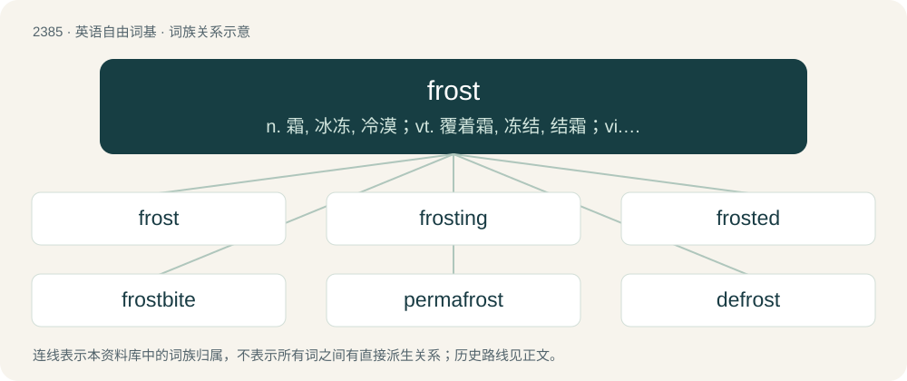

# 2493 · frost — n. 霜, 冰冻, 冷漠；vt. 覆着霜, 冻结, 结霜；vi. 受冻, 起霜

[总目录](../00_总目录_按常用程度.md)

**类型**：英语自由词基　｜　**来源语言**：见词源记录

## 核心含义与来源

- 核心含义：n. 霜, 冰冻, 冷漠；vt. 覆着霜, 冻结, 结霜；vi. 受冻, 起霜
- 英文含义：A cover of minute ice crystals on objects that are exposed to the air. Frost is formed by the same process as dew, except that the temperature of the frosted object is below freezing.
- 词形：frost

**来源记录 1**（名词；A cover of minute ice crystals on objects that are exposed to the air. Frost is formed by the same process as dew, except that the temperature of the frosted object is below freezing.）

From Middle English frost, from an unmetathesized variant of Old English forst (“frost”), from Proto-Germanic \*frustaz (“frost”), from Proto-Indo-European \*prews- (“to freeze; frost”). Cognate with Saterland Frisian Froast, Fröäst (“frost”), West Frisian froast (“frost”), Cimbrian bròst, vrost, vròst (“frost”), Dutch vorst (“frost”), German Frost (“frost”), Luxembourgish Frascht (“frost”), Vilamovian fröst (“frost”), Danish, Faroese, Icelandic, Norwegian Bokmål, Norwegian Nynorsk, Swedish frost (“frost”), Latin pruīna (“hoarfrost, frost, rime, snow”). Related to freeze.

## 词族图

## 单词速览（常用到不常用）

| 单词 | 音标 | 释义 |
|---|---|---|
| [frost](#w-1) | 英 /fɹɒst/；美 /fɹɔst/ | n. 霜, 冰冻, 冷漠；vt. 覆着霜, 冻结, 结霜；vi. 受冻, 起霜 |
| [frosting](#w-2) | 英 /ˈfɹɒst.ɪŋ/；美 /ˈfɹɔst.ɪŋ/ | n. 霜状白糖, 无光泽面, 装饰玻璃粉；\[化\] 起霜(塑料制品表面缺陷); 毛面蚀刻 |
| [frosted](#w-3) | /ˈfrɔstid/ | a. 结霜的, 冻伤的, 无光泽的, 磨砂的, 因年老而变白的, 冷淡的 |
| [frostbite](#w-4) | /ˈfrɒstbait/ | n. 冻伤, 冻疮；vt. 被霜伤害, 使冻伤 |
| [permafrost](#w-5) | 英 /ˈpɜːməˌfɹɔst/；美 /ˈpɝməˌfɹɔst/ | n. \[地\]永久冻结带 |
| [defrost](#w-6) | 英 /diːˈfɹɒst/；美 /diːˈfɹɔst/ | vt. 除霜；vi. 解冻 |

## 逐词详解

### 1. frost

**词性**：动词　｜　**音标**：英 /fɹɒst/；美 /fɹɔst/

**中文释义**：n. 霜, 冰冻, 冷漠；vt. 覆着霜, 冻结, 结霜；vi. 受冻, 起霜

**英文义项**：To cover with frost. / To become covered with frost.

**词源与演化**：

From Middle English frost, from an unmetathesized variant of Old English forst (“frost”), from Proto-Germanic \*frustaz (“frost”), from Proto-Indo-European \*prews- (“to freeze; frost”). Cognate with Saterland Frisian Froast, Fröäst (“frost”), West Frisian froast (“frost”), Cimbrian bròst, vrost, vròst (“frost”), Dutch vorst (“frost”), German Frost (“frost”), Luxembourgish Frascht (“frost”), Vilamovian fröst (“frost”), Danish, Faroese, Icelandic, Norwegian Bokmål, Norwegian Nynorsk, Swedish frost (“frost”), Latin pruīna (“hoarfrost, frost, rime, snow”). Related to freeze.

**例句**：

> I think the boss's decision frosted him a bit.

该用例对应义项：To anger or annoy.

### 2. frosting

**词性**：名词　｜　**音标**：英 /ˈfɹɒst.ɪŋ/；美 /ˈfɹɔst.ɪŋ/

**中文释义**：n. 霜状白糖, 无光泽面, 装饰玻璃粉；\[化\] 起霜(塑料制品表面缺陷); 毛面蚀刻

**英文义项**：Icing, a sweet, often creamy and thick, covering for cakes and other baked goods. / A layer of frost.

**构词拆分**：frost + -ing

**词源与演化**：

From frost + -ing.

**例句**：

> The pastry chef is decorating a cake with green owls made of buttercream frosting.

### 3. frosted

**词性**：形容词　｜　**音标**：/ˈfrɔstid/

**中文释义**：a. 结霜的, 冻伤的, 无光泽的, 磨砂的, 因年老而变白的, 冷淡的

**英文义项**：Covered in frost; frosty. / Translucent, appearing to be covered in frost.

**构词拆分**：frost + -ed

**词源与演化**：

From frost + -ed.

**例句**：

> She installed frosted windows, since there was a clear view of her bathroom from her neighbor's bedroom.

该用例对应义项：Translucent, appearing to be covered in frost.

### 4. frostbite

**词性**：名词　｜　**音标**：/ˈfrɒstbait/

**中文释义**：n. 冻伤, 冻疮；vt. 被霜伤害, 使冻伤

**英文义项**：An injury suffered as a result of freezing of some part of the body, typically fingers, toes or the nose.

**构词拆分**：frost + bite

**词源与演化**：

From frost + bite.

**例句**：

> If you go out in weather like this, you risk frostbite.

### 5. permafrost

**词性**：名词　｜　**音标**：英 /ˈpɜːməˌfɹɔst/；美 /ˈpɝməˌfɹɔst/

**中文释义**：n. \[地\]永久冻结带

**英文义项**：Permanently frozen ground, or a specific layer thereof.

**构词拆分**：perma- + frost

**词源与演化**：

From perma- + frost.

**例句**：

> The melting permafrost was key factor in the ecological disaster.

### 6. defrost

**词性**：动词　｜　**音标**：英 /diːˈfɹɒst/；美 /diːˈfɹɔst/

**中文释义**：vt. 除霜；vi. 解冻

**英文义项**：To remove frost from. / To thaw (something).

**构词拆分**：de- + frost

**词源与演化**：

From de- + frost.

**例句**：

> See you tomorrow evening; I'll have defrosted from my trip by then.

该用例对应义项：To recover from something tiresome.
