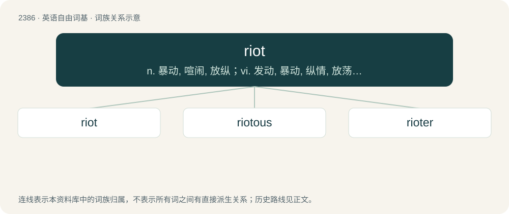

# 2494 · riot — n. 暴动, 喧闹, 放纵；vi. 发动, 暴动, 纵情, 放荡；vt. 浪费, 挥霍

[总目录](../00_总目录_按常用程度.md)

**类型**：英语自由词基　｜　**来源语言**：见词源记录

## 核心含义与来源

- 核心含义：n. 暴动, 喧闹, 放纵；vi. 发动, 暴动, 纵情, 放荡；vt. 浪费, 挥霍
- 英文含义：A tumultuous disturbance of the public peace by a large group of people, often involving violence or damage to property.
- 词形：riot

**来源记录 1**（名词；A tumultuous disturbance of the public peace by a large group of people, often involving violence or damage to property.）

From Middle English riot (“debauched living, dissipation”), from Old French riote (“debate”), from rioter (“to quarrel”), perhaps related to riboter or from Latin rugio (“to roar”). Compare French riotte and Occitan riòta.

## 词族图

## 单词速览（常用到不常用）

| 单词 | 音标 | 释义 |
|---|---|---|
| [riot](#w-1) | /ˈɹaɪ.ət/ | n. 暴动, 喧闹, 放纵；vi. 发动, 暴动, 纵情, 放荡；vt. 浪费, 挥霍 |
| [riotous](#w-2) | /ˈɹaɪətəs/ | a. 引起骚扰的, 暴乱的, 放荡的 |
| [rioter](#w-3) | 英 /ˈɹaɪətə/；美 /ˈɹaɪətɚ/ | n. 暴民, 暴徒, 纵情享乐者；\[法\] 暴徒, 骚乱者, 暴动者 |

## 逐词详解

### 1. riot

**词性**：名词　｜　**音标**：/ˈɹaɪ.ət/

**中文释义**：n. 暴动, 喧闹, 放纵；vi. 发动, 暴动, 纵情, 放荡；vt. 浪费, 挥霍

**英文义项**：A tumultuous disturbance of the public peace by a large group of people, often involving violence or damage to property. / A wide and unconstrained variety.

**词源与演化**：

From Middle English riot (“debauched living, dissipation”), from Old French riote (“debate”), from rioter (“to quarrel”), perhaps related to riboter or from Latin rugio (“to roar”). Compare French riotte and Occitan riòta.

**例句**：

> The protests began peacefully but turned into riots after several days.

该用例对应义项：A tumultuous disturbance of the public peace by a large group of people, often involving violence or damage to property.

### 2. riotous

**词性**：形容词　｜　**音标**：/ˈɹaɪətəs/

**中文释义**：a. 引起骚扰的, 暴乱的, 放荡的

**英文义项**：Having the characteristics of a riot. / Causing, inciting or taking part in a riot.

**构词拆分**：riot + -ous

**词源与演化**：

Inherited from Middle English riotous, from Anglo-Norman riotous; equivalent to riot + -ous.

### 3. rioter

**词性**：名词　｜　**音标**：英 /ˈɹaɪətə/；美 /ˈɹaɪətɚ/

**中文释义**：n. 暴民, 暴徒, 纵情享乐者；\[法\] 暴徒, 骚乱者, 暴动者

**英文义项**：One who riots; part of the unruly violent crowd causing a riot.

**构词拆分**：riot + -er

**词源与演化**：

Inherited from Middle English riotour, from Old French rioteor; equivalent to riot + -er.

**例句**：

> The rioters had erected a makeshift barricade and were pelting the police with rocks from behind it.

该用例对应义项：One who riots; part of the unruly violent crowd causing a riot.
