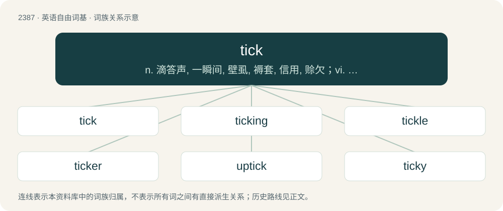

# 2495 · tick — n. 滴答声, 一瞬间, 壁虱, 褥套, 信用, 赊欠；vi. 滴答响, 活动；vt. 滴答地记录, 标记号于

[总目录](../00_总目录_按常用程度.md)

**类型**：英语自由词基　｜　**来源语言**：见词源记录

## 核心含义与来源

- 核心含义：n. 滴答声, 一瞬间, 壁虱, 褥套, 信用, 赊欠；vi. 滴答响, 活动；vt. 滴答地记录, 标记号于
- 英文含义：A tiny woodland arachnid of the suborder Ixodida.
- 词形：tick

**多个词源／构词路径**：同一拼写可能有不同来源；以下按词性和含义分别列出。

**来源记录 1**（名词；A tiny woodland arachnid of the suborder Ixodida.）

From Middle English tyke, teke, from Old English ticia (“parasitic animal, tick”), from Proto-West Germanic \*tīkō, compare Dutch teek, German Zecke.

**来源记录 2**（名词；A relatively quiet but sharp sound generally made repeatedly by moving machinery.）

From Middle English \*tik, tek, tyche (“light touch, tap”), from the verb (see Etymology 3 below). Compare Dutch tik (“a pat, tap”), Middle High German zic (“a slight touch”).

**来源记录 3**（动词；To make a clicking noise similar to the movement of the hands of an analog clock.）

From Middle English ticken, tiken, probably from Old English \*ticcian (“to touch, tap”), from Proto-West Germanic \*tikkōn (“to touch, tap”), cognate with German zecken (“to nudge, poke, jab”). Doublet of tig.

**来源记录 4**（名词；Ticking.）

From Middle English tike, probably from Middle Dutch tike and Middle Low German teke, both ultimately from Latin theca (“cover”). Compare also German Zieche (“duvet, pillowcase”).

**来源记录 5**（名词；Credit, trust.）

Clipping of ticket.

## 词族图

## 单词速览（常用到不常用）

| 单词 | 音标 | 释义 |
|---|---|---|
| [tick](#w-1) | 英 /tɪk/ | n. 滴答声, 一瞬间, 壁虱, 褥套, 信用, 赊欠；vi. 滴答响, 活动；vt. 滴答地记录, 标记号于 |
| [ticking](#w-2) | /ˈtɪkɪŋ/ | n. 坚质棉布 |
| [tickle](#w-3) | /ˈtɪkl̩/ | n. 胳肢, 痒；vt. 胳肢, 使发痒, 使快乐, 逗乐；vi. 觉得痒, 使人痒 |
| [ticker](#w-4) | /ˈtɪkə(ɹ)/ | n. 滴答响的东西, 断续器；\[经\] 股票行情自动收录器 |
| [uptick](#w-5) | /ˈʌptɪk/ | \[商\](股票)报升(成交价格比上一个交易高的成交或价格) |
| [ticky](#w-6) | /ˈtɪ.ki/ | n. \[南非\]三便士 |

## 逐词详解

### 1. tick

**词性**：名词　｜　**音标**：英 /tɪk/

**中文释义**：n. 滴答声, 一瞬间, 壁虱, 褥套, 信用, 赊欠；vi. 滴答响, 活动；vt. 滴答地记录, 标记号于

**英文义项**：A tiny woodland arachnid of the suborder Ixodida.

**词源与演化**：

From Middle English tyke, teke, from Old English ticia (“parasitic animal, tick”), from Proto-West Germanic \*tīkō, compare Dutch teek, German Zecke.

**例句**：

> I like to take things apart to see what makes them tick.

### 2. ticking

**词性**：名词　｜　**音标**：/ˈtɪkɪŋ/

**中文释义**：n. 坚质棉布

**英文义项**：A strong cotton or linen fabric used to cover pillows and mattresses.

**构词拆分**：From tick (“sheet, cover”) + -ing (“material, collection”).

**词源与演化**：

From tick (“sheet, cover”) + -ing (“material, collection”).

**例句**：

> The only sound to be heard was the ticking of the clock.

### 3. tickle

**词性**：名词　｜　**音标**：/ˈtɪkl̩/

**中文释义**：n. 胳肢, 痒；vt. 胳肢, 使发痒, 使快乐, 逗乐；vi. 觉得痒, 使人痒

**英文义项**：The act of tickling. / An itchy feeling resembling the result of tickling.

**构词拆分**：tick + -le

**词源与演化**：

From Middle English tiklen, tikelen, of uncertain origin. Perhaps from a frequentative form of Middle English tikken (“to touch lightly”), thus equivalent to tick + -le; or perhaps related to Old English tinclian (“to tickle”). Compare North Frisian tigele (“to tickle”) (Hallig dialect), and tiikle (“to tickle”) (Amrum dialect), German dialectal zicklen (“to excite; stir up”). Alternatively, from a metathetic alteration of Middle English kitelen ("to tickle"; see kittle). Both are ultimately sound-symbolic.

**例句**：

> I have a persistent tickle in my throat.

该用例对应义项：An itchy feeling resembling the result of tickling.

### 4. ticker

**词性**：名词　｜　**音标**：/ˈtɪkə(ɹ)/

**中文释义**：n. 滴答响的东西, 断续器；\[经\] 股票行情自动收录器

**英文义项**：One who makes a tick mark. / A measuring or reporting device, particularly one which makes a ticking sound as the measured events occur.

**构词拆分**：From tick + -er.

**词源与演化**：

From tick + -er.

**例句**：

> I checked the prices on the ticker one last time before placing the trade.

该用例对应义项：A ticker tape, either the traditional paper kind or a scrolling message on a screen.

### 5. uptick

**词性**：名词　｜　**音标**：/ˈʌptɪk/

**中文释义**：\[商\](股票)报升(成交价格比上一个交易高的成交或价格)

**英文义项**：A small increase or upward change in something that has been steady or declining. / A stock market transaction or quote at a price above a preceding one.

**构词拆分**：From up- + tick.

**词源与演化**：

From up- + tick.

**例句**：

> Many fear an uptick in the violence.

### 6. ticky

**词性**：形容词　｜　**音标**：/ˈtɪ.ki/

**中文释义**：n. \[南非\]三便士

**英文义项**：infested with ticks (the tiny woodland arthropod of the order Acarina).

**构词拆分**：From tick + -y.

**词源与演化**：

From tick + -y.

**例句**：

> The ticky cows should be kept well separated to avoid contamination.

该用例对应义项：infested with ticks (the tiny woodland arthropod of the order Acarina).
