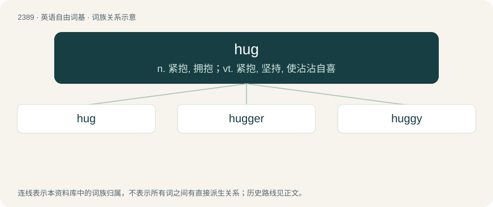

# 2497 · hug — n. 紧抱, 拥抱；vt. 紧抱, 坚持, 使沾沾自喜

[总目录](../00_总目录_按常用程度.md)

**类型**：英语自由词基　｜　**来源语言**：见词源记录

## 核心含义与来源

- 核心含义：n. 紧抱, 拥抱；vt. 紧抱, 坚持, 使沾沾自喜
- 英文含义：A close embrace, especially when charged with an emotion such as affection, joy, relief, lust, anger, aggression, compassion, or the like, as opposed to being characterized by formality, equivocation or ambivalence (a half-embrace).
- 词形：hug

**来源记录 1**（名词；A close embrace, especially when charged with an emotion such as affection, joy, relief, lust, anger, aggression, compassion, or the like, as opposed to being characterized by formality, equivocation or ambivalence (a half-embrace).）

From earlier hugge (“to embrace, clasp with the arms”) (1560), probably representing a conflation of huck (“to crouch, huddle down”) and Old Norse hugga (“to comfort, console”), from hugr (“mind, heart, thought”), from Proto-Germanic \*hugiz (“mind, thought, sense”), cognate with Icelandic hugga (“to comfort”), Old English hyġe (“thought”) (whence high (Etymology 2)).

## 词族图

## 单词速览（常用到不常用）

| 单词 | 音标 | 释义 |
|---|---|---|
| [hug](#w-1) | /hʌɡ/ | n. 紧抱, 拥抱；vt. 紧抱, 坚持, 使沾沾自喜 |
| [hugger](#w-2) | 英 /ˈhʌɡə/；美 /ˈhʌɡɚ/ | 极端派; 割理 |
| [huggy](#w-3) | /ˈhʌɡi/ | 【英文】Tending to hug; affectionate in a physical way. |

## 逐词详解

### 1. hug

**词性**：动词　｜　**音标**：/hʌɡ/

**中文释义**：n. 紧抱, 拥抱；vt. 紧抱, 坚持, 使沾沾自喜

**英文义项**：To cling closely together. / To embrace by holding closely, especially in the arms.

**词源与演化**：

From earlier hugge (“to embrace, clasp with the arms”) (1560), probably representing a conflation of huck (“to crouch, huddle down”) and Old Norse hugga (“to comfort, console”), from hugr (“mind, heart, thought”), from Proto-Germanic \*hugiz (“mind, thought, sense”), cognate with Icelandic hugga (“to comfort”), Old English hyġe (“thought”) (whence high (Etymology 2)).

**用法示例／搭配（非完整句）**：

> to hug the shore, to hug the coastline

该用例对应义项：To stay close to.

### 2. hugger

**词性**：名词　｜　**音标**：英 /ˈhʌɡə/；美 /ˈhʌɡɚ/

**中文释义**：极端派; 割理

**英文义项**：One who hugs or embraces. / A ceiling fan whose blades are close to the ceiling.

**构词拆分**：hug + -er

**词源与演化**：

From hug + -er.

**例句**：

> She never uses paper towels. She is such a tree hugger, you know.

### 3. huggy

**词性**：形容词　｜　**音标**：/ˈhʌɡi/

**英文义项**：Tending to hug; affectionate in a physical way.

**构词拆分**：hug + -y

**词源与演化**：

From hug + -y.
