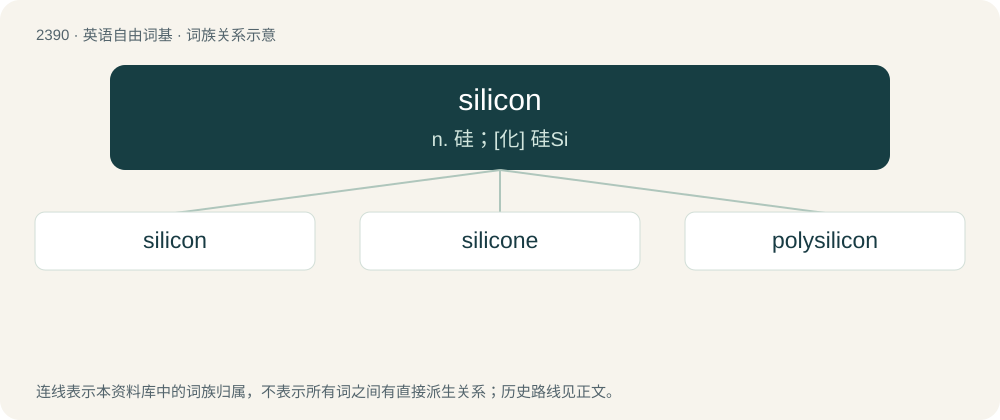

# 2499 · silicon — n. 硅；\[化\] 硅Si

[总目录](../00_总目录_按常用程度.md)

**类型**：英语自由词基　｜　**来源语言**：见词源记录

## 核心含义与来源

- 核心含义：n. 硅；\[化\] 硅Si
- 英文含义：A nonmetallic element (symbol Si) with an atomic number of 14 and atomic weight of 28.0855.
- 词形：silicon

**多个词源／构词路径**：同一拼写可能有不同来源；以下按词性和含义分别列出。

**来源记录 1**（名词；A nonmetallic element (symbol Si) with an atomic number of 14 and atomic weight of 28.0855.）

Coined by Scottish chemist Thomas Thomson as a modification of the earlier name silicium, from the stem of Latin silex (“flint, silica”) + -on from carbon.

**来源记录 2**（名词；Computing.）

From the silicon chips used in computers.

## 词族图

## 单词速览（常用到不常用）

| 单词 | 音标 | 释义 |
|---|---|---|
| [silicon](#w-1) | 英 /ˈsɪlɪkən/；美 /ˈsɪləˌkɑn/ | n. 硅；\[化\] 硅Si |
| [silicone](#w-2) | /ˈsɪlɪkəʊn/ | n. 硅树脂；\[化\] 硅氧烷; 聚硅氧烷 |
| [polysilicon](#w-3) | /,pɔliˈsilikən/ | \[计\] 多晶硅 |

## 逐词详解

### 1. silicon

**词性**：名词　｜　**音标**：英 /ˈsɪlɪkən/；美 /ˈsɪləˌkɑn/

**中文释义**：n. 硅；\[化\] 硅Si

**英文义项**：A nonmetallic element (symbol Si) with an atomic number of 14 and atomic weight of 28.0855. / A single atom of this element.

**构词拆分**：silicium + -on

**词源与演化**：

Coined by Scottish chemist Thomas Thomson as a modification of the earlier name silicium, from the stem of Latin silex (“flint, silica”) + -on from carbon.

**例句**：

> Electronic City near Bengaluru, Karnataka is considered the Silicon Valley of India.

### 2. silicone

**词性**：动词　｜　**音标**：/ˈsɪlɪkəʊn/

**中文释义**：n. 硅树脂；\[化\] 硅氧烷; 聚硅氧烷

**英文义项**：To join or treat (something) with a silicone-based product. / To enhance or reconstruct (a body part) with a prosthesis containing silicone.

**构词拆分**：silicon + -one

**词源与演化**：

From silicon + -one. Originally obtained by the attempted synthesis of the silicon equivalent of a ketone.

**用法示例／搭配（非完整句）**：

> silicone the bathtub to the tile

该用例对应义项：To join or treat (something) with a silicone-based product.

### 3. polysilicon

**词性**：形容词　｜　**音标**：/,pɔliˈsilikən/

**中文释义**：\[计\] 多晶硅

**英文义项**：Containing many silicon atoms, especially when linked into chains or networks.

**构词拆分**：poly- + silicon

**词源与演化**：

From poly- + silicon.
