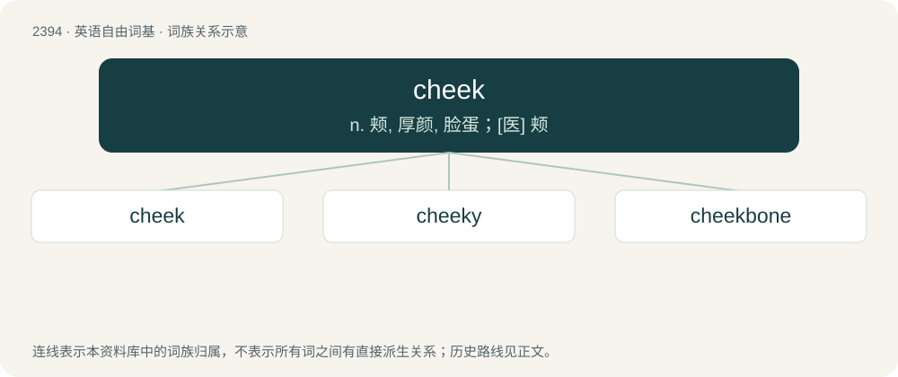

# 2503 · cheek — n. 颊, 厚颜, 脸蛋；\[医\] 颊

[总目录](../00_总目录_按常用程度.md)

**类型**：英语自由词基　｜　**来源语言**：见词源记录

## 核心含义与来源

- 核心含义：n. 颊, 厚颜, 脸蛋；\[医\] 颊
- 英文含义：The soft skin on each side of the face, below the eyes; the outer surface of the sides of the oral cavity.
- 词形：cheek

**来源记录 1**（名词；The soft skin on each side of the face, below the eyes; the outer surface of the sides of the oral cavity.）

From Middle English cheeke, cheke, cheoke, choke, from Old English ċēce, ċēace, ċēoce (“cheek; jaw”), from Proto-West Germanic \*kākā, \*keukā (“jaw, cheek”), from Proto-Germanic \*kēkǭ, \*keukǭ (“jaw; palate; pharynx”), perhaps from Proto-Indo-European \*ǵyewh₁- (“to chew”). Cognate with Saterland Frisian Sooke (“cheek”), West Frisian tsjeak (“jaw”), Dutch kaak (“jaw; cheek”), Swedish käke (“jaw; jowl”), Norwegian kjake (“jaw”), Old Norse kók (“mouth; gullet”).

## 词族图

## 单词速览（常用到不常用）

| 单词 | 音标 | 释义 |
|---|---|---|
| [cheek](#w-1) | /t͡ʃiːk/ | n. 颊, 厚颜, 脸蛋；\[医\] 颊 |
| [cheeky](#w-2) | /ˈt͡ʃiːki/ | a. 厚颜的, 无耻的, 色情的 |
| [cheekbone](#w-3) | 美 /ˈt͡ʃikˌboʊn/ | n. 颧骨 |

## 逐词详解

### 1. cheek

**词性**：名词　｜　**音标**：/t͡ʃiːk/

**中文释义**：n. 颊, 厚颜, 脸蛋；\[医\] 颊

**英文义项**：The soft skin on each side of the face, below the eyes; the outer surface of the sides of the oral cavity. / The lower part of the buttocks that is often exposed beneath very brief underwear, swimwear, or extremely short shorts.

**词源与演化**：

From Middle English cheeke, cheke, cheoke, choke, from Old English ċēce, ċēace, ċēoce (“cheek; jaw”), from Proto-West Germanic \*kākā, \*keukā (“jaw, cheek”), from Proto-Germanic \*kēkǭ, \*keukǭ (“jaw; palate; pharynx”), perhaps from Proto-Indo-European \*ǵyewh₁- (“to chew”). Cognate with Saterland Frisian Sooke (“cheek”), West Frisian tsjeak (“jaw”), Dutch kaak (“jaw; cheek”), Swedish käke (“jaw; jowl”), Norwegian kjake (“jaw”), Old Norse kók (“mouth; gullet”).

**例句**：

> You’ve got some cheek, asking me for money!

该用例对应义项：Impudence.

### 2. cheeky

**词性**：形容词　｜　**音标**：/ˈt͡ʃiːki/

**中文释义**：a. 厚颜的, 无耻的, 色情的

**英文义项**：Impudent; impertinent; impertinently bold, often in a way that is regarded as endearing or amusing. / Tending to expose the cheeks of the buttocks.

**构词拆分**：cheek + -y

**词源与演化**：

From cheek + -y. Compare typologically barefaced, bald-faced; Italian sfacciato (&lt; Latin ex- + faciēs); French effronté, Italian sfrontato (&lt; Latin ex- + frons), Polish czelny (&lt; czoło).

**例句**：

> If you're cheeky once more, I won't read you a story tonight.

### 3. cheekbone

**词性**：名词　｜　**音标**：美 /ˈt͡ʃikˌboʊn/

**中文释义**：n. 颧骨

**英文义项**：The small prominent bone of the cheek.

**构词拆分**：cheek + bone

**词源与演化**：

From Middle English chekebon, chekbone, from Old English ċēacbān (“cheekbone”); equivalent to cheek + bone. Compare Dutch kaakbeen (“jawbone”).

**例句**：

> Other injuries included a broken nose, a dislocated shoulder and a hairline fracture of a cheekbone.
