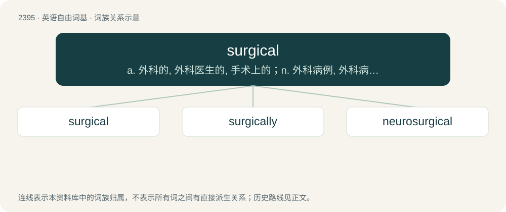

# 2504 · surgical — a. 外科的, 外科医生的, 手术上的；n. 外科病例, 外科病房, 外科手术

[总目录](../00_总目录_按常用程度.md)

**类型**：英语自由词基　｜　**来源语言**：见词源记录

## 核心含义与来源

- 核心含义：a. 外科的, 外科医生的, 手术上的；n. 外科病例, 外科病房, 外科手术
- 英文含义：Of, relating to, used in, or resulting from surgery.
- 词形：surgical

**来源记录 1**（形容词；Of, relating to, used in, or resulting from surgery.）

From Middle English cirurgical, borrowed from Middle French cirurgical, from Medieval Latin cirurgicālis, ultimately from Ancient Greek χειρουργία (kheirourgía), from χείρ (kheír, “hand”) + ἔργον (érgon, “work”). Replaced Old English Old English læċe (“doctor, physician”). By surface analysis, surgery + -ical.

## 词族图

## 单词速览（常用到不常用）

| 单词 | 音标 | 释义 |
|---|---|---|
| [surgical](#w-1) | 英 /ˈsɜːd͡ʒɪkəl/；美 /ˈsɝd͡ʒɪkəl/ | a. 外科的, 外科医生的, 手术上的；n. 外科病例, 外科病房, 外科手术 |
| [surgically](#w-2) |  | adv. 如外科手术般地 |
| [neurosurgical](#w-3) | /ˌnjʊərəʊˈsɜːdʒɪkl/ | a. &lt;医&gt;神经外科的 |

## 逐词详解

### 1. surgical

**词性**：形容词　｜　**音标**：英 /ˈsɜːd͡ʒɪkəl/；美 /ˈsɝd͡ʒɪkəl/

**中文释义**：a. 外科的, 外科医生的, 手术上的；n. 外科病例, 外科病房, 外科手术

**英文义项**：Of, relating to, used in, or resulting from surgery. / Precise or very accurate.

**词源与演化**：

From Middle English cirurgical, borrowed from Middle French cirurgical, from Medieval Latin cirurgicālis, ultimately from Ancient Greek χειρουργία (kheirourgía), from χείρ (kheír, “hand”) + ἔργον (érgon, “work”). Replaced Old English Old English læċe (“doctor, physician”). By surface analysis, surgery + -ical.

**例句**：

> The building was destroyed with a surgical air-strike.

该用例对应义项：Precise or very accurate.

### 2. surgically

**词性**：副词

**中文释义**：adv. 如外科手术般地

**英文义项**：Relating to surgery; by means of surgery.

**构词拆分**：surgical + -ly

**词源与演化**：

From surgical + -ly.

**例句**：

> His cancer was treated surgically instead of with drugs or radiation.

该用例对应义项：Relating to surgery; by means of surgery.

### 3. neurosurgical

**词性**：形容词　｜　**音标**：/ˌnjʊərəʊˈsɜːdʒɪkl/

**中文释义**：a. &lt;医&gt;神经外科的

**英文义项**：Of, or pertaining to neurosurgery.

**构词拆分**：neuro- + surgical

**词源与演化**：

From neuro- + surgical.
