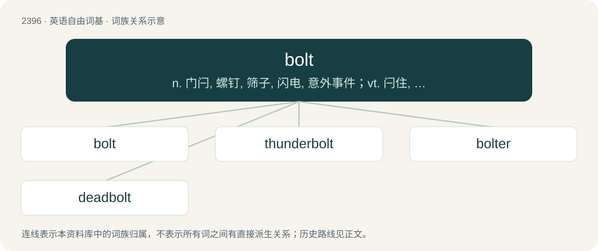

# 2505 · bolt — n. 门闩, 螺钉, 筛子, 闪电, 意外事件；vt. 闩住, 发射, 脱口而出, 筛, 囫囵吞下；vi. 囫囵吞枣, 射箭, 脱缰, 退出党派

[总目录](../00_总目录_按常用程度.md)

**类型**：英语自由词基　｜　**来源语言**：见词源记录

## 核心含义与来源

- 核心含义：n. 门闩, 螺钉, 筛子, 闪电, 意外事件；vt. 闩住, 发射, 脱口而出, 筛, 囫囵吞下；vi. 囫囵吞枣, 射箭, 脱缰, 退出党派
- 英文含义：A (usually) metal fastener consisting of a cylindrical body that is threaded, with a larger head on one end. It can be inserted into an unthreaded hole up to the head, with a nut then threaded on the other end; a heavy machine screw.
- 词形：bolt

**多个词源／构词路径**：同一拼写可能有不同来源；以下按词性和含义分别列出。

**来源记录 1**（名词；A (usually) metal fastener consisting of a cylindrical body that is threaded, with a larger head on one end. It can be inserted into an unthreaded hole up to the head, with a nut then threaded on the other end; a heavy machine screw.）

From Middle English bolt, from Old English bolt, from Proto-West Germanic \*bolt, from Proto-Germanic \*bultaz, perhaps from Proto-Indo-European \*bʰeld- (“to knock, strike”). Compare Lithuanian beldu (“I knock”), baldas (“pole for striking”). Akin to Dutch and West Frisian bout, German Bolz or Bolzen, Danish bolt, Swedish bult, Icelandic bolti. The association of thunder and lightning with 'bolts' is found back into prehistory in many cultures, at least in Eurasia. It comes from the long-standing widespread belief that lightning was caused by bolts, darts, or stones hurtling down from the sky to the earth. This belief was still regarded as commonplace until at least 1929.

**来源记录 2**（动词；To sift, especially through a cloth.）

From Middle English bulten, from Anglo-Norman buleter, Old French bulter (modern French bluter), from a Germanic source originally meaning "bag, pouch" cognate with Middle High German biuteln (“to sift”), from Proto-Germanic \*buzdô (“beetle, grub, swelling”), from Proto-Indo-European \*bʰūs- (“to move quickly”). Cognate with Dutch buidel.

## 词族图

## 单词速览（常用到不常用）

| 单词 | 音标 | 释义 |
|---|---|---|
| [bolt](#w-1) | 英 /bɒlt/；美 /boʊlt/ | n. 门闩, 螺钉, 筛子, 闪电, 意外事件；vt. 闩住, 发射, 脱口而出, 筛, 囫囵吞下；vi. 囫囵吞枣, 射箭, 脱缰, 退出党派 |
| [thunderbolt](#w-2) | /ˈθʌndə(ɹ)ˌboʊlt/ | n. 霹雳, 雷电, 晴天霹雳, 怒喝 |
| [bolter](#w-3) | 美 /ˈboʊltɚ/ | n. 退出党派的人, 脱缰的马, 筛面粉的机器；\[机\] 筛 |
| [deadbolt](#w-4) | 美 /ˈdɛdˌboʊ̯lt/ | = deadlock (2) |

## 逐词详解

### 1. bolt

**词性**：名词　｜　**音标**：英 /bɒlt/；美 /boʊlt/

**中文释义**：n. 门闩, 螺钉, 筛子, 闪电, 意外事件；vt. 闩住, 发射, 脱口而出, 筛, 囫囵吞下；vi. 囫囵吞枣, 射箭, 脱缰, 退出党派

**英文义项**：A (usually) metal fastener consisting of a cylindrical body that is threaded, with a larger head on one end. It can be inserted into an unthreaded hole up to the head, with a nut then threaded on the other end; a heavy machine screw. / A sliding pin or bar in a lock or latch mechanism.

**词源与演化**：

From Middle English bolt, from Old English bolt, from Proto-West Germanic \*bolt, from Proto-Germanic \*bultaz, perhaps from Proto-Indo-European \*bʰeld- (“to knock, strike”). Compare Lithuanian beldu (“I knock”), baldas (“pole for striking”). Akin to Dutch and West Frisian bout, German Bolz or Bolzen, Danish bolt, Swedish bult, Icelandic bolti. The association of thunder and lightning with 'bolts' is found back into prehistory in many cultures, at least in Eurasia. It comes from the long-standing widespread belief that lightning was caused by bolts, darts, or stones hurtling down from the sky to the earth. This belief was still regarded as commonplace until at least 1929.

**例句**：

> The problem's solution struck him like a bolt from the blue.

该用例对应义项：A sudden event, action or emotion.

### 2. thunderbolt

**词性**：名词　｜　**音标**：/ˈθʌndə(ɹ)ˌboʊlt/

**中文释义**：n. 霹雳, 雷电, 晴天霹雳, 怒喝

**英文义项**：A flash of lightning accompanied by a crash of thunder. / An event that is terrible, horrific or unexpected.

**构词拆分**：thunder + bolt

**词源与演化**：

From thunder + bolt.

**例句**：

> News of the actress’s death came as a thunderbolt to her fans.

该用例对应义项：An event that is terrible, horrific or unexpected.

### 3. bolter

**词性**：名词　｜　**音标**：美 /ˈboʊltɚ/

**中文释义**：n. 退出党派的人, 脱缰的马, 筛面粉的机器；\[机\] 筛

**英文义项**：A person or thing that bolts, or runs suddenly. / A plant that grows larger and more rapidly than usual.

**构词拆分**：From bolt + -er.

**词源与演化**：

From bolt + -er.

### 4. deadbolt

**词性**：名词　｜　**音标**：美 /ˈdɛdˌboʊ̯lt/

**中文释义**：= deadlock (2)

**英文义项**：The part of the lock which is moved when the key is engaged. / A kind of lock in which the bolt (moving portion) is held in position by the cylinder rather than by a spring and so cannot be retracted except by turning the cylinder.

**构词拆分**：dead + bolt

**词源与演化**：

From dead + bolt.
