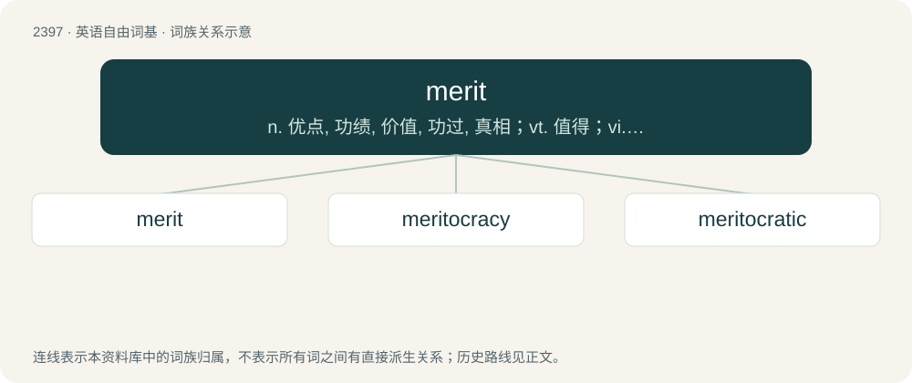

# 2506 · merit — n. 优点, 功绩, 价值, 功过, 真相；vt. 值得；vi. 应受

[总目录](../00_总目录_按常用程度.md)

**类型**：英语自由词基　｜　**来源语言**：见词源记录

## 核心含义与来源

- 核心含义：n. 优点, 功绩, 价值, 功过, 真相；vt. 值得；vi. 应受
- 英文含义：A claim to commendation or a reward.
- 词形：merit

**多个词源／构词路径**：同一拼写可能有不同来源；以下按词性和含义分别列出。

**来源记录 1**（名词；A claim to commendation or a reward.）

From Middle English merit, merite (“quality of person’s character or conduct deserving of reward or punishment; such reward or punishment; excellence, worthiness; benefit; right to be rewarded for spiritual service; retribution at doomsday; virtue through which Jesus Christ brings about salvation; virtue possessed by a holy person; power of a pagan deity”), from Anglo-Norman merit, merite, Old French merite (“moral worth, reward; merit”) (modern French mérite), from Latin meritum (“that which one deserves, deserts; benefit, reward, merit; service; kindness; importance, value, worth; blame, demerit, fault; grounds, reason”), neuter of meritus (“deserved, earned, obtained; due, proper, right; deserving, meritorious”), perfect passive participle of mereō (“to deserve, earn, obtain, merit; to earn a living”), from Proto-Indo-European \*(s)mer- (“to allot, assign”). The English word is probably cognate with Ancient Greek μέρος (méros, “component, part; portion, share; destiny, fate, lot”) and cognate with Old Occitan merit.

**来源记录 2**（动词；To deserve, to earn.）

From Middle English meriten, from Middle French meriter, Old French meriter (“to deserve, merit”) (modern French mériter), from merite: see further in Etymology 1. The word is cognate with Italian meritare (“to deserve, merit; to be worth; to earn”), Latin meritāre (“to earn regularly; to serve as a soldier”), Spanish meritar (“to deserve, merit; to earn”).

## 词族图

## 单词速览（常用到不常用）

| 单词 | 音标 | 释义 |
|---|---|---|
| [merit](#w-1) | 英 /ˈmɛɹɪt/；美 /ˈmɛɹɪt/ | n. 优点, 功绩, 价值, 功过, 真相；vt. 值得；vi. 应受 |
| [meritocracy](#w-2) | 英 /mɛɹɪˈtɒkɹəsi/；美 /mɛɹəˈtɑkɹəsi/ | n. 精英领导阶级 |
| [meritocratic](#w-3) | /ˌmerɪtəˈkrætɪk/ | a. 精英管理的；贤能统治的 |

## 逐词详解

### 1. merit

**词性**：名词　｜　**音标**：英 /ˈmɛɹɪt/；美 /ˈmɛɹɪt/

**中文释义**：n. 优点, 功绩, 价值, 功过, 真相；vt. 值得；vi. 应受

**英文义项**：A claim to commendation or a reward. / A mark or token of approbation or to recognize excellence.

**词源与演化**：

From Middle English merit, merite (“quality of person’s character or conduct deserving of reward or punishment; such reward or punishment; excellence, worthiness; benefit; right to be rewarded for spiritual service; retribution at doomsday; virtue through which Jesus Christ brings about salvation; virtue possessed by a holy person; power of a pagan deity”), from Anglo-Norman merit, merite, Old French merite (“moral worth, reward; merit”) (modern French mérite), from Latin meritum (“that which one deserves, deserts; benefit, reward, merit; service; kindness; importance, value, worth; blame, demerit, fault; grounds, reason”), neuter of meritus (“deserved, earned, obtained; due, proper, right; deserving, meritorious”), perfect passive participle of mereō (“to deserve, earn, obtain, merit; to earn a living”), from Proto-Indo-European \*(s)mer- (“to allot, assign”). The English word is probably cognate with Ancient Greek μέρος (méros, “component, part; portion, share; destiny, fate, lot”) and cognate with Old Occitan merit.

**例句**：

> For her good performance in the examination, her teacher gave her ten merits.

该用例对应义项：A mark or token of approbation or to recognize excellence.

### 2. meritocracy

**词性**：名词　｜　**音标**：英 /mɛɹɪˈtɒkɹəsi/；美 /mɛɹəˈtɑkɹəsi/

**中文释义**：n. 精英领导阶级

**英文义项**：Rule by merit and talent. / A type of society where wealth, income, and social status are assigned through competition.

**构词拆分**：merit + -o- + -cracy

**词源与演化**：

From merit + -o- + -cracy, coined by British sociologist Alan Fox in 1956 in an article in Socialist Commentary from May 1956, used as a derisive term, and popularized by British sociologist Michael Young, Baron Young of Dartington in his book The Rise of the Meritocracy (1958).

**例句**：

> As a small nation without natural resources, Singapore relies on education and meritocracy to develop its economy.

该用例对应义项：Rule by merit and talent.

### 3. meritocratic

**词性**：形容词　｜　**音标**：/ˌmerɪtəˈkrætɪk/

**中文释义**：a. 精英管理的；贤能统治的

**英文义项**：Pertaining to a meritocracy.

**构词拆分**：merit + -o- + -cratic；meritocrat + -ic

**词源与演化**：

From merit + -o- + -cratic or meritocrat + -ic.
