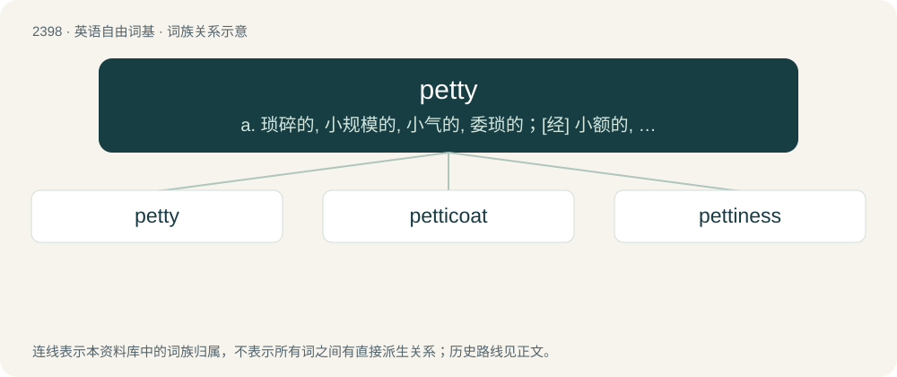

# 2507 · petty — a. 琐碎的, 小规模的, 小气的, 委琐的；\[经\] 小额的, 微小的, 小规模的

[总目录](../00_总目录_按常用程度.md)

**类型**：英语自由词基　｜　**来源语言**：见词源记录

## 核心含义与来源

- 核心含义：a. 琐碎的, 小规模的, 小气的, 委琐的；\[经\] 小额的, 微小的, 小规模的
- 英文含义：Having little or no importance.
- 词形：petty

**来源记录 1**（形容词；Having little or no importance.）

The adjective is derived from Middle English peti, pety (“little, small; minor”) \[and other forms\], from Anglo-Norman petit, Middle French petit, and Old French peti, petit, pitet (“young; little, small; inferior; insignificant”) (modern French petit), ultimately of imitative origin. It is no longer thought that the word is derived from Celtic. Doublet of petit and petite. The noun is derived from the adjective.

## 词族图

## 单词速览（常用到不常用）

| 单词 | 音标 | 释义 |
|---|---|---|
| [petty](#w-1) | 英 /ˈpɛt.i/；美 /ˈpɛt.i/ | a. 琐碎的, 小规模的, 小气的, 委琐的；\[经\] 小额的, 微小的, 小规模的 |
| [petticoat](#w-2) | 英 /ˈpɛt.ɪ.kəʊt/；美 /ˈpɛt.ɪ.koʊt/ | n. 衬裙, 裙子 |
| [pettiness](#w-3) | /ˈpetinis/ | n. 琐碎, 微小, 小气, 委琐, 偏狭, 卑鄙, 心胸狭窄的举动 |

## 逐词详解

### 1. petty

**词性**：形容词　｜　**音标**：英 /ˈpɛt.i/；美 /ˈpɛt.i/

**中文释义**：a. 琐碎的, 小规模的, 小气的, 委琐的；\[经\] 小额的, 微小的, 小规模的

**英文义项**：Having little or no importance. / Of persons or their behaviour: marked by or reflective of undesirably limited interests, sympathies, or views; begrudging, selfish, small-minded; also, preoccupied with subjects having little or no importance and not mindful of broader concerns.

**词源与演化**：

The adjective is derived from Middle English peti, pety (“little, small; minor”) \[and other forms\], from Anglo-Norman petit, Middle French petit, and Old French peti, petit, pitet (“young; little, small; inferior; insignificant”) (modern French petit), ultimately of imitative origin. It is no longer thought that the word is derived from Celtic. Doublet of petit and petite. The noun is derived from the adjective.

**例句**：

> My cousin is so petty—I forgot his birthday and he's been making snarky comments all week.

该用例对应义项：Inclined to cause frustration or annoyance to others out of spite over minor grievances; extremely vindictive.

### 2. petticoat

**词性**：形容词　｜　**音标**：英 /ˈpɛt.ɪ.kəʊt/；美 /ˈpɛt.ɪ.koʊt/

**中文释义**：n. 衬裙, 裙子

**英文义项**：Feminine; female; involving a woman.

**构词拆分**：petty + coat

**词源与演化**：

From Middle English petticote, petycote, peticote, petite cote, equivalent to petty + coat.

**用法示例／搭配（非完整句）**：

> petticoat influence

该用例对应义项：Feminine; female; involving a woman.

### 3. pettiness

**词性**：名词　｜　**音标**：/ˈpetinis/

**中文释义**：n. 琐碎, 微小, 小气, 委琐, 偏狭, 卑鄙, 心胸狭窄的举动

**英文义项**：The quality of being petty. / A petty behaviour, attitude, etc.

**构词拆分**：petty + -ness

**词源与演化**：

From petty + -ness.

**例句**：

> The pettiness of the accounting department asking me to save a receipt from a fast-food restaurant was absurd.

该用例对应义项：The quality of being petty.
