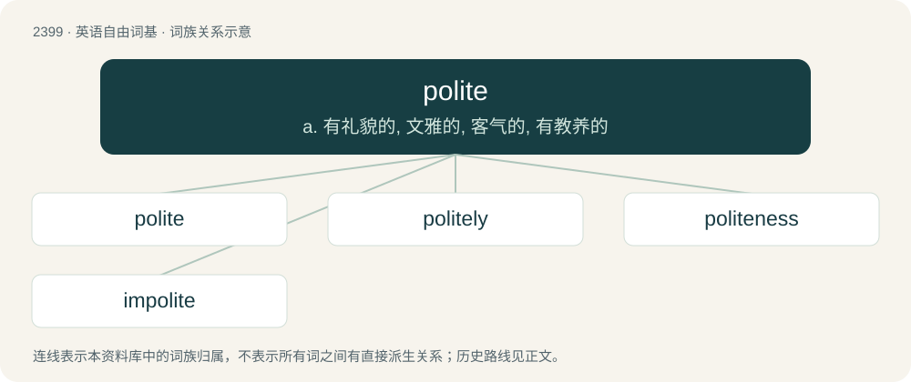

# 2508 · polite — a. 有礼貌的, 文雅的, 客气的, 有教养的

[总目录](../00_总目录_按常用程度.md)

**类型**：英语自由词基　｜　**来源语言**：见词源记录

## 核心含义与来源

- 核心含义：a. 有礼貌的, 文雅的, 客气的, 有教养的
- 英文含义：Well-mannered, civilized.
- 词形：polite

**来源记录 1**（形容词；Well-mannered, civilized.）

From Latin polītus (“polished”), past participle of poliō (“to polish, smooth”); see polish.

## 词族图

## 单词速览（常用到不常用）

| 单词 | 音标 | 释义 |
|---|---|---|
| [polite](#w-1) | /pəˈlaɪt/ | a. 有礼貌的, 文雅的, 客气的, 有教养的 |
| [politely](#w-2) | /pəˈlaɪtli/ | adv. 有礼貌地, 文雅地, 客气地 |
| [politeness](#w-3) | /pəˈlaɪtnəs/ | n. 有礼, 优雅 |
| [impolite](#w-4) | /ɪmpəˈlaɪt/ | a. 无礼的, 粗鲁的 |

## 逐词详解

### 1. polite

**词性**：形容词　｜　**音标**：/pəˈlaɪt/

**中文释义**：a. 有礼貌的, 文雅的, 客气的, 有教养的

**英文义项**：Well-mannered, civilized.

**词源与演化**：

From Latin polītus (“polished”), past participle of poliō (“to polish, smooth”); see polish.

**例句**：

> It's not polite to use a mobile phone in a restaurant.

该用例对应义项：Well-mannered, civilized.

### 2. politely

**词性**：副词　｜　**音标**：/pəˈlaɪtli/

**中文释义**：adv. 有礼貌地, 文雅地, 客气地

**英文义项**：in a polite manner

**构词拆分**：polite + -ly

**词源与演化**：

From polite + -ly.

**例句**：

> If pressed about a serious accusation like rape, you can politely reply that you can’t answer questions pertaining to such an allegation without legal representation and wish to remain silent.

该用例对应义项：in a polite manner

### 3. politeness

**词性**：名词　｜　**音标**：/pəˈlaɪtnəs/

**中文释义**：n. 有礼, 优雅

**英文义项**：The quality of being polite. / A polite act.

**构词拆分**：polite + -ness

**词源与演化**：

From polite + -ness.

**例句**：

> This is because of the difference between Japanese politeness and American politeness.

### 4. impolite

**词性**：形容词　｜　**音标**：/ɪmpəˈlaɪt/

**中文释义**：a. 无礼的, 粗鲁的

**英文义项**：Not polite; discourteous; not of polished manners; wanting in good manners.

**构词拆分**：im- + polite

**词源与演化**：

Learned borrowing from Latin impolītus. Equivalent to im- + polite.

**例句**：

> Because of his impolite reply, she got angry and slapped his face.
