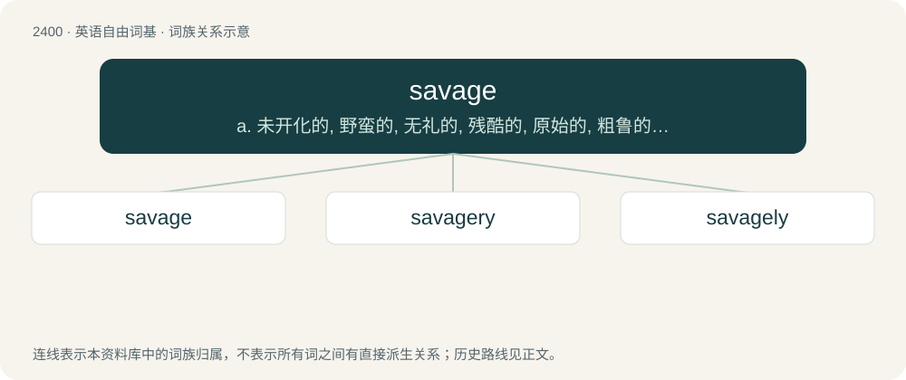

# 2509 · savage — a. 未开化的, 野蛮的, 无礼的, 残酷的, 原始的, 粗鲁的, 未开发的；vt. 用暴力对付, 凶猛攻击；n. 原始人, 粗鲁人

[总目录](../00_总目录_按常用程度.md)

**类型**：英语自由词基　｜　**来源语言**：见词源记录

## 核心含义与来源

- 核心含义：a. 未开化的, 野蛮的, 无礼的, 残酷的, 原始的, 粗鲁的, 未开发的；vt. 用暴力对付, 凶猛攻击；n. 原始人, 粗鲁人
- 英文含义：Wild; not cultivated or tamed.
- 词形：savage

**来源记录 1**（形容词；Wild; not cultivated or tamed.）

From Middle English savage, from Old French sauvage, salvage (“wild, untamed”), from Late Latin salvāticus, alteration of Latin silvāticus (“wild”, literally “of the woods”), from silva (“forest; grove”). Doublet of sylvatic.

## 词族图

## 单词速览（常用到不常用）

| 单词 | 音标 | 释义 |
|---|---|---|
| [savage](#w-1) | 英 /ˈsævɪd͡ʒ/ | a. 未开化的, 野蛮的, 无礼的, 残酷的, 原始的, 粗鲁的, 未开发的；vt. 用暴力对付, 凶猛攻击；n. 原始人, 粗鲁人 |
| [savagery](#w-2) | /ˈsæv.ɪd͡ʒ.ɹɪ/ | n. 兽性, 原始状态, 野蛮人 |
| [savagely](#w-3) |  | adv. 野蛮地；残忍地 |

## 逐词详解

### 1. savage

**词性**：形容词　｜　**音标**：英 /ˈsævɪd͡ʒ/

**中文释义**：a. 未开化的, 野蛮的, 无礼的, 残酷的, 原始的, 粗鲁的, 未开发的；vt. 用暴力对付, 凶猛攻击；n. 原始人, 粗鲁人

**英文义项**：Wild; not cultivated or tamed. / Barbaric; not civilized.

**词源与演化**：

From Middle English savage, from Old French sauvage, salvage (“wild, untamed”), from Late Latin salvāticus, alteration of Latin silvāticus (“wild”, literally “of the woods”), from silva (“forest; grove”). Doublet of sylvatic.

**例句**：

> Wow, that was a savage burn. Absolutely no chill.

该用例对应义项：Of an insult or person: disrespectful, audacious, and either blunt or sarcastic, in a hilarious way.

### 2. savagery

**词性**：名词　｜　**音标**：/ˈsæv.ɪd͡ʒ.ɹɪ/

**中文释义**：n. 兽性, 原始状态, 野蛮人

**英文义项**：Savage or brutal behaviour; barbarity. / A violent act of cruelty.

**构词拆分**：savage + -ry

**词源与演化**：

From savage + -ry.

**例句**：

> I don't tolerate savagery, much less in a country that claims to be democratic.

### 3. savagely

**词性**：副词

**中文释义**：adv. 野蛮地；残忍地

**英文义项**：In a wild, uncontrolled, or savage manner.

**构词拆分**：savage + -ly

**词源与演化**：

From savage + -ly.

**例句**：

> Dad would beat Mom savagely and all we could do was cry.
