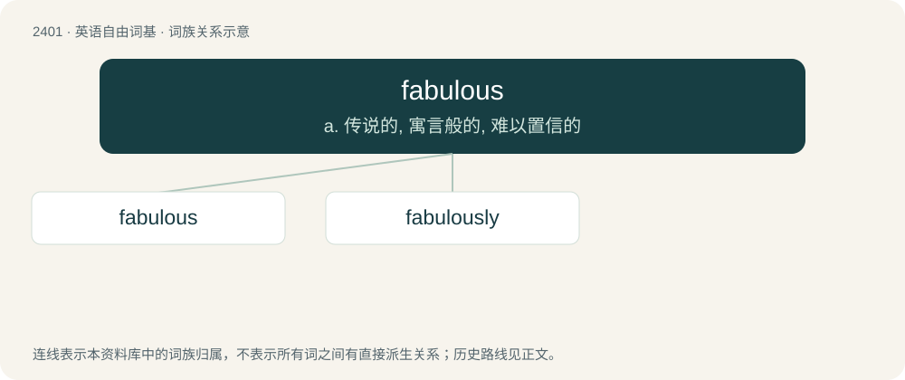

# 2510 · fabulous — a. 传说的, 寓言般的, 难以置信的

[总目录](../00_总目录_按常用程度.md)

**类型**：英语自由词基　｜　**来源语言**：见词源记录

## 核心含义与来源

- 核心含义：a. 传说的, 寓言般的, 难以置信的
- 英文含义：Of or relating to fable, myth or legend.
- 词形：fabulous

**来源记录 1**（形容词；Of or relating to fable, myth or legend.）

From Late Middle English fabulous, fabulose, from Latin fābulōsus (“celebrated in fable”); Equivalent to fable + -ous.

## 词族图

## 单词速览（常用到不常用）

| 单词 | 音标 | 释义 |
|---|---|---|
| [fabulous](#w-1) | /ˈfæbjʊləs/ | a. 传说的, 寓言般的, 难以置信的 |
| [fabulously](#w-2) | 美 /ˈfæb.jʊ.lɪs.li/；/ˈfæb.jʊ.ləs.li/ | adv. 非常(富有的/伟大的) |

## 逐词详解

### 1. fabulous

**词性**：形容词　｜　**音标**：/ˈfæbjʊləs/

**中文释义**：a. 传说的, 寓言般的, 难以置信的

**英文义项**：Of or relating to fable, myth or legend. / Characteristic of fables; marvelous, extraordinary, incredible.

**构词拆分**：fable + -ous

**词源与演化**：

From Late Middle English fabulous, fabulose, from Latin fābulōsus (“celebrated in fable”); Equivalent to fable + -ous.

**例句**：

> In the blue sea, among the green islands, fabulous Viking ships sail.

### 2. fabulously

**词性**：副词　｜　**音标**：美 /ˈfæb.jʊ.lɪs.li/；/ˈfæb.jʊ.ləs.li/

**中文释义**：adv. 非常(富有的/伟大的)

**英文义项**：In a fashionable or glamorous manner. / In an apocryphal or mythical manner; in fables.

**构词拆分**：fabulous + -ly

**词源与演化**：

From fabulous + -ly.

**例句**：

> Burying its head in the sand is fabulously attributed to the ostrich.

该用例对应义项：In an apocryphal or mythical manner; in fables.
