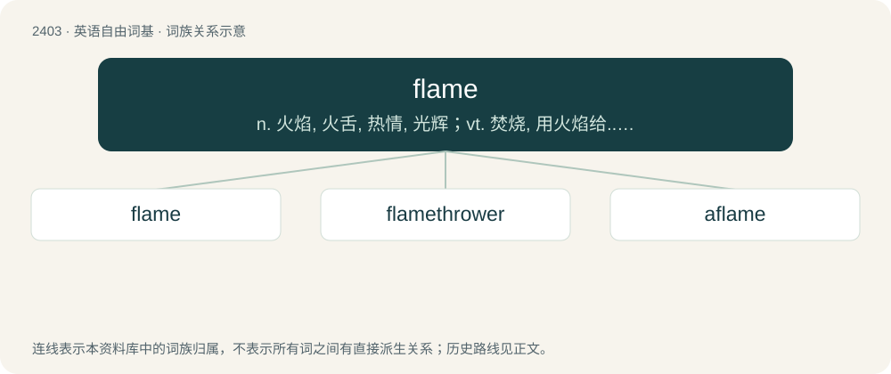

# 2511 · flame — n. 火焰, 火舌, 热情, 光辉；vt. 焚烧, 用火焰给...灭菌, 用火焰传送(信号), 点燃, 激动；vi. 燃烧, 爆发, 闪耀

[总目录](../00_总目录_按常用程度.md)

**类型**：英语自由词基　｜　**来源语言**：见词源记录

## 核心含义与来源

- 核心含义：n. 火焰, 火舌, 热情, 光辉；vt. 焚烧, 用火焰给...灭菌, 用火焰传送(信号), 点燃, 激动；vi. 燃烧, 爆发, 闪耀
- 英文含义：The visible part of fire; a stream of burning vapour or gas, emitting light and heat.
- 词形：flame

**多个词源／构词路径**：同一拼写可能有不同来源；以下按词性和含义分别列出。

**来源记录 1**（名词；The visible part of fire; a stream of burning vapour or gas, emitting light and heat.）

From Middle English flawme, blend of Old French flame and flambe, flamble, the first from Latin flamma, the second from Latin flammula, diminutive of flamma, both from pre-Latin \*fladma; Proto-Italic \*flagmā, ultimately from Proto-Indo-European \*bʰel- (“to shimmer, gleam, shine”). Displaced native Old English līeġ.

**来源记录 2**（动词；To produce flames; to burn with a flame or blaze.）

From Middle English flawmen, from Old French flamber, flammer.

## 词族图

## 单词速览（常用到不常用）

| 单词 | 音标 | 释义 |
|---|---|---|
| [flame](#w-1) | /fleɪm/ | n. 火焰, 火舌, 热情, 光辉；vt. 焚烧, 用火焰给...灭菌, 用火焰传送(信号), 点燃, 激动；vi. 燃烧, 爆发, 闪耀 |
| [flamethrower](#w-2) | 英 /ˈfleɪmˌθɹəʊ.ə/；美 /ˈfleɪmˌθɹoʊ.ɚ/ | n. 喷火器操纵者, 喷火器 |
| [aflame](#w-3) | 英 /əˈfleɪm/ | a. 燃烧中的, 火一般红的, 激动的；adv. 燃烧中 |

## 逐词详解

### 1. flame

**词性**：名词　｜　**音标**：/fleɪm/

**中文释义**：n. 火焰, 火舌, 热情, 光辉；vt. 焚烧, 用火焰给...灭菌, 用火焰传送(信号), 点燃, 激动；vi. 燃烧, 爆发, 闪耀

**英文义项**：The visible part of fire; a stream of burning vapour or gas, emitting light and heat. / A romantic partner or lover in a usually short-lived but passionate affair.

**词源与演化**：

From Middle English flawme, blend of Old French flame and flambe, flamble, the first from Latin flamma, the second from Latin flammula, diminutive of flamma, both from pre-Latin \*fladma; Proto-Italic \*flagmā, ultimately from Proto-Indo-European \*bʰel- (“to shimmer, gleam, shine”). Displaced native Old English līeġ.

**例句**：

> The cello has a two-piece back with a beautiful narrow flame.

该用例对应义项：The contrasting light and dark figure seen in wood used for stringed instrument making; the curl.

### 2. flamethrower

**词性**：名词　｜　**音标**：英 /ˈfleɪmˌθɹəʊ.ə/；美 /ˈfleɪmˌθɹoʊ.ɚ/

**中文释义**：n. 喷火器操纵者, 喷火器

**英文义项**：A device that projects a flame for starting fires, and sometimes also additional fuel to help ignition. Used either as a weapon or a tool. / Someone who is extremely good at throwing or shooting balls.

**构词拆分**：flame + thrower

**词源与演化**：

From flame + thrower, calque of German Flammenwerfer.

**例句**：

> William used the flamethrower again to push the aliens into the wormhole.

### 3. aflame

**词性**：动词　｜　**音标**：英 /əˈfleɪm/

**中文释义**：a. 燃烧中的, 火一般红的, 激动的；adv. 燃烧中

**英文义项**：Synonym of inflame (“to set (something) on fire; (figurative) to intensify or kindle (a feeling, such as appetite or passion); to intensify or kindle a feeling in (someone)”). / Chiefly in the present participle: to be in flames or on fire; to blaze, to flare up.

**构词拆分**：a- + flame；a- (intensifying prefix) + flame (verb)

**词源与演化**：

From a- (intensifying prefix) + flame (verb). Flame is derived from Middle English flamen, flaumben, flaumen, flawmen (“to emit flames, blaze; to shine like fire, gleam; to arouse (an emotion), kindle; to give off (an odour); of an odour: to issue; (cooking) to baste (meat) with grease; to glaze (pastry)”), from Anglo-Norman flaumber, flaumer, and Old French flamber, flammer (“to blaze, burn”) (modern French flamber), from flambe, flamme (“flame”, noun) + -er (variant of -ier (suffix forming verbs)). Flamme is derived from Latin flamma (“fire; flame”), ultimately from Proto-Indo-European \*bʰel-, bʰl̥g- (“to blaze, burn; to glow, shine; to be bright or brightly coloured (?); bright flame, fire (?)”).

**例句**：

> Keep on setting my heart aflame, I like it so far!
