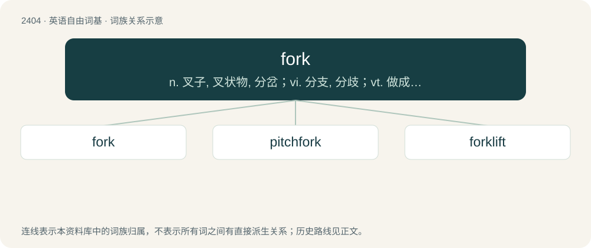

# 2512 · fork — n. 叉子, 叉状物, 分岔；vi. 分支, 分歧；vt. 做成叉形, 叉起

[总目录](../00_总目录_按常用程度.md)

**类型**：英语自由词基　｜　**来源语言**：见词源记录

## 核心含义与来源

- 核心含义：n. 叉子, 叉状物, 分岔；vi. 分支, 分歧；vt. 做成叉形, 叉起
- 英文含义：A utensil with spikes used to put solid food into the mouth, or to hold food down while cutting, or for serving food.
- 词形：fork

**多个词源／构词路径**：同一拼写可能有不同来源；以下按词性和含义分别列出。

**来源记录 1**（名词；A utensil with spikes used to put solid food into the mouth, or to hold food down while cutting, or for serving food.）

From Middle English forke (“digging fork”), from Old English force, forca (“forked instrument used to torture”), from Proto-West Germanic \*furkō (“fork”), from Latin furca (“pitchfork, forked stake; gallows, beam, stake, support post, yoke”), of uncertain origin. The Middle English word was later reinforced by Anglo-Norman, Old Northern French forque (= Old French forche whence French fourche), also from the Latin. Doublet of fourche and furcate. Cognate also with North Frisian forck (“fork”), Dutch vork (“fork”), Danish fork (“fork”), German Forke (“pitchfork”). Displaced native gafol, ġeafel, ġeafle (“fork”), from Old English. In its primary sense of “fork”, Latin furca appears to be derived from Proto-Indo-European \*ǵʰerk(ʷ)-, \*ǵʰerg(ʷ)- (“fork”), although the development of the -c- is difficult to explain. In other senses this derivation is unlikely. For these, perhaps it is connected to Proto-Germanic \*furkaz, \*firkalaz (“stake, stick, pole, post”), from Proto-Indo-European \*perg- (“pole, post”). If so, this would relate the word to Old English forclas pl (“bolt”), Old Saxon ferkal (“lock, bolt, bar”), Old Norse forkr (“pole, staff, stick”), Norwegian fork (“stick, bat”), Swedish fork (“pole”).

**来源记录 2**（名词；The bottom of a sump into which the water of a mine drains.）

Ultimately from Etymology 1, above, through use for various things with two or more branches. Attested in this sense from the 18th century.

## 词族图

## 单词速览（常用到不常用）

| 单词 | 音标 | 释义 |
|---|---|---|
| [fork](#w-1) | 英 /fɔːk/；美 /fɔɹk/ | n. 叉子, 叉状物, 分岔；vi. 分支, 分歧；vt. 做成叉形, 叉起 |
| [pitchfork](#w-2) | /ˈpɪt͡ʃˌfɔɹk/ | n. 干草叉, 草靶, 音叉；vt. 骤然把...塞进, 骤然把...抛入 |
| [forklift](#w-3) | /ˈfɔɹklɪft/ | n. 铲车, 叉式升降机 |

## 逐词详解

### 1. fork

**词性**：名词　｜　**音标**：英 /fɔːk/；美 /fɔɹk/

**中文释义**：n. 叉子, 叉状物, 分岔；vi. 分支, 分歧；vt. 做成叉形, 叉起

**英文义项**：A utensil with spikes used to put solid food into the mouth, or to hold food down while cutting, or for serving food. / Any of several types of pronged tools for use on farms, in fields, or in the garden or lawn, such as a smaller hand fork for weeding or a larger one for turning over the soil.

**词源与演化**：

From Middle English forke (“digging fork”), from Old English force, forca (“forked instrument used to torture”), from Proto-West Germanic \*furkō (“fork”), from Latin furca (“pitchfork, forked stake; gallows, beam, stake, support post, yoke”), of uncertain origin. The Middle English word was later reinforced by Anglo-Norman, Old Northern French forque (= Old French forche whence French fourche), also from the Latin. Doublet of fourche and furcate. Cognate also with North Frisian forck (“fork”), Dutch vork (“fork”), Danish fork (“fork”), German Forke (“pitchfork”). Displaced native gafol, ġeafel, ġeafle (“fork”), from Old English. In its primary sense of “fork”, Latin furca appears to be derived from Proto-Indo-European \*ǵʰerk(ʷ)-, \*ǵʰerg(ʷ)- (“fork”), although the development of the -c- is difficult to explain. In other senses this derivation is unlikely. For these, perhaps it is connected to Proto-Germanic \*furkaz, \*firkalaz (“stake, stick, pole, post”), from Proto-Indo-European \*perg- (“pole, post”). If so, this would relate the word to Old English forclas pl (“bolt”), Old Saxon ferkal (“lock, bolt, bar”), Old Norse forkr (“pole, staff, stick”), Norwegian fork (“stick, bat”), Swedish fork (“pole”).

**例句**：

> Get those forks tilted back more or you're gonna lose that pallet!

该用例对应义项：Either of the blades of a forklift (or, in plural, the set of blades), on which the goods to be raised are loaded.

### 2. pitchfork

**词性**：名词　｜　**音标**：/ˈpɪt͡ʃˌfɔɹk/

**中文释义**：n. 干草叉, 草靶, 音叉；vt. 骤然把...塞进, 骤然把...抛入

**英文义项**：An agricultural hand tool comprising a fork with sparse, light tines, attached to a long handle, used for pitching hay (especially loose hay) high up onto a stack (as on a wagon or haystack, or into a haymow). / A similar fork with slightly more and heavier tines, used for mucking stalls and pitching soiled bedding into a wagon or manure spreader.

**构词拆分**：pitch (verb) + fork

**词源与演化**：

From Middle English pichfork, pycchefork, pychforke, pikeforke, pikkforke, pic-forcke, equivalent to pitch (verb) + fork (i.e. "a fork used for pitching or throwing material, like hay"). The figurative sense (noun sense 4) is an allusion to a crowd of farmers wielding their farm tools as weapons.

**例句**：

> The city council was facing the pitchforks once the public had realized what the new ordinance entailed.

该用例对应义项：An angry mob; the power or effects of such a mob.

### 3. forklift

**词性**：名词　｜　**音标**：/ˈfɔɹklɪft/

**中文释义**：n. 铲车, 叉式升降机

**英文义项**：A small industrial vehicle with a power-operated fork-like pronged platform that can be raised and lowered for insertion under a load, often on pallets, to be lifted and moved.

**构词拆分**：fork + lift

**词源与演化**：

From fork + lift.

**例句**：

> I thought that you didn't know how to drive a forklift.
