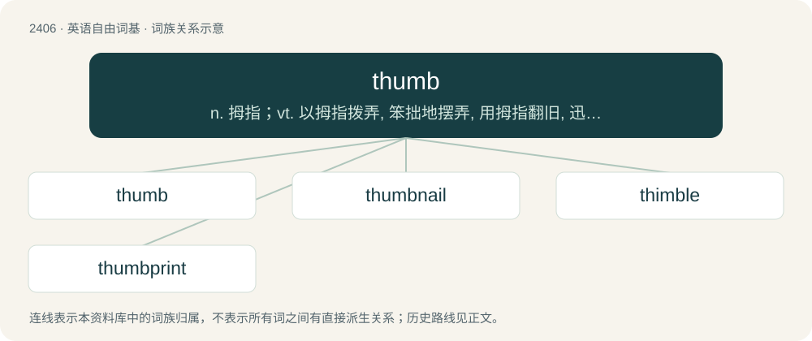

# 2513 · thumb — n. 拇指；vt. 以拇指拨弄, 笨拙地摆弄, 用拇指翻旧, 迅速翻阅, 作搭车手势

[总目录](../00_总目录_按常用程度.md)

**类型**：英语自由词基　｜　**来源语言**：见词源记录

## 核心含义与来源

- 核心含义：n. 拇指；vt. 以拇指拨弄, 笨拙地摆弄, 用拇指翻旧, 迅速翻阅, 作搭车手势
- 英文含义：The shortest and thickest digit of the hand that for humans has the most mobility and can be made to oppose (moved to touch) all of the other fingers.
- 词形：thumb

**来源记录 1**（名词；The shortest and thickest digit of the hand that for humans has the most mobility and can be made to oppose (moved to touch) all of the other fingers.）

Derived from Middle English thombe, thoume, thoumbe (“thumb”), from Old English þūma (“thumb”), from Proto-West Germanic \*þūmō (“thumb”), from Proto-Germanic \*þūmô (“thumb”), from Proto-Indo-European \*tūm- (“to grow”). Cognate with West Frisian tomme (“thumb”), Dutch duim (“thumb”), Low German Duum (“thumb”), German Daumen (“thumb”), Danish, Norwegian Bokmål, and Norwegian Nynorsk tomme (“inch”), Norn tum (“thumb”), Swedish tumme (“thumb”), tum (“inch”), Russian дюйм (djujm, “inch”), Ancient Greek τύμβος (túmbos, “burial mound”). Also compare Welsh tyfu (“to grow”), Latin tumēre (“to swell”), Lithuanian tumėti (“to thicken, clot”), Avestan 𐬀𐬨𐬏𐬙 (amūt, “strong”), Sanskrit तुम्र (túmra, “strong, thick”). The parasitic ‐b has existed since the late 13th century. Doublet of tomb.

## 词族图

## 单词速览（常用到不常用）

| 单词 | 音标 | 释义 |
|---|---|---|
| [thumb](#w-1) | /ˈθʌm/ | n. 拇指；vt. 以拇指拨弄, 笨拙地摆弄, 用拇指翻旧, 迅速翻阅, 作搭车手势 |
| [thumbnail](#w-2) | /ˈθʌm.neɪl/ | n. 大拇指指甲, 极小之物；a. 极小的, 极短的 |
| [thimble](#w-3) | 英 /ˈθɪmb(ə)l/ | n. 顶针, 嵌环, 套管；\[机\] 套管 |
| [thumbprint](#w-4) | /ˈθʌmprint/ | n. 拇指指纹；\[医\] 拇指纹 |

## 逐词详解

### 1. thumb

**词性**：名词　｜　**音标**：/ˈθʌm/

**中文释义**：n. 拇指；vt. 以拇指拨弄, 笨拙地摆弄, 用拇指翻旧, 迅速翻阅, 作搭车手势

**英文义项**：The shortest and thickest digit of the hand that for humans has the most mobility and can be made to oppose (moved to touch) all of the other fingers. / The part of a slider that may be moved linearly along the slider.

**词源与演化**：

Derived from Middle English thombe, thoume, thoumbe (“thumb”), from Old English þūma (“thumb”), from Proto-West Germanic \*þūmō (“thumb”), from Proto-Germanic \*þūmô (“thumb”), from Proto-Indo-European \*tūm- (“to grow”). Cognate with West Frisian tomme (“thumb”), Dutch duim (“thumb”), Low German Duum (“thumb”), German Daumen (“thumb”), Danish, Norwegian Bokmål, and Norwegian Nynorsk tomme (“inch”), Norn tum (“thumb”), Swedish tumme (“thumb”), tum (“inch”), Russian дюйм (djujm, “inch”), Ancient Greek τύμβος (túmbos, “burial mound”). Also compare Welsh tyfu (“to grow”), Latin tumēre (“to swell”), Lithuanian tumėti (“to thicken, clot”), Avestan 𐬀𐬨𐬏𐬙 (amūt, “strong”), Sanskrit तुम्र (túmra, “strong, thick”). The parasitic ‐b has existed since the late 13th century. Doublet of tomb.

**用法示例／搭配（非完整句）**：

> a scroll-bar thumb

该用例对应义项：The part of a slider that may be moved linearly along the slider.

### 2. thumbnail

**词性**：名词　｜　**音标**：/ˈθʌm.neɪl/

**中文释义**：n. 大拇指指甲, 极小之物；a. 极小的, 极短的

**英文义项**：The fingernail on the thumb. / A rough sketch (e.g., the size of one's thumbnail).

**构词拆分**：thumb + nail

**词源与演化**：

From thumb + nail. Compare West Frisian tommeneil (“thumbnail”), Dutch duimnagel (“thumbnail”), German Daumennagel (“thumbnail”). The phrase thumbnail sketch was first attested 1852. Verb sense attested 1930s.

**例句**：

> Tom clicked on the thumbnail so he could see a larger version of the same image.

### 3. thimble

**词性**：名词　｜　**音标**：英 /ˈθɪmb(ə)l/

**中文释义**：n. 顶针, 嵌环, 套管；\[机\] 套管

**英文义项**：A pitted, now usually metal, cup-shaped cap worn on the tip of a finger, which is used in sewing to push the needle through material. / As much as fills a thimble (sense 1); a thimbleful.

**构词拆分**：thumb + -le (suffix forming agent nouns)

**词源与演化**：

The noun is derived from Middle English thymbyll, thimel (“thimble”) \[and other forms\], from Old English þȳmel (“thimble, thumbstall; fingerstall”), then either: \* from Old English þūma (“thumb”) (ultimately from Proto-Indo-European \*tewh₂- (“to swell”)) + -el (suffix forming agent nouns and the names of instruments); or \* from Proto-Germanic \*þūmilaz (“thumb-covering, thumb-sheath”), from \*þūmô (“thumb”) (ultimately from the Proto-Indo-European root mentioned above) + \*-ilaz (suffix forming agent nouns). The English word is analysable as thumb + -le (suffix forming agent nouns), and is cognate with Dutch duimeling (“thumbstall”), German Däumling (“thumbstall”), German Low German Dümelke (“thumbstall”), Saterland Frisian Düümelke (“thumbstall”), Scots thummle, thumble (“thimble”). The verb is derived from the noun.

**例句**：

> A thimble can be very useful for sewing, if you don't want bleeding fingers.

### 4. thumbprint

**词性**：名词　｜　**音标**：/ˈθʌmprint/

**中文释义**：n. 拇指指纹；\[医\] 拇指纹

**英文义项**：A print, mark or impression made by a thumb.

**构词拆分**：thumb + print

**词源与演化**：

From thumb + print.
