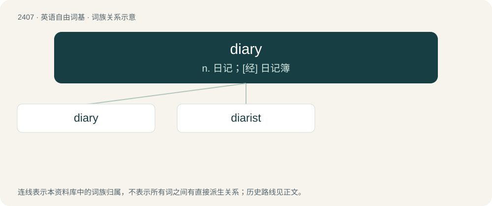

# 2514 · diary — n. 日记；\[经\] 日记簿

[总目录](../00_总目录_按常用程度.md)

**类型**：英语自由词基　｜　**来源语言**：见词源记录

## 核心含义与来源

- 核心含义：n. 日记；\[经\] 日记簿
- 英文含义：A daily log of experiences, especially those of the writer.
- 词形：diary

**来源记录 1**（名词；A daily log of experiences, especially those of the writer.）

From Latin diārium (“a daily allowance for soldiers, in Late Latin also ‘diary’”), neuter of \*diārius, from diēs (“a day”) (whence also journal). Cognate with Spanish diario (“daily; diary”).

## 词族图

## 单词速览（常用到不常用）

| 单词 | 音标 | 释义 |
|---|---|---|
| [diary](#w-1) | /ˈdaɪ.ə.ɹi/ | n. 日记；\[经\] 日记簿 |
| [diarist](#w-2) | /ˈdaɪəɹɪst/ | n. 记日记的人, 日记作者 |

## 逐词详解

### 1. diary

**词性**：名词　｜　**音标**：/ˈdaɪ.ə.ɹi/

**中文释义**：n. 日记；\[经\] 日记簿

**英文义项**：A daily log of experiences, especially those of the writer. / A personal organizer or appointment diary.

**词源与演化**：

From Latin diārium (“a daily allowance for soldiers, in Late Latin also ‘diary’”), neuter of \*diārius, from diēs (“a day”) (whence also journal). Cognate with Spanish diario (“daily; diary”).

**例句**：

> They kept separate diaries. His was on paper and her diary was on her computer's hard drive.

该用例对应义项：A daily log of experiences, especially those of the writer.

### 2. diarist

**词性**：名词　｜　**音标**：/ˈdaɪəɹɪst/

**中文释义**：n. 记日记的人, 日记作者

**英文义项**：Someone who keeps a diary.

**构词拆分**：diary + -ist

**词源与演化**：

From diary + -ist.
