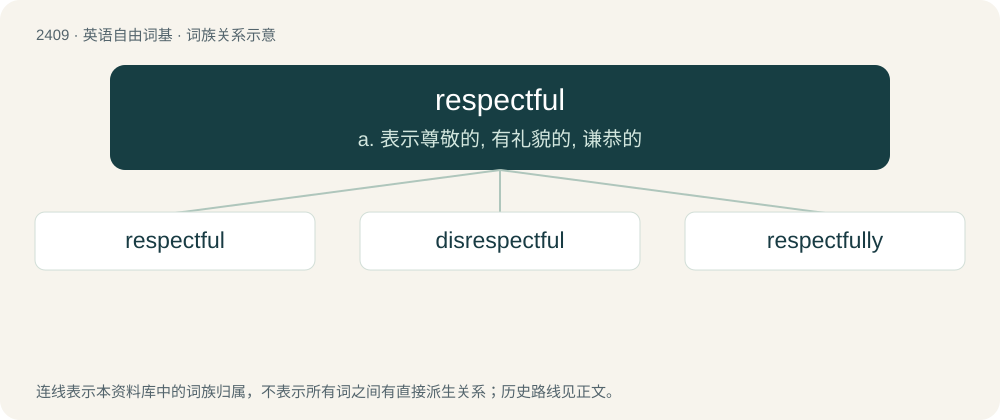

# 2516 · respectful — a. 表示尊敬的, 有礼貌的, 谦恭的

[总目录](../00_总目录_按常用程度.md)

**类型**：英语自由词基　｜　**来源语言**：见词源记录

## 核心含义与来源

- 核心含义：a. 表示尊敬的, 有礼貌的, 谦恭的
- 英文含义：Marked or characterized by respect
- 词形：respectful

**来源记录 1**（形容词；Marked or characterized by respect）

From respect + -ful.

## 词族图

## 单词速览（常用到不常用）

| 单词 | 音标 | 释义 |
|---|---|---|
| [respectful](#w-1) | /ɹɪˈspɛkt.fl̩/ | a. 表示尊敬的, 有礼貌的, 谦恭的 |
| [disrespectful](#w-2) | /dɪs.ɹɪˈspɛkt.fəl/ | a. 失礼的, 无礼的, 不尊敬的 |
| [respectfully](#w-3) | /ɹɪˈspɛkt.fə.li/ | adv. 尊敬地 |

## 逐词详解

### 1. respectful

**词性**：形容词　｜　**音标**：/ɹɪˈspɛkt.fl̩/

**中文释义**：a. 表示尊敬的, 有礼貌的, 谦恭的

**英文义项**：Marked or characterized by respect

**构词拆分**：respect + -ful

**词源与演化**：

From respect + -ful.

**例句**：

> It is of great importance that you act in a respectful manner towards the duke and duchess.

该用例对应义项：Marked or characterized by respect

### 2. disrespectful

**词性**：形容词　｜　**音标**：/dɪs.ɹɪˈspɛkt.fəl/

**中文释义**：a. 失礼的, 无礼的, 不尊敬的

**英文义项**：Lacking respect. / irrespective, heedless, regardless

**构词拆分**：dis- + respectful

**词源与演化**：

From dis- + respectful.

**例句**：

> Remarks disrespectful of the law.

该用例对应义项：exhibiting lack of respect; rude and discourteous

### 3. respectfully

**词性**：副词　｜　**音标**：/ɹɪˈspɛkt.fə.li/

**中文释义**：adv. 尊敬地

**英文义项**：In a respectful manner.

**构词拆分**：respectful + -ly

**词源与演化**：

From respectful + -ly.

**例句**：

> Might I respectfully suggest to the Town Council that they should adopt a policy of masterly inactivity?

该用例对应义项：in a respectful manner
