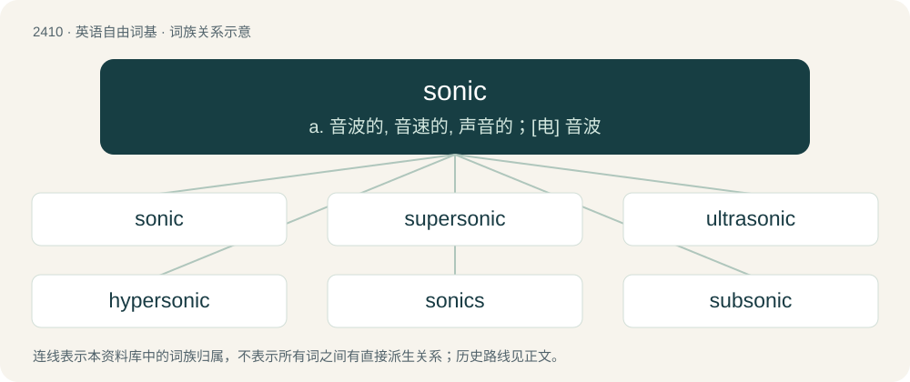

# 2517 · sonic — a. 音波的, 音速的, 声音的；\[电\] 音波

[总目录](../00_总目录_按常用程度.md)

**类型**：英语自由词基　｜　**来源语言**：见词源记录

## 核心含义与来源

- 核心含义：a. 音波的, 音速的, 声音的；\[电\] 音波
- 英文含义：Of or relating to sound.
- 词形：sonic

**来源记录 1**（形容词；Of or relating to sound.）

From Latin sonus + English -ic.

## 词族图

## 单词速览（常用到不常用）

| 单词 | 音标 | 释义 |
|---|---|---|
| [sonic](#w-1) | 英 /ˈsɒnɪk/；美 /ˈsɑnɪk/ | a. 音波的, 音速的, 声音的；\[电\] 音波 |
| [supersonic](#w-2) | /.sjuːpəˈsɒnik/ | a. 超声波的；\[医\] 超声\[波\]的 |
| [ultrasonic](#w-3) | /ʌltɹəˈsɒnɪk/ | n. 超声波；a. 超音速的 |
| [hypersonic](#w-4) | /ˌhaɪ.pəɹˈsɒ.nɪk/ | a. 极超音速的, 以高超声速行进的；\[化\] 特超声速的; 高超声速的 |
| [sonics](#w-5) | /ˈsɔniks/ | n. 声能学 |
| [subsonic](#w-6) | /sʌbˈsɒnik/ | a. 比音速稍慢的, 次音速的；\[医\] 听域下的 |
| [sonically](#w-7) |  | adv. sonic的变形 |

## 逐词详解

### 1. sonic

**词性**：形容词　｜　**音标**：英 /ˈsɒnɪk/；美 /ˈsɑnɪk/

**中文释义**：a. 音波的, 音速的, 声音的；\[电\] 音波

**英文义项**：Of or relating to sound. / Having a speed approaching that of the speed of sound in air.

**词源与演化**：

From Latin sonus + English -ic.

**用法示例／搭配（非完整句）**：

> a sonic extravagance

该用例对应义项：Of or relating to sound.

### 2. supersonic

**词性**：形容词　｜　**音标**：/.sjuːpəˈsɒnik/

**中文释义**：a. 超声波的；\[医\] 超声\[波\]的

**英文义项**：Greater than the speed of sound (in the same medium, and at the same temperature and pressure). / Ultrasonic, having a frequency too high to be audible.

**构词拆分**：super- + sonic

**词源与演化**：

From super- + sonic. Doublet of hypersonic.

**用法示例／搭配（非完整句）**：

> supersonic movement

该用例对应义项：Greater than the speed of sound (in the same medium, and at the same temperature and pressure).

### 3. ultrasonic

**词性**：形容词　｜　**音标**：/ʌltɹəˈsɒnɪk/

**中文释义**：n. 超声波；a. 超音速的

**英文义项**：Beyond (higher in frequency than) the range of sound perceptible to the human ear; with a frequency of 20 kilohertz or higher.

**构词拆分**：ultra- + sonic

**词源与演化**：

From ultra- + sonic.

**例句**：

> Scientists at the Oak Ridge National Laboratory have invented an ultrasonic dryer that can dry clothes without heating them.

### 4. hypersonic

**词性**：形容词　｜　**音标**：/ˌhaɪ.pəɹˈsɒ.nɪk/

**中文释义**：a. 极超音速的, 以高超声速行进的；\[化\] 特超声速的; 高超声速的

**英文义项**：Of a speed, equal to, or greater than, or capable of achieving, five times the speed of sound. / Of a speed, far enough above the speed of sound as to cause significant differences in behaviour due to chemical reactions or dissociation of the air.

**构词拆分**：hyper- + sonic

**词源与演化**：

From hyper- + sonic. Doublet of supersonic.

**例句**：

> The Russians could destroy US aircraft carriers with hypersonic weapons.

### 5. sonics

**词性**：名词　｜　**音标**：/ˈsɔniks/

**中文释义**：n. 声能学

**英文义项**：The science and technology of sound.

**构词拆分**：sonic + -s

**词源与演化**：

From sonic + -s.

### 6. subsonic

**词性**：形容词　｜　**音标**：/sʌbˈsɒnik/

**中文释义**：a. 比音速稍慢的, 次音速的；\[医\] 听域下的

**英文义项**：having a frequency too low to be audible / very quiet, almost inaudible

**构词拆分**：sub- + sonic

**词源与演化**：

From sub- + sonic.

**例句**：

> Aircraft flying at subsonic speeds.

该用例对应义项：(of speed) less than that of sound in a designated medium

### 7. sonically

**词性**：副词

**中文释义**：adv. sonic的变形

**英文义项**：In a sonic manner / By means of sound

**构词拆分**：sonic + -ally

**词源与演化**：

From sonic + -ally.

**例句**：

> The artifact was cleaned sonically in the ultrasonic cleaner tank in mere seconds.

该用例对应义项：By means of sound
