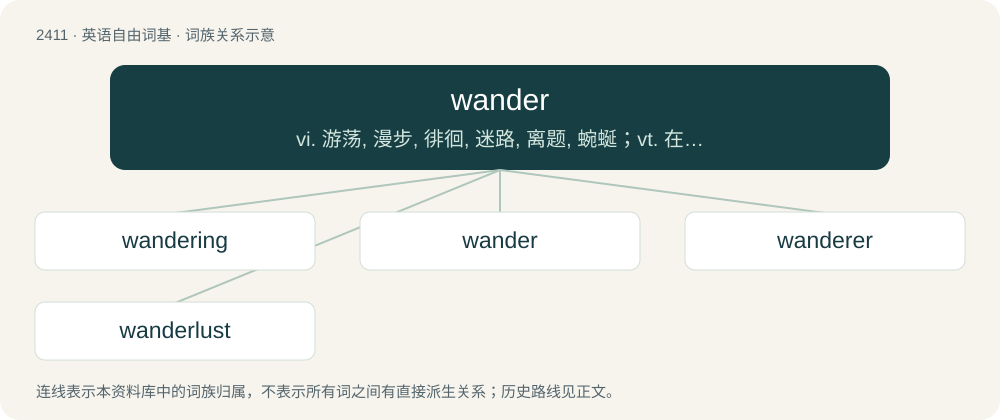

# 2518 · wander — vi. 游荡, 漫步, 徘徊, 迷路, 离题, 蜿蜒；vt. 在...漫游

[总目录](../00_总目录_按常用程度.md)

**类型**：英语自由词基　｜　**来源语言**：见词源记录

## 核心含义与来源

- 核心含义：vi. 游荡, 漫步, 徘徊, 迷路, 离题, 蜿蜒；vt. 在...漫游
- 英文含义：To move without purpose or specified destination; often in search of livelihood.
- 词形：wander

**来源记录 1**（动词；To move without purpose or specified destination; often in search of livelihood.）

From Middle English wandren, from Old English wandrian (“to wander, roam, fly around, hover; change; stray, err”), from Proto-West Germanic \*wandarōn (“to wander”), from \*wandōn (“to turn, change”) + \*-rōn (frequentative suffix). Cognate with Scots wander (“to wander”), German wandern (“to wander, roam, hike, migrate”), Dutch wandelen (“to wander, roam, hike, migrate”), Danish vandre (“to wander, roam, hike, migrate”), Swedish vandra (“to wander, hike”).

## 词族图

## 单词速览（常用到不常用）

| 单词 | 音标 | 释义 |
|---|---|---|
| [wandering](#w-1) | 英 /ˈwɒndəɹɪŋ/；美 /ˈwɑndəɹɪŋ/ | a. 漫游的, 徘徊的, 流浪的, 蜿蜒的；n. 闲逛, 流浪, 离题, 胡言乱语 |
| [wander](#w-2) | 英 /ˈwɒndə/；美 /ˈwɑndɚ/ | vi. 游荡, 漫步, 徘徊, 迷路, 离题, 蜿蜒；vt. 在...漫游 |
| [wanderer](#w-3) | 英 /ˈwɒndəɹə/；美 /ˈwɑndəɹɚ/ | n. 漫游者, 流浪者, 徘徊者 |
| [wanderlust](#w-4) | 英 /ˈwɒndəlʌst/；美 /ˈwɑndɚˌlʌst/ | n. 漫游癖, 流浪癖 |

## 逐词详解

### 1. wandering

**词性**：形容词　｜　**音标**：英 /ˈwɒndəɹɪŋ/；美 /ˈwɑndəɹɪŋ/

**中文释义**：a. 漫游的, 徘徊的, 流浪的, 蜿蜒的；n. 闲逛, 流浪, 离题, 胡言乱语

**英文义项**：Which wanders; travelling from place to place. / Abnormally capable of moving in certain directions.

**构词拆分**：From wander + -ing.

**词源与演化**：

From wander + -ing.

**用法示例／搭配（非完整句）**：

> a wandering kidney; a wandering liver

该用例对应义项：Abnormally capable of moving in certain directions.

### 2. wander

**词性**：动词　｜　**音标**：英 /ˈwɒndə/；美 /ˈwɑndɚ/

**中文释义**：vi. 游荡, 漫步, 徘徊, 迷路, 离题, 蜿蜒；vt. 在...漫游

**英文义项**：To move without purpose or specified destination; often in search of livelihood. / To stray; stray from one's course; err.

**词源与演化**：

From Middle English wandren, from Old English wandrian (“to wander, roam, fly around, hover; change; stray, err”), from Proto-West Germanic \*wandarōn (“to wander”), from \*wandōn (“to turn, change”) + \*-rōn (frequentative suffix). Cognate with Scots wander (“to wander”), German wandern (“to wander, roam, hike, migrate”), Dutch wandelen (“to wander, roam, hike, migrate”), Danish vandre (“to wander, roam, hike, migrate”), Swedish vandra (“to wander, hike”).

**例句**：

> A writer wanders from his subject.

该用例对应义项：To stray; stray from one's course; err.

### 3. wanderer

**词性**：名词　｜　**音标**：英 /ˈwɒndəɹə/；美 /ˈwɑndəɹɚ/

**中文释义**：n. 漫游者, 流浪者, 徘徊者

**英文义项**：One who wanders, who travels aimlessly. / Any of various far-migrating nymphalid butterflies of the genus Danaus.

**构词拆分**：wander + -er

**词源与演化**：

From Middle English wanderere, wandrere, wanderare, equivalent to wander + -er. Cognate with Scots wanderer, wandirer (“wanderer”), Dutch wandelaar (“walker, hiker”), German Wanderer (“wanderer”), Danish vandrer (“wanderer”), Swedish vandrare (“wanderer”), Norwegian vandrer (“wanderer”).

**例句**：

> "The Wanderer" is a book written by Fritz Leiber in 1963.

### 4. wanderlust

**词性**：名词　｜　**音标**：英 /ˈwɒndəlʌst/；美 /ˈwɑndɚˌlʌst/

**中文释义**：n. 漫游癖, 流浪癖

**英文义项**：A strong impulse or longing to travel. / An impulse to be unfaithful or seek out other romantic or sexual partners; a straying heart.

**构词拆分**：wander + lust

**词源与演化**：

Borrowed from German Wanderlust (“an urge to travel; a love of the ‘great outdoors’”), from wandern (“to wander; to hike”) (ultimately from Proto-Indo-European \*wendʰ- (“to turn; to wind”)) + Lust (“a desire, a wish to do or have something; fun, pleasure”) (possibly ultimately from Proto-Indo-European \*lewH- (“to separate; to set free; to untie”)); analysable as wander + lust.

**例句**：

> In spring, Tom is always seized by wanderlust and has to get out into nature.
