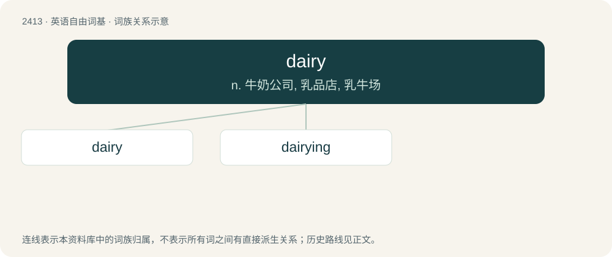

# 2520 · dairy — n. 牛奶公司, 乳品店, 乳牛场

[总目录](../00_总目录_按常用程度.md)

**类型**：英语自由词基　｜　**来源语言**：见词源记录

## 核心含义与来源

- 核心含义：n. 牛奶公司, 乳品店, 乳牛场
- 英文含义：(also dairy products or dairy produce) Products produced from milk.
- 词形：dairy

**来源记录 1**（名词；(also dairy products or dairy produce) Products produced from milk.）

Inherited from Middle English deyerie (“dairy, dairy farm”), from Anglo-Norman deyerie (“dairy”), from deye (“dairymaid”) + -erie (“-ery”); by surface analysis, dey (“dairymaid”) + -ry. Cognate with Scots dery, dyrie.

## 词族图

## 单词速览（常用到不常用）

| 单词 | 音标 | 释义 |
|---|---|---|
| [dairy](#w-1) | 英 /ˈdɛə.ɹi/；/ˈdɛɚ.i/ | n. 牛奶公司, 乳品店, 乳牛场 |
| [dairying](#w-2) | /ˈdeəriiŋ/ | n. 乳制品业 |

## 逐词详解

### 1. dairy

**词性**：名词　｜　**音标**：英 /ˈdɛə.ɹi/；/ˈdɛɚ.i/

**中文释义**：n. 牛奶公司, 乳品店, 乳牛场

**英文义项**：(also dairy products or dairy produce) Products produced from milk. / A place, often on a farm, where milk is processed and turned into products such as butter and cheese.

**词源与演化**：

Inherited from Middle English deyerie (“dairy, dairy farm”), from Anglo-Norman deyerie (“dairy”), from deye (“dairymaid”) + -erie (“-ery”); by surface analysis, dey (“dairymaid”) + -ry. Cognate with Scots dery, dyrie.

**例句**：

> Can you go and buy some yoghurt and blue cheese from the dairy?

该用例对应义项：A shop selling dairy products.

### 2. dairying

**词性**：名词　｜　**音标**：/ˈdeəriiŋ/

**中文释义**：n. 乳制品业

**英文义项**：Synonym of dairy farming.

**构词拆分**：From dairy + -ing.

**词源与演化**：

From dairy + -ing.

**例句**：

> Maria knows everything there is to know about dairying, having been employed in the field for over 35 years.
