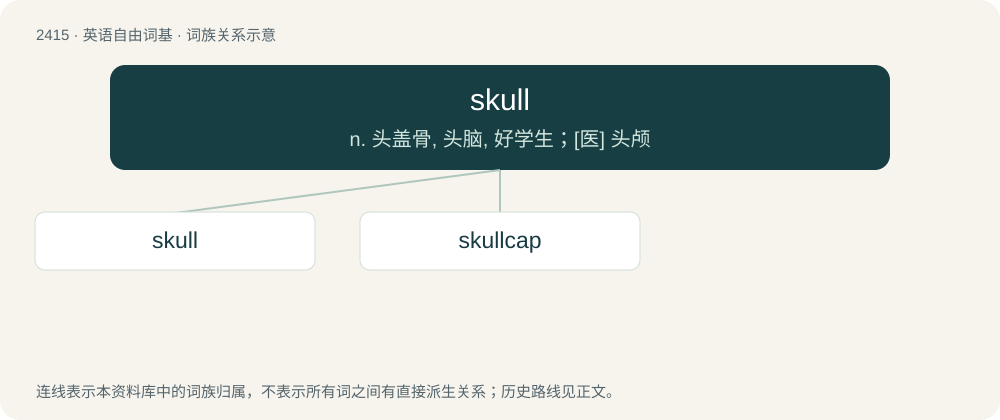

# 2522 · skull — n. 头盖骨, 头脑, 好学生；\[医\] 头颅

[总目录](../00_总目录_按常用程度.md)

**类型**：英语自由词基　｜　**来源语言**：见词源记录

## 核心含义与来源

- 核心含义：n. 头盖骨, 头脑, 好学生；\[医\] 头颅
- 英文含义：The main bones of the head considered as a unit; including the cranium, facial bones, and mandible.
- 词形：skull

**来源记录 1**（名词；The main bones of the head considered as a unit; including the cranium, facial bones, and mandible.）

From Middle English sculle, scolle (also schulle, scholle), probably from a dialectal form of Old Norse skalli (“bald head, skull”), itself probably related to Old English sċealu (“husk”), to Proto-Norse \*ᛋᚲᚨᛚᛟ (\*skalo), from Proto-Germanic \*skallô; compare Finnish kallo. Compare Scots scull, Danish skal (“skull”) and skalle (“bald head, skull”), Norwegian skalle, Swedish skalle and especially dialectal Swedish skulle. Related to Old Norse skoltr (“brow”), skolptr (“muzzle, snout”), akin to Icelandic skoltur (“jaw”), dialectal Swedish skult, skulle (“dome, crown of the head, skull”), Norwegian Nynorsk skult, skolt (“cranium, head (of a hammer); crag; hub”), Middle Dutch scolle, scholle, Middle Low German scholle, schulle (“clod, sod”), and Scots skult, skolt. Compare also Old High German sciula, skiula (“skull”). Possibly related to Latin celsus (“lofty, high, tall”), collis (“hill”). Also related to Old Norse skǫllóttr, Icelandic sköllóttur, Old Swedish skallotter, Swedish skallig, Danish skaldet, Norwegian skallet (“bald”).

## 词族图

## 单词速览（常用到不常用）

| 单词 | 音标 | 释义 |
|---|---|---|
| [skull](#w-1) | /ˈskʌl/ | n. 头盖骨, 头脑, 好学生；\[医\] 头颅 |
| [skullcap](#w-2) | /ˈskʌlkæp/ | n. 无边便帽, 黄芩属植物；\[医\] 美黄芩 |

## 逐词详解

### 1. skull

**词性**：名词　｜　**音标**：/ˈskʌl/

**中文释义**：n. 头盖骨, 头脑, 好学生；\[医\] 头颅

**英文义项**：The main bones of the head considered as a unit; including the cranium, facial bones, and mandible. / These bones as a symbol for death; death's-head.

**词源与演化**：

From Middle English sculle, scolle (also schulle, scholle), probably from a dialectal form of Old Norse skalli (“bald head, skull”), itself probably related to Old English sċealu (“husk”), to Proto-Norse \*ᛋᚲᚨᛚᛟ (\*skalo), from Proto-Germanic \*skallô; compare Finnish kallo. Compare Scots scull, Danish skal (“skull”) and skalle (“bald head, skull”), Norwegian skalle, Swedish skalle and especially dialectal Swedish skulle. Related to Old Norse skoltr (“brow”), skolptr (“muzzle, snout”), akin to Icelandic skoltur (“jaw”), dialectal Swedish skult, skulle (“dome, crown of the head, skull”), Norwegian Nynorsk skult, skolt (“cranium, head (of a hammer); crag; hub”), Middle Dutch scolle, scholle, Middle Low German scholle, schulle (“clod, sod”), and Scots skult, skolt. Compare also Old High German sciula, skiula (“skull”). Possibly related to Latin celsus (“lofty, high, tall”), collis (“hill”). Also related to Old Norse skǫllóttr, Icelandic sköllóttur, Old Swedish skallotter, Swedish skallig, Danish skaldet, Norwegian skallet (“bald”).

**例句**：

> Sami was shot with one shot to the base of the skull.

### 2. skullcap

**词性**：名词　｜　**音标**：/ˈskʌlkæp/

**中文释义**：n. 无边便帽, 黄芩属植物；\[医\] 美黄芩

**英文义项**：A small domed cap that covers the area from the forehead to just above the back of the neck. / A yarmulke-like hat.

**构词拆分**：skull + cap

**词源与演化**：

From skull + cap.

**例句**：

> You couldn't just don a skullcap and gatecrash a synagogue.
