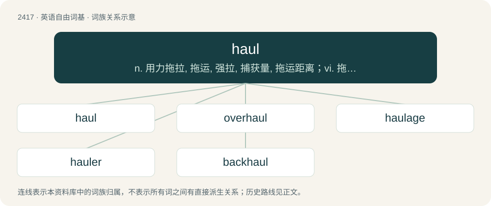

# 2523 · haul — n. 用力拖拉, 拖运, 强拉, 捕获量, 拖运距离；vi. 拖, 拉, 改变方向, 改变主意；vt. 拖拉, 拖运

[总目录](../00_总目录_按常用程度.md)

**类型**：英语自由词基　｜　**来源语言**：见词源记录

## 核心含义与来源

- 核心含义：n. 用力拖拉, 拖运, 强拉, 捕获量, 拖运距离；vi. 拖, 拉, 改变方向, 改变主意；vt. 拖拉, 拖运
- 英文含义：To transport by drawing or pulling, as with horses or oxen, or a motor vehicle.
- 词形：haul

**来源记录 1**（动词；To transport by drawing or pulling, as with horses or oxen, or a motor vehicle.）

From Middle English hālen, hailen, haulen, halien (“to drag, pull; to draw up”), from Old French haler (“to haul, pull”), from Frankish \*halōn (“to drag, fetch, haul”) or Middle Dutch halen (“to drag, fetch, haul”), possibly merging with Old English \*halian (“to haul, drag”); all from Proto-Germanic \*halōną, \*halēną, \*hulōną (“to call, fetch, summon”), from Proto-Indo-European \*kelh₁- (“to call, cry, summon”). The noun is derived from the verb. Cognates The word is cognate with Danish hale (“to haul”), Middle Dutch halen (“to draw, fetch, haul”), Dutch halen (“to fetch, bring, haul”), Old Frisian halia, Saterland Frisian halen (“to draw, haul, pull”), Low German halen (“to draw, pull”), Old High German halôn, holôn, German holen (“to fetch, get”), Norwegian hale (“to haul”), Old Saxon halôn (“to fetch, get”), Swedish hala (“to hale, haul, pull, tug”), and related to Old English ġeholian (“to get, obtain”).

## 词族图

## 单词速览（常用到不常用）

| 单词 | 音标 | 释义 |
|---|---|---|
| [haul](#w-1) | 英 /hɔːl/；美 /hɔl/ | n. 用力拖拉, 拖运, 强拉, 捕获量, 拖运距离；vi. 拖, 拉, 改变方向, 改变主意；vt. 拖拉, 拖运 |
| [overhaul](#w-2) | /ˈəʊvəˌhɔːl/ | vt. 分解检查, 翻修, 精细检查, 彻底革新；n. 分解检查, 精细检查, 大检修 |
| [haulage](#w-3) | /hɔːləd͡ʒ/ | n. 拖曳, 运费, 牵引量；\[经\] 公路运输, 拖运费 |
| [hauler](#w-4) | 英 /hɔːlə/；美 /hɔlɚ/ | \[化\] 绞盘 |
| [backhaul](#w-5) | /ˈbækhɔːl/ | n. (货运车的)回程(通常亦载货),回程运费 |

## 逐词详解

### 1. haul

**词性**：动词　｜　**音标**：英 /hɔːl/；美 /hɔl/

**中文释义**：n. 用力拖拉, 拖运, 强拉, 捕获量, 拖运距离；vi. 拖, 拉, 改变方向, 改变主意；vt. 拖拉, 拖运

**英文义项**：To transport by drawing or pulling, as with horses or oxen, or a motor vehicle. / To draw or pull something heavy.

**词源与演化**：

From Middle English hālen, hailen, haulen, halien (“to drag, pull; to draw up”), from Old French haler (“to haul, pull”), from Frankish \*halōn (“to drag, fetch, haul”) or Middle Dutch halen (“to drag, fetch, haul”), possibly merging with Old English \*halian (“to haul, drag”); all from Proto-Germanic \*halōną, \*halēną, \*hulōną (“to call, fetch, summon”), from Proto-Indo-European \*kelh₁- (“to call, cry, summon”). The noun is derived from the verb. Cognates The word is cognate with Danish hale (“to haul”), Middle Dutch halen (“to draw, fetch, haul”), Dutch halen (“to fetch, bring, haul”), Old Frisian halia, Saterland Frisian halen (“to draw, haul, pull”), Low German halen (“to draw, pull”), Old High German halôn, holôn, German holen (“to fetch, get”), Norwegian hale (“to haul”), Old Saxon halôn (“to fetch, get”), Swedish hala (“to hale, haul, pull, tug”), and related to Old English ġeholian (“to get, obtain”).

**用法示例／搭配（非完整句）**：

> to haul logs to a sawmill

该用例对应义项：To transport by drawing or pulling, as with horses or oxen, or a motor vehicle.

### 2. overhaul

**词性**：名词　｜　**音标**：/ˈəʊvəˌhɔːl/

**中文释义**：vt. 分解检查, 翻修, 精细检查, 彻底革新；n. 分解检查, 精细检查, 大检修

**英文义项**：A major repair, renovation, or revision. / The process after the fire appears extinguished in which the firefighters search the structure for signs of hot spots that may cause the structure to reignite.

**构词拆分**：over- + haul

**词源与演化**：

From over- + haul.

**例句**：

> The engine required a complete overhaul to run properly.

该用例对应义项：A major repair, renovation, or revision.

### 3. haulage

**词性**：名词　｜　**音标**：/hɔːləd͡ʒ/

**中文释义**：n. 拖曳, 运费, 牵引量；\[经\] 公路运输, 拖运费

**英文义项**：The act of hauling. / The business of transporting heavy goods.

**构词拆分**：haul + -age

**词源与演化**：

From haul + -age.

**例句**：

> Haulage firms are experts at transporting goods across borders.

### 4. hauler

**词性**：名词　｜　**音标**：英 /hɔːlə/；美 /hɔlɚ/

**中文释义**：\[化\] 绞盘

**英文义项**：A person or thing that hauls another person or thing. / A person or company engaged in the haulage of goods.

**构词拆分**：haul + -er

**词源与演化**：

From Middle English halere, equivalent to haul + -er. Doublet of haulier.

### 5. backhaul

**词性**：名词　｜　**音标**：/ˈbækhɔːl/

**中文释义**：n. (货运车的)回程(通常亦载货),回程运费

**英文义项**：A return trip after delivery of cargo. / The shipment of material to or through an area from which the material had previously been shipped.

**构词拆分**：back + haul

**词源与演化**：

From back + haul.

**例句**：

> Low rates for backhaul account for the huge volume of waste paper shipped to Asia from the US.

该用例对应义项：A return trip after delivery of cargo.
