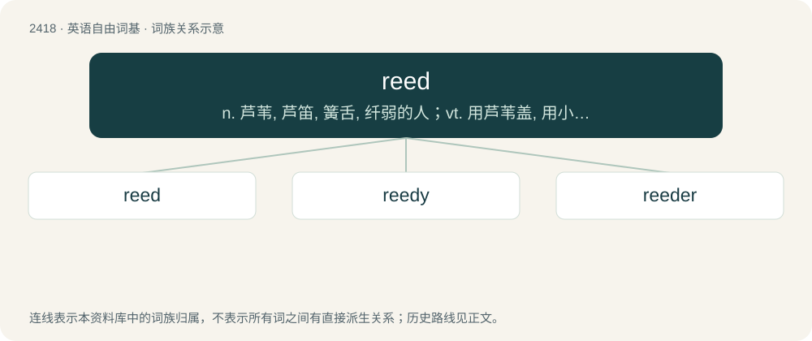

# 2524 · reed — n. 芦苇, 芦笛, 簧舌, 纤弱的人；vt. 用芦苇盖, 用小凸嵌线装饰

[总目录](../00_总目录_按常用程度.md)

**类型**：英语自由词基　｜　**来源语言**：见词源记录

## 核心含义与来源

- 核心含义：n. 芦苇, 芦笛, 簧舌, 纤弱的人；vt. 用芦苇盖, 用小凸嵌线装饰
- 英文含义：Any of various types of tall stiff perennial grass-like plants growing together in groups near water.
- 词形：reed

**多个词源／构词路径**：同一拼写可能有不同来源；以下按词性和含义分别列出。

**来源记录 1**（名词；Any of various types of tall stiff perennial grass-like plants growing together in groups near water.）

From Middle English red, from Old English hrēod, from Proto-West Germanic \*hreud (“reed”), of uncertain origin. Cognates Cognate with North Frisian raid (“reed”), Saterland Frisian Räit (“reed”), West Frisian reid (“reed”), Dutch riet (“reed”), German Reet, Ried (“reed”). No cognates in North Germanic languages, but the existence of an otherwise unattested Gothic \*𐌷𐍂𐌹𐌿𐌳 (\*hriud) was supposed by the brothers Grimm. They also theorised that the word may have a relation to the retas mentioned in Noctes Atticae (Aulus Gellius). The measuring reed sense is the translation of Akkadian qanûm ("cane") used in the Bible and elsewhere.

**来源记录 2**（动词；To thatch.）

From Middle English reden, from the noun (see above).

**来源记录 3**（名词；The fourth stomach of a ruminant; rennet.）

From Middle English rede (“abomasum”), from Old English rēada, from Proto-West Germanic \*raudō.

## 词族图

## 单词速览（常用到不常用）

| 单词 | 音标 | 释义 |
|---|---|---|
| [reed](#w-1) | /ɹiːd/ | n. 芦苇, 芦笛, 簧舌, 纤弱的人；vt. 用芦苇盖, 用小凸嵌线装饰 |
| [reedy](#w-2) | /ˈɹiː.di/ | a. 芦苇丛生的, 芦苇做的, 芦苇状的 |
| [reeder](#w-3) |  | \[人名\] \[英格兰人姓氏\] 里德 Reader的变体; \[地名\] \[美国\] 里德 |

## 逐词详解

### 1. reed

**词性**：名词　｜　**音标**：/ɹiːd/

**中文释义**：n. 芦苇, 芦笛, 簧舌, 纤弱的人；vt. 用芦苇盖, 用小凸嵌线装饰

**英文义项**：Any of various types of tall stiff perennial grass-like plants growing together in groups near water. / The hollow stem of these plants.

**词源与演化**：

From Middle English red, from Old English hrēod, from Proto-West Germanic \*hreud (“reed”), of uncertain origin. Cognates Cognate with North Frisian raid (“reed”), Saterland Frisian Räit (“reed”), West Frisian reid (“reed”), Dutch riet (“reed”), German Reet, Ried (“reed”). No cognates in North Germanic languages, but the existence of an otherwise unattested Gothic \*𐌷𐍂𐌹𐌿𐌳 (\*hriud) was supposed by the brothers Grimm. They also theorised that the word may have a relation to the retas mentioned in Noctes Atticae (Aulus Gellius). The measuring reed sense is the translation of Akkadian qanûm ("cane") used in the Bible and elsewhere.

**例句**：

> The clarinetist fitted a new reed onto his mouthpiece.

该用例对应义项：a vibrator consisting of a thin strip of stiff material that vibrates to produce a tone when air streams over it

### 2. reedy

**词性**：形容词　｜　**音标**：/ˈɹiː.di/

**中文释义**：a. 芦苇丛生的, 芦苇做的, 芦苇状的

**英文义项**：Full of, or edged with, reeds. / High and thin in tone.

**构词拆分**：reed + -y

**词源与演化**：

From Middle English reedy, reedi, reeddy, equivalent to reed + -y.

**用法示例／搭配（非完整句）**：

> reedy iron

该用例对应义项：Imperfectly welded together in masses of rods.

### 3. reeder

**词性**：名词

**中文释义**：\[人名\] \[英格兰人姓氏\] 里德 Reader的变体; \[地名\] \[美国\] 里德

**英文义项**：One who thatches with reeds. / A thatched frame covering blocks or tiles of dried china clay, to protect them from the rain while permitting free ventilation.

**构词拆分**：reed + -er

**词源与演化**：

From Middle English redere, equivalent to reed + -er.
