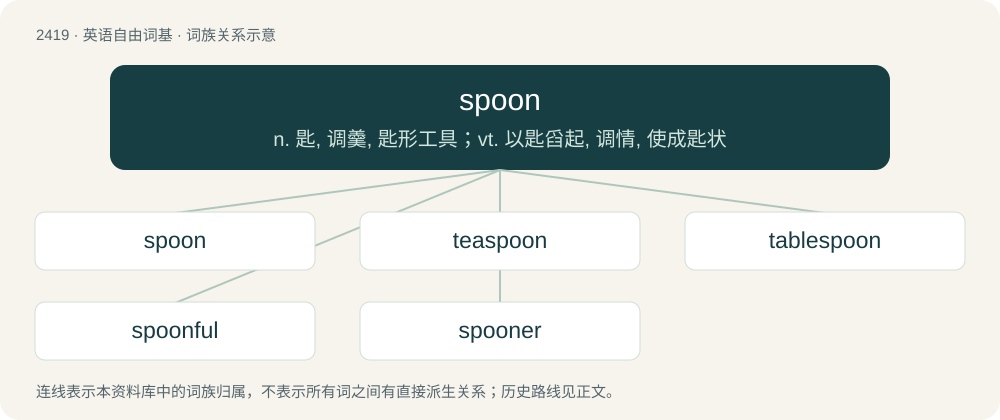

# 2525 · spoon — n. 匙, 调羹, 匙形工具；vt. 以匙舀起, 调情, 使成匙状

[总目录](../00_总目录_按常用程度.md)

**类型**：英语自由词基　｜　**来源语言**：见词源记录

## 核心含义与来源

- 核心含义：n. 匙, 调羹, 匙形工具；vt. 以匙舀起, 调情, 使成匙状
- 英文含义：An implement for eating or serving; a scooped utensil whose long handle is straight, in contrast to a ladle.
- 词形：spoon

**来源记录 1**（名词；An implement for eating or serving; a scooped utensil whose long handle is straight, in contrast to a ladle.）

From Middle English spoon, spoune, spone, spon (“spoon, chip of wood”), from Old English spōn (“sliver, chip of wood, shaving”), from Proto-West Germanic \*spānu, from Proto-Germanic \*spēnuz (“chip, flake, shaving”), from Proto-Indo-European \*(s)peH- (“chip, shaving, log, length of wood”). Cognate with Scots spun, spon (“spoon, shingle”), West Frisian spoen (“chip”), Dutch spaan (“chip, flinders”), German Span (“chip, flake, shaving”), Swedish spån (“chip, flake”), Norwegian Nynorsk spon (“chip, spoon”), Faroese spónur (“wood chip; spoon”), Ancient Greek σφήν (sphḗn, “wedge”)(though the connection to the Greek is likely impossible by modern reconstructions of PIE). Eclipsed non-native Middle English cuculer, coclear (“spoon”), from Old English cuculer, cuceler, cucler, borrowed from Latin cochlear (“spoon”). The "metaphoric unit of personal energy" sense was coined by writer and disability advocate Christine Miserandino in 2003 (see spoon theory).

## 词族图

## 单词速览（常用到不常用）

| 单词 | 音标 | 释义 |
|---|---|---|
| [spoon](#w-1) | /spuːn/ | n. 匙, 调羹, 匙形工具；vt. 以匙舀起, 调情, 使成匙状 |
| [teaspoon](#w-2) | 英 /ˈtiːˌspuːn/；美 /ˈtiˌspun/ | n. 茶匙；\[医\] 茶匙(4毫升) |
| [tablespoon](#w-3) | 英 /ˈteɪbəlˌspuːn/；美 /ˈteɪbəlˌspun/ | n. 大汤匙；\[医\] 汤匙, 大匙(15毫升) |
| [spoonful](#w-4) | /ˈspuːnfəl/ | n. 一匙；\[医\] 一匙, 匙 |
| [spooner](#w-5) | /ˈspuːnɚ/ | 【英文】A person who engages in kissing and petting. |

## 逐词详解

### 1. spoon

**词性**：动词　｜　**音标**：/spuːn/

**中文释义**：n. 匙, 调羹, 匙形工具；vt. 以匙舀起, 调情, 使成匙状

**英文义项**：To serve using a spoon; to transfer (something) with a spoon. / To flirt; to make advances; to court, to interact romantically or amorously.

**词源与演化**：

From Middle English spoon, spoune, spone, spon (“spoon, chip of wood”), from Old English spōn (“sliver, chip of wood, shaving”), from Proto-West Germanic \*spānu, from Proto-Germanic \*spēnuz (“chip, flake, shaving”), from Proto-Indo-European \*(s)peH- (“chip, shaving, log, length of wood”). Cognate with Scots spun, spon (“spoon, shingle”), West Frisian spoen (“chip”), Dutch spaan (“chip, flinders”), German Span (“chip, flake, shaving”), Swedish spån (“chip, flake”), Norwegian Nynorsk spon (“chip, spoon”), Faroese spónur (“wood chip; spoon”), Ancient Greek σφήν (sphḗn, “wedge”)(though the connection to the Greek is likely impossible by modern reconstructions of PIE). Eclipsed non-native Middle English cuculer, coclear (“spoon”), from Old English cuculer, cuceler, cucler, borrowed from Latin cochlear (“spoon”). The "metaphoric unit of personal energy" sense was coined by writer and disability advocate Christine Miserandino in 2003 (see spoon theory).

**例句**：

> Sarah spooned some apple sauce onto her plate.

该用例对应义项：To serve using a spoon; to transfer (something) with a spoon.

### 2. teaspoon

**词性**：动词　｜　**音标**：英 /ˈtiːˌspuːn/；美 /ˈtiˌspun/

**中文释义**：n. 茶匙；\[医\] 茶匙(4毫升)

**英文义项**：To serve with a teaspoon.

**构词拆分**：tea + spoon

**词源与演化**：

From tea + spoon.

**例句**：

> I teaspooned some sugar into my cup.

该用例对应义项：To serve with a teaspoon.

### 3. tablespoon

**词性**：名词　｜　**音标**：英 /ˈteɪbəlˌspuːn/；美 /ˈteɪbəlˌspun/

**中文释义**：n. 大汤匙；\[医\] 汤匙, 大匙(15毫升)

**英文义项**：A large spoon, used for eating food from a bowl. / A spoon too large for eating, usually used for cooking or serving.

**构词拆分**：table + spoon

**词源与演化**：

From table + spoon.

**例句**：

> Tom adds a tablespoon of ground flaxseeds to his oatmeal every morning.

### 4. spoonful

**词性**：名词　｜　**音标**：/ˈspuːnfəl/

**中文释义**：n. 一匙；\[医\] 一匙, 匙

**英文义项**：The amount that a spoon will hold, either level or heaped.

**构词拆分**：spoon + -ful

**词源与演化**：

From Middle English sponeful, sponefull, sponful, spone-ful, equivalent to spoon + -ful.

**例句**：

> A spoonful of honey is more attractive than a barrel of vinegar.

### 5. spooner

**词性**：名词　｜　**音标**：/ˈspuːnɚ/

**英文义项**：A person who engages in kissing and petting. / A person who lies nestled against their partner in bed, back-to-front on their sides

**构词拆分**：spoon + -er

**词源与演化**：

From spoon + -er.
