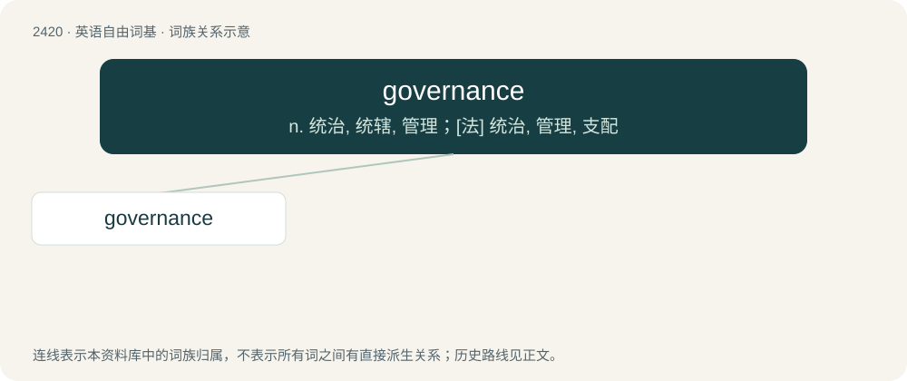

# 2528 · governance — n. 统治, 统辖, 管理；\[法\] 统治, 管理, 支配

[总目录](../00_总目录_按常用程度.md)

**类型**：英语自由词基　｜　**来源语言**：见词源记录

## 核心含义与来源

- 核心含义：n. 统治, 统辖, 管理；\[法\] 统治, 管理, 支配
- 英文含义：The process, or the power, of governing; government or administration.
- 词形：governance

**来源记录 1**（名词；The process, or the power, of governing; government or administration.）

From Middle English governaunce, from Old French gouvernance, governance, equivalent to govern + -ance.

## 词族图

## 单词速览（常用到不常用）

| 单词 | 音标 | 释义 |
|---|---|---|
| [governance](#w-1) | 英 /ˈɡʌvənəns/；美 /ˈɡʌvəɹnəns/ | n. 统治, 统辖, 管理；\[法\] 统治, 管理, 支配 |

## 逐词详解

### 1. governance

**词性**：名词　｜　**音标**：英 /ˈɡʌvənəns/；美 /ˈɡʌvəɹnəns/

**中文释义**：n. 统治, 统辖, 管理；\[法\] 统治, 管理, 支配

**英文义项**：The process, or the power, of governing; government or administration. / The specific system by which a political system is ruled.

**构词拆分**：govern + -ance

**词源与演化**：

From Middle English governaunce, from Old French gouvernance, governance, equivalent to govern + -ance.

**例句**：

> The governance of an association is responsible to its members.

该用例对应义项：the persons (or committees or departments etc.) who make up a body for the purpose of administering something
