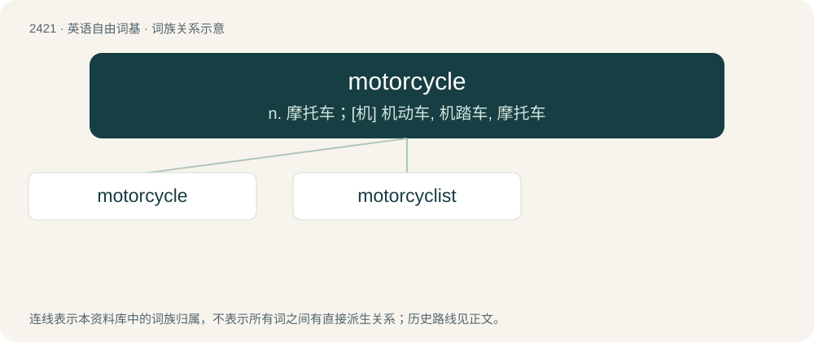

# 2529 · motorcycle — n. 摩托车；\[机\] 机动车, 机踏车, 摩托车

[总目录](../00_总目录_按常用程度.md)

**类型**：英语自由词基　｜　**来源语言**：见词源记录

## 核心含义与来源

- 核心含义：n. 摩托车；\[机\] 机动车, 机踏车, 摩托车
- 英文含义：An open-seated motor vehicle with handlebars instead of a steering wheel, and having two (or sometimes three) wheels.
- 词形：motorcycle

**来源记录 1**（名词；An open-seated motor vehicle with handlebars instead of a steering wheel, and having two (or sometimes three) wheels.）

From motor + cycle, from the Motorcyclette produced in 1897 by the French Werner Frères et Cie.

## 词族图

## 单词速览（常用到不常用）

| 单词 | 音标 | 释义 |
|---|---|---|
| [motorcycle](#w-1) | 英 /ˈməʊʔəˌsaɪkl̩/；美 /ˈmoʊtɚˌsaɪkəl/ | n. 摩托车；\[机\] 机动车, 机踏车, 摩托车 |
| [motorcyclist](#w-2) | /ˈməutəsaiklist/ | n. 骑摩托车 |

## 逐词详解

### 1. motorcycle

**词性**：名词　｜　**音标**：英 /ˈməʊʔəˌsaɪkl̩/；美 /ˈmoʊtɚˌsaɪkəl/

**中文释义**：n. 摩托车；\[机\] 机动车, 机踏车, 摩托车

**英文义项**：An open-seated motor vehicle with handlebars instead of a steering wheel, and having two (or sometimes three) wheels.

**构词拆分**：motor + cycle

**词源与演化**：

From motor + cycle, from the Motorcyclette produced in 1897 by the French Werner Frères et Cie.

**例句**：

> Tom doesn't want to spend more than $300 for a used motorcycle.

### 2. motorcyclist

**词性**：名词　｜　**音标**：/ˈməutəsaiklist/

**中文释义**：n. 骑摩托车

**英文义项**：Someone who rides a motorcycle.

**构词拆分**：motorcycle + -ist；motor + cyclist

**词源与演化**：

From motorcycle + -ist or motor + cyclist.

**例句**：

> Were you involved in the accident as a pedestrian, cyclist, motorcyclist or motorist?
