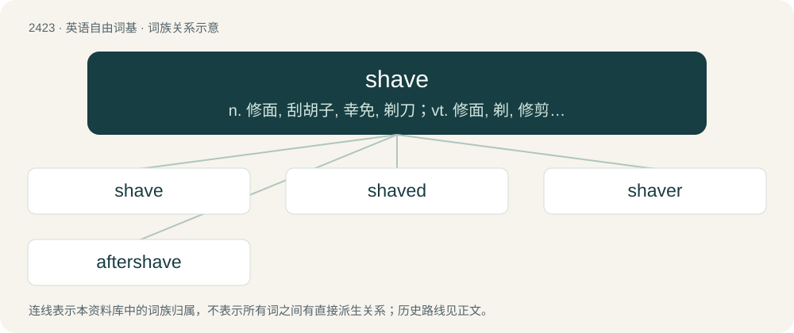

# 2531 · shave — n. 修面, 刮胡子, 幸免, 剃刀；vt. 修面, 剃, 修剪, 掠过；vi. 刮脸, 勉强通过

[总目录](../00_总目录_按常用程度.md)

**类型**：英语自由词基　｜　**来源语言**：见词源记录

## 核心含义与来源

- 核心含义：n. 修面, 刮胡子, 幸免, 剃刀；vt. 修面, 剃, 修剪, 掠过；vi. 刮脸, 勉强通过
- 英文含义：To make (the head, skin etc.) bald or (the hair) shorter by using a tool such as a razor or electric clippers to cut the hair close to the skin.
- 词形：shave

**多个词源／构词路径**：同一拼写可能有不同来源；以下按词性和含义分别列出。

**来源记录 1**（动词；To make (the head, skin etc.) bald or (the hair) shorter by using a tool such as a razor or electric clippers to cut the hair close to the skin.）

Inherited from Middle English shaven, schaven, from Old English sċafan (“to shave, scrape, shred, polish”), from Proto-West Germanic \*skaban, from Proto-Germanic \*skabaną (“to scrape”), from Proto-Indo-European \*skabʰ- (“to cut, split, form, carve”). Cognate with West Frisian skave, Dutch schaven, Low German schaven, German schaben, Danish skave, Norwegian Nynorsk skava, Swedish skava, Icelandic skafa, Gothic 𐍃𐌺𐌰𐌱𐌰𐌽 (skaban), all roughly “to scrape, chafe, shave, plane, remove the outer lay of”.

**来源记录 2**（名词；An instance of shaving.）

From Middle English shave, from Old English sceafa, from Proto-Germanic \*skabô.

## 词族图

## 单词速览（常用到不常用）

| 单词 | 音标 | 释义 |
|---|---|---|
| [shave](#w-1) | /ˈʃeɪ̯v/ | n. 修面, 刮胡子, 幸免, 剃刀；vt. 修面, 剃, 修剪, 掠过；vi. 刮脸, 勉强通过 |
| [shaved](#w-2) | /ʃeɪvd/ | shave的过去式和过去分词 |
| [shaver](#w-3) | 英 /ˈʃeɪvə/；美 /ˈʃeɪvɚ/ | n. 修面的人, 电动剃刀, 刨刀, 杀价买进期票的人, 善于讨价还价的人 |
| [aftershave](#w-4) | /ˈɑːftəʃeɪv/ | n. 须后水；修脸润肤露 |

## 逐词详解

### 1. shave

**词性**：动词　｜　**音标**：/ˈʃeɪ̯v/

**中文释义**：n. 修面, 刮胡子, 幸免, 剃刀；vt. 修面, 剃, 修剪, 掠过；vi. 刮脸, 勉强通过

**英文义项**：To make (the head, skin etc.) bald or (the hair) shorter by using a tool such as a razor or electric clippers to cut the hair close to the skin. / To cut anything in this fashion.

**词源与演化**：

Inherited from Middle English shaven, schaven, from Old English sċafan (“to shave, scrape, shred, polish”), from Proto-West Germanic \*skaban, from Proto-Germanic \*skabaną (“to scrape”), from Proto-Indo-European \*skabʰ- (“to cut, split, form, carve”). Cognate with West Frisian skave, Dutch schaven, Low German schaven, German schaben, Danish skave, Norwegian Nynorsk skava, Swedish skava, Icelandic skafa, Gothic 𐍃𐌺𐌰𐌱𐌰𐌽 (skaban), all roughly “to scrape, chafe, shave, plane, remove the outer lay of”.

**例句**：

> I had little time to shave this morning.

该用例对应义项：To remove hair from one's face by this means.

### 2. shaved

**词性**：形容词　｜　**音标**：/ʃeɪvd/

**中文释义**：shave的过去式和过去分词

**英文义项**：Having had a shave.

**构词拆分**：shave + -ed

**词源与演化**：

From shave + -ed.

**例句**：

> If you eat shaved ice very fast you will get brain freeze.

### 3. shaver

**词性**：名词　｜　**音标**：英 /ˈʃeɪvə/；美 /ˈʃeɪvɚ/

**中文释义**：n. 修面的人, 电动剃刀, 刨刀, 杀价买进期票的人, 善于讨价还价的人

**英文义项**：One who shaves. / A barber, one whose occupation is to shave.

**构词拆分**：shave + -er

**词源与演化**：

From Middle English schaver; equivalent to shave + -er. In its meaning of a boy, lad, recorded since 1592, the word shaver has also been postulated to derive from Romani chavo (“young man”), which also gives us the modern slang chav, ultimately derived from Sanskrit छा (chā, “young animal”).

**例句**：

> It certainly feels smooth when you run the shaver over your skin.

### 4. aftershave

**词性**：名词　｜　**音标**：/ˈɑːftəʃeɪv/

**中文释义**：n. 须后水；修脸润肤露

**英文义项**：a lotion, gel, or liquid used after finishing shaving

**构词拆分**：after- + shave

**词源与演化**：

From after- + shave.

**例句**：

> Don't tell me you don't like this aftershave.
