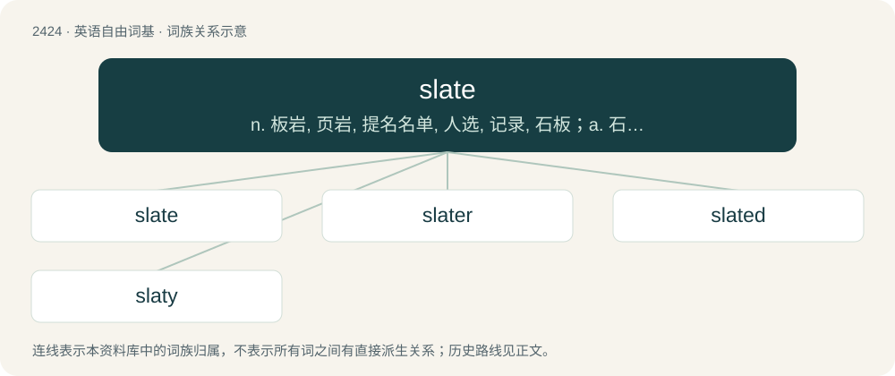

# 2532 · slate — n. 板岩, 页岩, 提名名单, 人选, 记录, 石板；a. 石板色的；vt. 铺石板, 责骂, 痛打

[总目录](../00_总目录_按常用程度.md)

**类型**：英语自由词基　｜　**来源语言**：见词源记录

## 核心含义与来源

- 核心含义：n. 板岩, 页岩, 提名名单, 人选, 记录, 石板；a. 石板色的；vt. 铺石板, 责骂, 痛打
- 英文含义：A piece of such stone, usually cut into a rectangular shape, used as a tile for flooring, roofing, etc.; (uncountable) such tiles collectively, or the material from which they are made.
- 词形：slate

**多个词源／构词路径**：同一拼写可能有不同来源；以下按词性和含义分别列出。

**来源记录 1**（名词；A piece of such stone, usually cut into a rectangular shape, used as a tile for flooring, roofing, etc.; (uncountable) such tiles collectively, or the material from which they are made.）

The noun is derived from Middle English sclate, slat, slate (“type of rock; roofing slate; writing slate”), from Old French esclate, a feminine form of esclat (“broken piece, shard”) (modern French éclat), from Old French esclater (“to break, shatter”), from Frankish \*slaitijan (“to split, break”), from Proto-Germanic \*slaitijaną, the causative of \*slītaną (“to cut up, split”); further etymology unknown (see the Proto-Germanic entry for a discussion). Doublet of éclat and slat. The adjective and verb are derived from the noun.

**来源记录 2**（动词；To scold (someone) harshly; to chastise, to excoriate, to lambaste.）

The verb is probably derived from slate (“flake or piece of certain types of stone that tend to cleave into thin layers; fine-grained homogeneous sedimentary rock which cleaves easily into thin layers”, noun) (etymology 1; possibly alluding to the sharpness of such rock). The noun is derived from the verb.

**来源记录 3**（动词；To set (one or more dogs) on a person or animal; to sic.）

From Middle English slaiten, slat, slate (“to set (a dog) on an animal”), from Old Norse \*sleita, possibly related to Proto-Germanic \*slītaną (“to tear apart”), further etymology unknown.

## 词族图

## 单词速览（常用到不常用）

| 单词 | 音标 | 释义 |
|---|---|---|
| [slate](#w-1) | 英 /sleɪt/ | n. 板岩, 页岩, 提名名单, 人选, 记录, 石板；a. 石板色的；vt. 铺石板, 责骂, 痛打 |
| [slater](#w-2) | 英 /ˈsleɪtə/；美 /ˈsleɪtɚ/ | n. 石板瓦工, 铺石板者 |
| [slated](#w-3) | /ˈsleɪ.tɪd/ | v. 用石板瓦盖( slate的过去式和过去分词 ) |
| [slaty](#w-4) | 英 /ˈsleɪti/ | a. 石板一样的, 石板色的 |

## 逐词详解

### 1. slate

**词性**：名词　｜　**音标**：英 /sleɪt/

**中文释义**：n. 板岩, 页岩, 提名名单, 人选, 记录, 石板；a. 石板色的；vt. 铺石板, 责骂, 痛打

**英文义项**：A piece of such stone, usually cut into a rectangular shape, used as a tile for flooring, roofing, etc.; (uncountable) such tiles collectively, or the material from which they are made. / A piece of other material used as a roofing tile.

**词源与演化**：

The noun is derived from Middle English sclate, slat, slate (“type of rock; roofing slate; writing slate”), from Old French esclate, a feminine form of esclat (“broken piece, shard”) (modern French éclat), from Old French esclater (“to break, shatter”), from Frankish \*slaitijan (“to split, break”), from Proto-Germanic \*slaitijaną, the causative of \*slītaną (“to cut up, split”); further etymology unknown (see the Proto-Germanic entry for a discussion). Doublet of éclat and slat. The adjective and verb are derived from the noun.

**例句**：

> Put it on my slate—I’ll pay you next week.

该用例对应义项：A record, for example, of money owed.

### 2. slater

**词性**：名词　｜　**音标**：英 /ˈsleɪtə/；美 /ˈsleɪtɚ/

**中文释义**：n. 石板瓦工, 铺石板者

**英文义项**：One who lays slates, or whose occupation is to slate buildings. / Any terrestrial isopod crustacean of the genus Porcellio and allied genera; a woodlouse.

**构词拆分**：slate + -er

**词源与演化**：

From Middle English sclater, equivalent to slate + -er.

**例句**：

> How do you happen to know Mr Slater?

### 3. slated

**词性**：形容词　｜　**音标**：/ˈsleɪ.tɪd/

**中文释义**：v. 用石板瓦盖( slate的过去式和过去分词 )

**英文义项**：scheduled / reviewed unfavorably

**构词拆分**：slate + -ed

**词源与演化**：

From Middle English slattyd, equivalent to slate + -ed.

**例句**：

> The tractor plant is slated for the ax.

该用例对应义项：scheduled

### 4. slaty

**词性**：形容词　｜　**音标**：英 /ˈsleɪti/

**中文释义**：a. 石板一样的, 石板色的

**英文义项**：Resembling the rock slate. / Of a light grey colour as slate.

**构词拆分**：slate + -y

**词源与演化**：

From slate + -y.

**例句**：

> The slaty sky of dawn.

该用例对应义项：of the color of slate or granite
