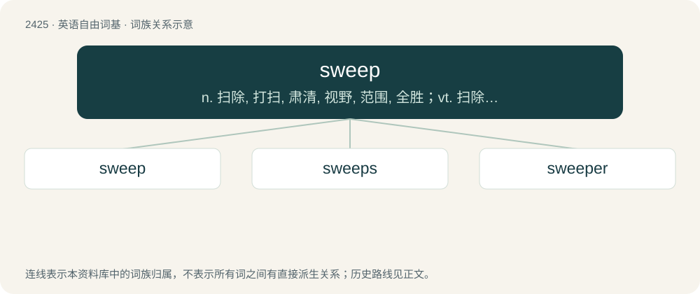

# 2533 · sweep — n. 扫除, 打扫, 肃清, 视野, 范围, 全胜；vt. 扫除, 掸去, 猛拉, 扫荡, 肃清, 冲走, 刮起, 环视, 掠过, 扫射；vi. 扫, 打扫, 袭击, 席卷, 扫视, 掠过

[总目录](../00_总目录_按常用程度.md)

**类型**：英语自由词基　｜　**来源语言**：见词源记录

## 核心含义与来源

- 核心含义：n. 扫除, 打扫, 肃清, 视野, 范围, 全胜；vt. 扫除, 掸去, 猛拉, 扫荡, 肃清, 冲走, 刮起, 环视, 掠过, 扫射；vi. 扫, 打扫, 袭击, 席卷, 扫视, 掠过
- 英文含义：To clean (a surface) by means of a stroking motion of a broom or brush.
- 词形：sweep

**来源记录 1**（动词；To clean (a surface) by means of a stroking motion of a broom or brush.）

From Middle English swepen, from Proto-West Germanic \*swaipijan (unattested in Old English), from Proto-Germanic \*swaipijaną. Cognate with Early Modern West Frisian swiepe (“whip, cleanse, sweep”), from Old Frisian swēpa, suepa (“sweep”). More distantly related to Old Norse sveipa (whence Swedish svepa). See also swoop.

## 词族图

## 单词速览（常用到不常用）

| 单词 | 音标 | 释义 |
|---|---|---|
| [sweep](#w-1) | 英 /swiːp/；美 /swip/ | n. 扫除, 打扫, 肃清, 视野, 范围, 全胜；vt. 扫除, 掸去, 猛拉, 扫荡, 肃清, 冲走, 刮起, 环视, 掠过, 扫射；vi. 扫, 打扫, 袭击, 席卷, 扫视, 掠过 |
| [sweeps](#w-2) | /swiːps/ | n. 清扫；废屑；\[俚\]无赖汉（sweep的复数）；赌金（等于sweepstakes） |
| [sweeper](#w-3) | 美 /ˈswipɚ/ | n. 清扫夫；\[机\] 扫刷 |

## 逐词详解

### 1. sweep

**词性**：动词　｜　**音标**：英 /swiːp/；美 /swip/

**中文释义**：n. 扫除, 打扫, 肃清, 视野, 范围, 全胜；vt. 扫除, 掸去, 猛拉, 扫荡, 肃清, 冲走, 刮起, 环视, 掠过, 扫射；vi. 扫, 打扫, 袭击, 席卷, 扫视, 掠过

**英文义项**：To clean (a surface) by means of a stroking motion of a broom or brush. / To move through a (horizontal) arc or similar long stroke.

**词源与演化**：

From Middle English swepen, from Proto-West Germanic \*swaipijan (unattested in Old English), from Proto-Germanic \*swaipijaną. Cognate with Early Modern West Frisian swiepe (“whip, cleanse, sweep”), from Old Frisian swēpa, suepa (“sweep”). More distantly related to Old Norse sveipa (whence Swedish svepa). See also swoop.

**例句**：

> The wind sweeps the snow from the hills.

该用例对应义项：To remove something abruptly and thoroughly.

### 2. sweeps

**词性**：名词　｜　**音标**：/swiːps/

**中文释义**：n. 清扫；废屑；\[俚\]无赖汉（sweep的复数）；赌金（等于sweepstakes）

**英文义项**：The Nielsen ratings used to measure television show viewership several times a year.

**构词拆分**：sweep + -s

**词源与演化**：

From sweep + -s (pluralia tantum suffix).

**例句**：

> When we think of nineteenth-century chimney sweeps, we think of ragamuffins with soot on their cheeks.

### 3. sweeper

**词性**：名词　｜　**音标**：美 /ˈswipɚ/

**中文释义**：n. 清扫夫；\[机\] 扫刷

**英文义项**：One who sweeps; one whose occupation is sweeping. / One who sweeps floors or chimneys.

**构词拆分**：sweep + -er

**词源与演化**：

From Middle English swepere, swepare, equivalent to sweep + -er. Cognate with Middle Low German swēpære, swēper (“broom for sweeping up debris”, literally “sweeper”).

**例句**：

> Tom, you're the duster this week. Mary, you're the sweeper. I'm the dishwasher.
