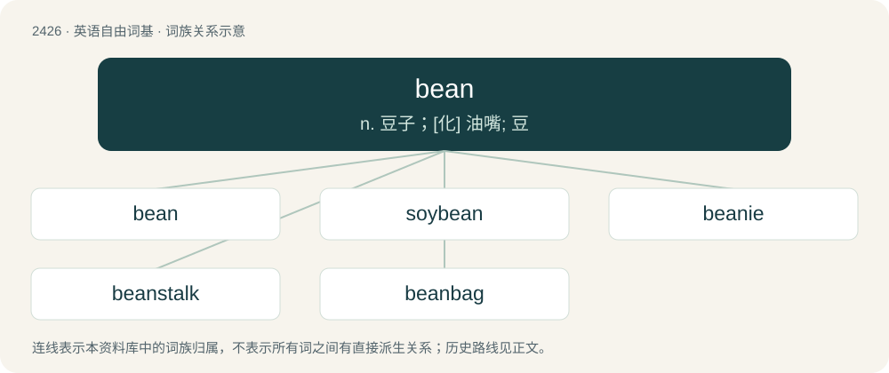

# 2534 · bean — n. 豆子；\[化\] 油嘴; 豆

[总目录](../00_总目录_按常用程度.md)

**类型**：英语自由词基　｜　**来源语言**：见词源记录

## 核心含义与来源

- 核心含义：n. 豆子；\[化\] 油嘴; 豆
- 英文含义：Any plant of several genera of the taxonomic family Fabaceae that produces large edible seeds or edible seedpods.
- 词形：bean

**来源记录 1**（名词；Any plant of several genera of the taxonomic family Fabaceae that produces large edible seeds or edible seedpods.）

From Middle English bene, from Old English bēan, from Proto-West Germanic \*baunu, from Proto-Germanic \*baunō (“bean”), from Proto-Indo-European \*bʰabʰ- (“bean”). Cognate with Scots bene, bein (“bean”), North Frisian buan, Saterland Frisian Boone, West Frisian bean, beanne, Dutch boon, German Bohne, Luxembourgish Boun, Danish bønne, Faroese bøn, bøna, Icelandic baun, Norwegian Bokmål bønne, Norwegian Nynorsk bauna, baune, bogna, bønne, Swedish böna, Irish pónaire, Manx poanrey, Scottish Gaelic pònair, Latin faba, Russian боб (bob), Serbo-Croatian bȍb /бо̏б. Doublet of fava.

## 词族图

## 单词速览（常用到不常用）

| 单词 | 音标 | 释义 |
|---|---|---|
| [bean](#w-1) | /ˈbi(ː)n/ | n. 豆子；\[化\] 油嘴; 豆 |
| [soybean](#w-2) | 美 /ˈsɔɪˌbin/ | n. 大豆；\[化\] 大豆 |
| [beanie](#w-3) | 英 /ˈbiː.ni/ | n. (大学一年级男生或儿童等戴的)无檐小便帽 |
| [beanstalk](#w-4) | /ˈbiːnstɒːk/ | n. 豆茎 |
| [beanbag](#w-5) | /ˈbiːnbæɡ/ | n. 豆子袋(儿童投掷游戏用) |

## 逐词详解

### 1. bean

**词性**：名词　｜　**音标**：/ˈbi(ː)n/

**中文释义**：n. 豆子；\[化\] 油嘴; 豆

**英文义项**：Any plant of several genera of the taxonomic family Fabaceae that produces large edible seeds or edible seedpods. / The large edible seed of such a plant (for example, a broad bean, navy bean, or garbanzo bean).

**词源与演化**：

From Middle English bene, from Old English bēan, from Proto-West Germanic \*baunu, from Proto-Germanic \*baunō (“bean”), from Proto-Indo-European \*bʰabʰ- (“bean”). Cognate with Scots bene, bein (“bean”), North Frisian buan, Saterland Frisian Boone, West Frisian bean, beanne, Dutch boon, German Bohne, Luxembourgish Boun, Danish bønne, Faroese bøn, bøna, Icelandic baun, Norwegian Bokmål bønne, Norwegian Nynorsk bauna, baune, bogna, bønne, Swedish böna, Irish pónaire, Manx poanrey, Scottish Gaelic pònair, Latin faba, Russian боб (bob), Serbo-Croatian bȍb /бо̏б. Doublet of fava.

**例句**：

> Green beans, also called French beans, can be pickled.

该用例对应义项：The edible seedpod of such a plant.

### 2. soybean

**词性**：名词　｜　**音标**：美 /ˈsɔɪˌbin/

**中文释义**：n. 大豆；\[化\] 大豆

**英文义项**：A legume plant (Glycine max), commonly cultivated for human and animal consumption and as a nitrogen-fixing ground cover. / The edible seed of this plant.

**构词拆分**：soy + bean

**词源与演化**：

From soy + bean.

**例句**：

> Genetically modified soybean oil may not be as healthy as you think, research suggests.

### 3. beanie

**词性**：名词　｜　**音标**：英 /ˈbiː.ni/

**中文释义**：n. (大学一年级男生或儿童等戴的)无檐小便帽

**英文义项**：A cap that fits the head closely, usually knitted from wool. / A head-hugging brimless cap, with or without a visor, made from triangular sections of cloth, leather, or silk joined by a button at the crown and seamed together around the sides.

**构词拆分**：bean + -ie

**词源与演化**：

From bean (“the head”) + -ie (diminutive suffix).

**例句**：

> Enrique Iglesias is often seen wearing a beanie.

该用例对应义项：A cap that fits the head closely, usually knitted from wool.

### 4. beanstalk

**词性**：名词　｜　**音标**：/ˈbiːnstɒːk/

**中文释义**：n. 豆茎

**英文义项**：The stem of a bean plant, proverbially fast-growing and tall. / A tall, slim person.

**构词拆分**：bean + stalk

**词源与演化**：

From bean + stalk.

### 5. beanbag

**词性**：名词　｜　**音标**：/ˈbiːnbæɡ/

**中文释义**：n. 豆子袋(儿童投掷游戏用)

**英文义项**：A small cloth bag filled with drybeans, used as a toy or for exercising the hands. / A type of juggling ball usually made from leather or cloth stuffed with dry beans.

**构词拆分**：bean + bag

**词源与演化**：

From bean + bag.

**例句**：

> Tom sat in his beanbag chair.
