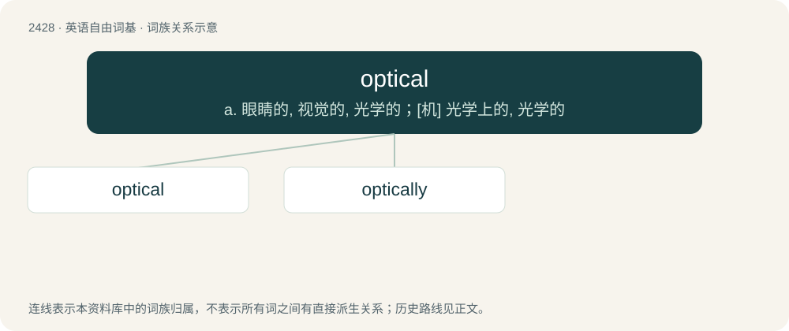

# 2535 · optical — a. 眼睛的, 视觉的, 光学的；\[机\] 光学上的, 光学的

[总目录](../00_总目录_按常用程度.md)

**类型**：英语自由词基　｜　**来源语言**：见词源记录

## 核心含义与来源

- 核心含义：a. 眼睛的, 视觉的, 光学的；\[机\] 光学上的, 光学的
- 英文含义：Of or relating to sight; visual.
- 词形：optical

**来源记录 1**（形容词；Of or relating to sight; visual.）

From optic + -al.

## 词族图

## 单词速览（常用到不常用）

| 单词 | 音标 | 释义 |
|---|---|---|
| [optical](#w-1) | 英 /ˈɒptɪkəl/；美 /ˈɑptɪkəl/ | a. 眼睛的, 视觉的, 光学的；\[机\] 光学上的, 光学的 |
| [optically](#w-2) |  | adv. 眼睛地；视力地；光学地 |

## 逐词详解

### 1. optical

**词性**：形容词　｜　**音标**：英 /ˈɒptɪkəl/；美 /ˈɑptɪkəl/

**中文释义**：a. 眼睛的, 视觉的, 光学的；\[机\] 光学上的, 光学的

**英文义项**：Of or relating to sight; visual. / Designed to assist or enhance sight

**构词拆分**：From optic + -al.

**词源与演化**：

From optic + -al.

**例句**：

> Optical telescopes don't work when it is cloudy.

该用例对应义项：Of or relating to visible light.

### 2. optically

**词性**：副词

**中文释义**：adv. 眼睛地；视力地；光学地

**英文义项**：regarding or using optics

**构词拆分**：optical + -ly

**词源与演化**：

From optical + -ly.

**例句**：

> Hubble’s view is optically stable, meaning the quality of its observing conditions never changes from day to day or even orbit to orbit.
