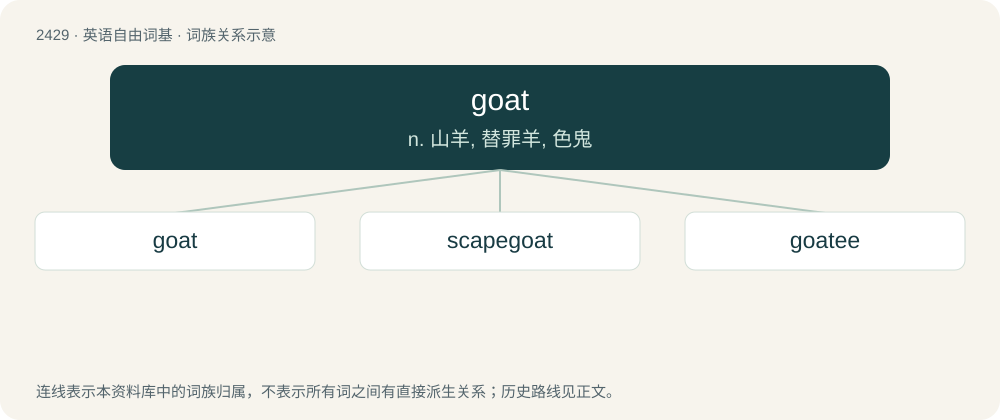

# 2536 · goat — n. 山羊, 替罪羊, 色鬼

[总目录](../00_总目录_按常用程度.md)

**类型**：英语自由词基　｜　**来源语言**：见词源记录

## 核心含义与来源

- 核心含义：n. 山羊, 替罪羊, 色鬼
- 英文含义：Any ruminant of the genus Capra.
- 词形：goat

**来源记录 1**（名词；Any ruminant of the genus Capra.）

Inherited from Middle English goot, got, gat, from Old English gāt, from Proto-West Germanic \*gait, from Proto-Germanic \*gaits, from a substrate language. The sense of lecherous man derives from the slang expression "horny as a goat".

## 词族图

## 单词速览（常用到不常用）

| 单词 | 音标 | 释义 |
|---|---|---|
| [goat](#w-1) | 英 /ɡəʊt/；美 /ɡoʊt/ | n. 山羊, 替罪羊, 色鬼 |
| [scapegoat](#w-2) | 英 /ˈskeɪpˌɡəʊt/；美 /ˈskeɪpˌɡoʊt/ | n. 替罪羔羊, 替人顶罪者, 替身；\[法\] 替罪羊, 代人受过者 |
| [goatee](#w-3) | 英 /ɡəʊˈtiː/；美 /ˌɡoʊˈtiː/ | n. 山羊胡子 |

## 逐词详解

### 1. goat

**词性**：名词　｜　**音标**：英 /ɡəʊt/；美 /ɡoʊt/

**中文释义**：n. 山羊, 替罪羊, 色鬼

**英文义项**：Any ruminant of the genus Capra. / The meat of these animals.

**词源与演化**：

Inherited from Middle English goot, got, gat, from Old English gāt, from Proto-West Germanic \*gait, from Proto-Germanic \*gaits, from a substrate language. The sense of lecherous man derives from the slang expression "horny as a goat".

**例句**：

> It is easy to get the cranky man's goat by teasing him.

### 2. scapegoat

**词性**：名词　｜　**音标**：英 /ˈskeɪpˌɡəʊt/；美 /ˈskeɪpˌɡoʊt/

**中文释义**：n. 替罪羔羊, 替人顶罪者, 替身；\[法\] 替罪羊, 代人受过者

**英文义项**：In the Mosaic Day of Atonement ritual, a goat symbolically imbued with the sins of the people, and sent out alive into the wilderness while another was sacrificed. / Someone unfairly blamed or punished for some failure.

**构词拆分**：scape + goat

**词源与演化**：

From scape + goat; coined by English biblical scholar and translator William Tyndale, interpreting Biblical Hebrew עֲזָאזֵל (“azazél”) (Leviticus 16:8, 10, 26), from an interpretation as coming from עֵז (ez, “goat”) and אוזל (ozél, “escapes”). First attested 1530. Compare English scapegrace, scapegallows.

**例句**：

> I'm no scapegoat to take it lying down.

### 3. goatee

**词性**：名词　｜　**音标**：英 /ɡəʊˈtiː/；美 /ˌɡoʊˈtiː/

**中文释义**：n. 山羊胡子

**英文义项**：A beard trimmed to grow only at the center of the chin.

**构词拆分**：goat + -ee；goat + -ee (diminutive suffix)

**词源与演化**：

From goat + -ee (diminutive suffix), referring to the tuft of hair on the chin of many domestic goats.

**例句**：

> Tom says he might dye his goatee red and green for Christmas.
