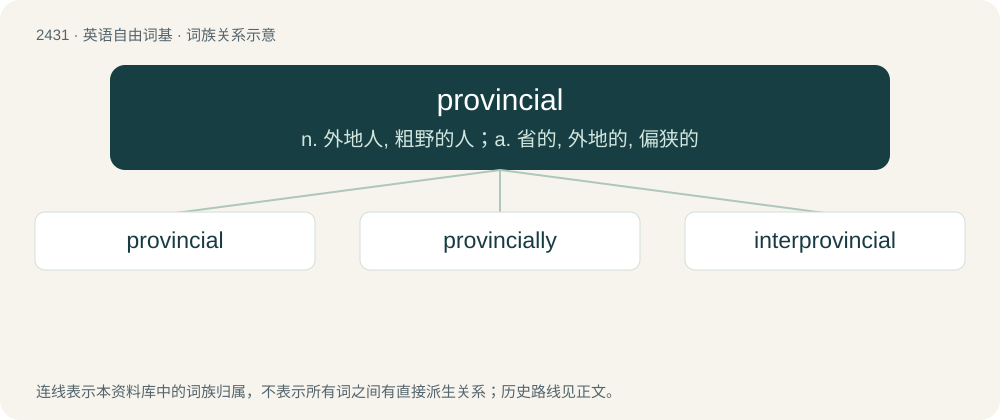

# 2537 · provincial — n. 外地人, 粗野的人；a. 省的, 外地的, 偏狭的

[总目录](../00_总目录_按常用程度.md)

**类型**：英语自由词基　｜　**来源语言**：见词源记录

## 核心含义与来源

- 核心含义：n. 外地人, 粗野的人；a. 省的, 外地的, 偏狭的
- 英文含义：Of or pertaining to a province.
- 词形：provincial

**来源记录 1**（形容词；Of or pertaining to a province.）

From Middle English provincial, from Old French provincial, from Latin prōvinciālis (“of a province”), equivalent to province + -ial.

## 词族图

## 单词速览（常用到不常用）

| 单词 | 音标 | 释义 |
|---|---|---|
| [provincial](#w-1) | 英 /pɹəˈvɪn(t)ʃəl/ | n. 外地人, 粗野的人；a. 省的, 外地的, 偏狭的 |
| [provincially](#w-2) | /prəˈvɪnʃəlɪ/ | adv. 外省地, 地方地 |
| [interprovincial](#w-3) | /,intəprəˈvinʃəl/ | a. 省与省之间的,各省之间的,省际的 |

## 逐词详解

### 1. provincial

**词性**：形容词　｜　**音标**：英 /pɹəˈvɪn(t)ʃəl/

**中文释义**：n. 外地人, 粗野的人；a. 省的, 外地的, 偏狭的

**英文义项**：Of or pertaining to a province. / Constituting a province.

**构词拆分**：province + -ial

**词源与演化**：

From Middle English provincial, from Old French provincial, from Latin prōvinciālis (“of a province”), equivalent to province + -ial.

**用法示例／搭配（非完整句）**：

> a provincial government

该用例对应义项：Of or pertaining to a province.

### 2. provincially

**词性**：副词　｜　**音标**：/prəˈvɪnʃəlɪ/

**中文释义**：adv. 外省地, 地方地

**英文义项**：In a provincial way.

**构词拆分**：provincial + -ly

**词源与演化**：

From provincial + -ly.

### 3. interprovincial

**词性**：形容词　｜　**音标**：/,intəprəˈvinʃəl/

**中文释义**：a. 省与省之间的,各省之间的,省际的

**英文义项**：Occurring or existing between provinces

**构词拆分**：inter- + provincial

**词源与演化**：

From inter- + provincial.
