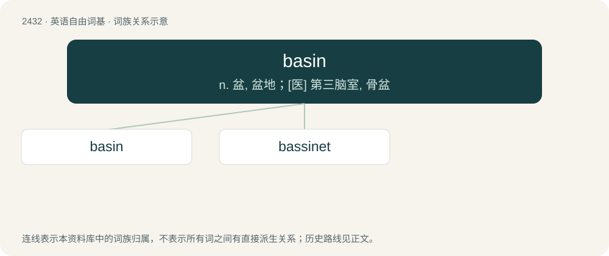

# 2539 · basin — n. 盆, 盆地；\[医\] 第三脑室, 骨盆

[总目录](../00_总目录_按常用程度.md)

**类型**：英语自由词基　｜　**来源语言**：见词源记录

## 核心含义与来源

- 核心含义：n. 盆, 盆地；\[医\] 第三脑室, 骨盆
- 英文含义：A wide bowl for washing, sometimes affixed to a wall.
- 词形：basin

**来源记录 1**（名词；A wide bowl for washing, sometimes affixed to a wall.）

From Middle English basyn, from Old French bacin, from Vulgar Latin \*baccinum (“wide bowl”).

## 词族图

## 单词速览（常用到不常用）

| 单词 | 音标 | 释义 |
|---|---|---|
| [basin](#w-1) | 英 /ˈbeɪsɪn/ | n. 盆, 盆地；\[医\] 第三脑室, 骨盆 |
| [bassinet](#w-2) | 英 /ˌbæsɪˈnɛt/；美 /ˌbæsɪˈnɛt/ | n. 摇篮, 摇篮车 |

## 逐词详解

### 1. basin

**词性**：名词　｜　**音标**：英 /ˈbeɪsɪn/

**中文释义**：n. 盆, 盆地；\[医\] 第三脑室, 骨盆

**英文义项**：A wide bowl for washing, sometimes affixed to a wall. / A depression, natural or artificial, containing water.

**词源与演化**：

From Middle English basyn, from Old French bacin, from Vulgar Latin \*baccinum (“wide bowl”).

**例句**：

> The basin of the Great Salt Lake.

该用例对应义项：a natural depression in the surface of the land often with a lake at the bottom of it

### 2. bassinet

**词性**：名词　｜　**音标**：英 /ˌbæsɪˈnɛt/；美 /ˌbæsɪˈnɛt/

**中文释义**：n. 摇篮, 摇篮车

**英文义项**：A newborn baby's bed, traditionally woven with reeds or straw; a (wicker) cradle.

**构词拆分**：basin + -et

**词源与演化**：

From French bassinet (“small basin”), equivalent to basin + -et. Ernest Klein, however, suggests derivation from French bercelonnette (“cradle”), with influence from bassin(et), to account for the English sense's semantic specialization.

**例句**：

> Tom put the baby in the bassinet.
