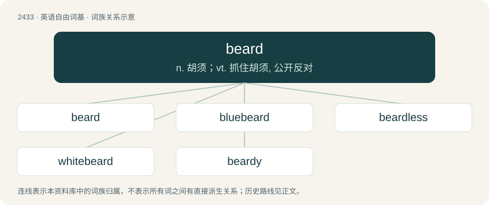

# 2540 · beard — n. 胡须；vt. 抓住胡须, 公开反对

[总目录](../00_总目录_按常用程度.md)

**类型**：英语自由词基　｜　**来源语言**：见词源记录

## 核心含义与来源

- 核心含义：n. 胡须；vt. 抓住胡须, 公开反对
- 英文含义：Facial hair on the chin, cheeks, jaw and neck.
- 词形：beard

**来源记录 1**（名词；Facial hair on the chin, cheeks, jaw and neck.）

From Middle English berd, bard, bærd, from Old English beard, from Proto-West Germanic \*bard, from Proto-Germanic \*bardaz, from Proto-Indo-European \*bʰardʰeh₂, \*bʰh₂erdʰeh₂. Cognates Cognate with Scots beird (“beard”), Yola bearde (“beard”), North Frisian biard (“beard”), Saterland Frisian Boart (“beard”), West Frisian burd (“beard”), Bavarian Bårt (“beard”), Dutch baard (“beard”), German Bart (“beard”), German Low German and Luxembourgish Baart (“beard”), Vilamovian biöt (“beard”), Yiddish באָרד (bord, “beard”), Icelandic barð (“brim; edge, ridge”), Norwegian Bokmål bart (“moustache”), Norwegian Nynorsk bard, barde (“edge, rim”), bart (“moustache”), Crimean Gothic bars (“beard”); also Latin barba (“beard”), Latvian bārda (“beard”), Lithuanian barzda (“beard”), Belarusian барада́ (baradá, “beard”), Bulgarian and Macedonian брада́ (bradá, “beard; chin”), Czech, Slovak, and Slovene brada (“beard”), Russian and Ukrainian борода́ (borodá, “beard”), Serbo-Croatian бра́да, bráda (“beard”). Doublet of barb.

## 词族图

## 单词速览（常用到不常用）

| 单词 | 音标 | 释义 |
|---|---|---|
| [beard](#w-1) | 英 /bɪəd/；美 /bɪɹd/ | n. 胡须；vt. 抓住胡须, 公开反对 |
| [bluebeard](#w-2) |  | 【英文】Any member of the genus Caryopteris of plants native to eastern Asia, now cultivated in gardens. |
| [beardless](#w-3) | /ˈbiədlis/ | a. 无须的, 乳臭未干的 |
| [whitebeard](#w-4) | /ˈhwait,biəd/ | n. 白胡子老人,老翁 |
| [beardy](#w-5) | 英 /ˈbɪədi/ | 【英文】Bearded. |

## 逐词详解

### 1. beard

**词性**：名词　｜　**音标**：英 /bɪəd/；美 /bɪɹd/

**中文释义**：n. 胡须；vt. 抓住胡须, 公开反对

**英文义项**：Facial hair on the chin, cheeks, jaw and neck. / The cluster of small feathers at the base of the beak in some birds.

**词源与演化**：

From Middle English berd, bard, bærd, from Old English beard, from Proto-West Germanic \*bard, from Proto-Germanic \*bardaz, from Proto-Indo-European \*bʰardʰeh₂, \*bʰh₂erdʰeh₂. Cognates Cognate with Scots beird (“beard”), Yola bearde (“beard”), North Frisian biard (“beard”), Saterland Frisian Boart (“beard”), West Frisian burd (“beard”), Bavarian Bårt (“beard”), Dutch baard (“beard”), German Bart (“beard”), German Low German and Luxembourgish Baart (“beard”), Vilamovian biöt (“beard”), Yiddish באָרד (bord, “beard”), Icelandic barð (“brim; edge, ridge”), Norwegian Bokmål bart (“moustache”), Norwegian Nynorsk bard, barde (“edge, rim”), bart (“moustache”), Crimean Gothic bars (“beard”); also Latin barba (“beard”), Latvian bārda (“beard”), Lithuanian barzda (“beard”), Belarusian барада́ (baradá, “beard”), Bulgarian and Macedonian брада́ (bradá, “beard; chin”), Czech, Slovak, and Slovene brada (“beard”), Russian and Ukrainian борода́ (borodá, “beard”), Serbo-Croatian бра́да, bráda (“beard”). Doublet of barb.

**用法示例／搭配（非完整句）**：

> the beard of grain

该用例对应义项：The long or stiff hairs on a plant; the awn.

### 2. bluebeard

**词性**：名词

**英文义项**：Any member of the genus Caryopteris of plants native to eastern Asia, now cultivated in gardens.

**构词拆分**：blue + beard

**词源与演化**：

From blue + beard.

### 3. beardless

**词性**：形容词　｜　**音标**：/ˈbiədlis/

**中文释义**：a. 无须的, 乳臭未干的

**英文义项**：Lacking a beard. / Not having reached puberty or manhood; youthful.

**构词拆分**：beard + -less

**词源与演化**：

From Middle English bērdlēs, from Old English beardlēas (“beardless”), from Proto-West Germanic \*bardalaus (“beardless”), equivalent to beard + -less. Cognate with Scots berdles (“beardless”), Saterland Frisian boartloos (“beardless”), West Frisian burdleas (“beardless”), Dutch baardeloos (“beardless”), German Low German baartlos (“beardless”), German bartlos (“beardless”).

**用法示例／搭配（非完整句）**：

> beardless wheat

该用例对应义项：Lacking an awn.

### 4. whitebeard

**词性**：名词　｜　**音标**：/ˈhwait,biəd/

**中文释义**：n. 白胡子老人,老翁

**英文义项**：An old man; a greybeard.

**构词拆分**：white + beard

**词源与演化**：

From white + beard.

### 5. beardy

**词性**：形容词　｜　**音标**：英 /ˈbɪədi/

**英文义项**：Bearded. / Manly, masculine.

**构词拆分**：beard + -y

**词源与演化**：

From beard + -y. Compare Saterland Frisian boartich (“bearded”), Dutch baardig (“bearded”), German bärtig (“bearded”).
