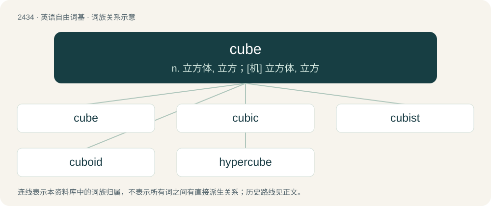

# 2541 · cube — n. 立方体, 立方；\[机\] 立方体, 立方

[总目录](../00_总目录_按常用程度.md)

**类型**：英语自由词基　｜　**来源语言**：见词源记录

## 核心含义与来源

- 核心含义：n. 立方体, 立方；\[机\] 立方体, 立方
- 英文含义：A regular polyhedron having six identical square faces.
- 词形：cube

**多个词源／构词路径**：同一拼写可能有不同来源；以下按词性和含义分别列出。

**来源记录 1**（名词；A regular polyhedron having six identical square faces.）

From Old French cube, from Latin cubus, from Ancient Greek κύβος (kúbos). Displaced Old English tæfel ("cube, die, game with dice or tables").

**来源记录 2**（名词；A cubicle, especially one of those found in offices.）

Clipped form of cubicle (with intentional reference to their common shape per cube, etymology 1), which from Latin cubiculum (“a small bedchamber or lounge”), from cubare (“to lie down”).

## 词族图

## 单词速览（常用到不常用）

| 单词 | 音标 | 释义 |
|---|---|---|
| [cube](#w-1) | 英 /kjuːb/；美 /kjub/ | n. 立方体, 立方；\[机\] 立方体, 立方 |
| [cubic](#w-2) | 英 /ˈkjuː.bɪk/；美 /ˈkju.bɪk/ | a. 立方体的, 立方的；\[机\] 立方的, 立方体的 |
| [cubist](#w-3) | /ˈkjuːbist/ | n. 立体派画家；a. 立体派的 |
| [cuboid](#w-4) | /ˈkjuːbɔɪd/ | a. 立方形的, 骰骨的；n. 骰骨, 立方体 |
| [hypercube](#w-5) | 英 /ˈhaɪ.pə.kjuːb/；美 /ˈhaɪ.pɚ.kjuːb/ | \[计\] 超立方体 |

## 逐词详解

### 1. cube

**词性**：名词　｜　**音标**：英 /kjuːb/；美 /kjub/

**中文释义**：n. 立方体, 立方；\[机\] 立方体, 立方

**英文义项**：A regular polyhedron having six identical square faces. / Any object more or less in the form of a cube.

**词源与演化**：

From Old French cube, from Latin cubus, from Ancient Greek κύβος (kúbos). Displaced Old English tæfel ("cube, die, game with dice or tables").

**例句**：

> A: One cube or two? B: Oh, no sugar for me, thanks.

该用例对应义项：Any object more or less in the form of a cube.

### 2. cubic

**词性**：形容词　｜　**音标**：英 /ˈkjuː.bɪk/；美 /ˈkju.bɪk/

**中文释义**：a. 立方体的, 立方的；\[机\] 立方的, 立方体的

**英文义项**：Used in the names of units of volume formed by multiplying a unit of length by itself twice. / Relating to polynomials of the form ax³+bx²+cx+d.

**构词拆分**：cube + -ic

**词源与演化**：

From Middle French cubique, equivalent to cube + -ic.

**用法示例／搭配（非完整句）**：

> cubic cleavage

该用例对应义项：Having three equal axes and all angles 90°.

### 3. cubist

**词性**：名词　｜　**音标**：/ˈkjuːbist/

**中文释义**：n. 立体派画家；a. 立体派的

**英文义项**：A player of Rubik's cube; a cuber.

**构词拆分**：cube + -ist

**词源与演化**：

From cube + -ist.

### 4. cuboid

**词性**：形容词　｜　**音标**：/ˈkjuːbɔɪd/

**中文释义**：a. 立方形的, 骰骨的；n. 骰骨, 立方体

**英文义项**：Of the shape of a cube.

**构词拆分**：cube + -oid

**词源与演化**：

From cube + -oid.

### 5. hypercube

**词性**：名词　｜　**音标**：英 /ˈhaɪ.pə.kjuːb/；美 /ˈhaɪ.pɚ.kjuːb/

**中文释义**：\[计\] 超立方体

**英文义项**：A geometric figure in four or more dimensions, which is analogous to a cube in three dimensions. Specifically, the n-dimensional equivalent of a cube for any non-negative integer n. / Such a figure in four dimensions; a tesseract.

**构词拆分**：hyper- + cube

**词源与演化**：

From hyper- + cube.
