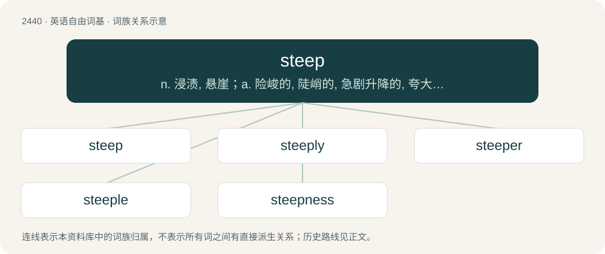

# 2544 · steep — n. 浸渍, 悬崖；a. 险峻的, 陡峭的, 急剧升降的, 夸大的；v. 浸, 泡

[总目录](../00_总目录_按常用程度.md)

**类型**：英语自由词基　｜　**来源语言**：见词源记录

## 核心含义与来源

- 核心含义：n. 浸渍, 悬崖；a. 险峻的, 陡峭的, 急剧升降的, 夸大的；v. 浸, 泡
- 英文含义：Of a near-vertical gradient; of a slope, surface, curve, etc. that proceeds upward or downward at an angle approaching vertical.
- 词形：steep

**多个词源／构词路径**：同一拼写可能有不同来源；以下按词性和含义分别列出。

**来源记录 1**（形容词；Of a near-vertical gradient; of a slope, surface, curve, etc. that proceeds upward or downward at an angle approaching vertical.）

From Middle English steep, from Old English stēap (“high”), from Proto-Germanic \*staupaz, from Proto-Indo-European \*(s)tewp- (“to push, stick”). Compare Old Frisian stāp ("high, towering"; &gt; Modern Saterland Frisian stiep (“steep”)), Dutch stoop (“grand; proud”), Middle High German stouf (“towering cliff, precipice”), Middle High German stief (“steep”)). The Proto-Indo-European root (and related) has many and varied descendants, including English stub; compare also Scots stap (“to strike, to forcibly insert”). The sense of “sharp slope” is attested circa 1200; the sense “expensive” is attested US 1856.

**来源记录 2**（动词；To soak or wet thoroughly.）

From Middle English stepen, from Old Norse steypa (“to make stoop, cast down, pour out, cast (metal)”), from Proto-Germanic \*staupijaną (“to tumble, make tumble, plunge”), from Proto-Indo-European \*(s)tewb- (“to push, hit”). Cognate with Danish støbe (“cast (metal)”), Norwegian støpe, støype, Swedish stöpa (“to found, cast (metal)”), Old English stūpian (“to stoop, bend the back, slope”). Related to stoop.

## 词族图

## 单词速览（常用到不常用）

| 单词 | 音标 | 释义 |
|---|---|---|
| [steep](#w-1) | /stiːp/ | n. 浸渍, 悬崖；a. 险峻的, 陡峭的, 急剧升降的, 夸大的；v. 浸, 泡 |
| [steeply](#w-2) | /ˈstiːpli/ | adv. 险峻地 |
| [steeper](#w-3) | /ˈstiːpə/ | n. 浸泡用的桶子；\[化\] 浸渍器 |
| [steeple](#w-4) | 英 /ˈsti(ː)pəl/ | n. 尖顶, (教堂的)尖塔, 锥形体 |
| [steepness](#w-5) | /ˈstiːpnis/ | n. 险峻 |

## 逐词详解

### 1. steep

**词性**：形容词　｜　**音标**：/stiːp/

**中文释义**：n. 浸渍, 悬崖；a. 险峻的, 陡峭的, 急剧升降的, 夸大的；v. 浸, 泡

**英文义项**：Of a near-vertical gradient; of a slope, surface, curve, etc. that proceeds upward or downward at an angle approaching vertical. / Expensive.

**词源与演化**：

From Middle English steep, from Old English stēap (“high”), from Proto-Germanic \*staupaz, from Proto-Indo-European \*(s)tewp- (“to push, stick”). Compare Old Frisian stāp ("high, towering"; &gt; Modern Saterland Frisian stiep (“steep”)), Dutch stoop (“grand; proud”), Middle High German stouf (“towering cliff, precipice”), Middle High German stief (“steep”)). The Proto-Indo-European root (and related) has many and varied descendants, including English stub; compare also Scots stap (“to strike, to forcibly insert”). The sense of “sharp slope” is attested circa 1200; the sense “expensive” is attested US 1856.

**例句**：

> The steep rake of the windshield enhances the fast lines of the exterior.

该用例对应义项：resulting in a mast or windshield angle that strongly diverges from the perpendicular.

### 2. steeply

**词性**：副词　｜　**音标**：/ˈstiːpli/

**中文释义**：adv. 险峻地

**英文义项**：In a steep manner.

**构词拆分**：steep + -ly

**词源与演化**：

From steep + -ly.

**例句**：

> The street rose steeply up to the castle.

该用例对应义项：in a steep manner

### 3. steeper

**词性**：名词　｜　**音标**：/ˈstiːpə/

**中文释义**：n. 浸泡用的桶子；\[化\] 浸渍器

**英文义项**：A vessel, vat, or cistern in which things are steeped. / The stem of a shrub or small tree in a hedgerow, often laid by being partially cut through at the base in the process of laying a hedge.

**构词拆分**：steep + -er

**词源与演化**：

From steep + -er.

**例句**：

> The path became steeper, and we had to slow our pace.

### 4. steeple

**词性**：动词　｜　**音标**：英 /ˈsti(ː)pəl/

**中文释义**：n. 尖顶, (教堂的)尖塔, 锥形体

**英文义项**：To form something into the shape of a steeple.

**构词拆分**：steep + -le

**词源与演化**：

From Middle English stepel, from Old English stīpel, stȳpel, stīepel (“tower, steeple”), from Proto-West Germanic \*staupil, from Proto-Germanic \*staupilaz (“that which is steep, tower, steeple”), equivalent to steep + -le. Cognate with Old Norse stǫpull (“tower, steeple”).

**例句**：

> The steeple of the cathedral of Seville used to be a minaret.

### 5. steepness

**词性**：名词　｜　**音标**：/ˈstiːpnis/

**中文释义**：n. 险峻

**英文义项**：The state or quality of being steep. / The result or product of being steep.

**构词拆分**：steep + -ness

**词源与演化**：

From steep + -ness.

**例句**：

> The steepness of the hill caused the accident.

该用例对应义项：The state or quality of being steep.
