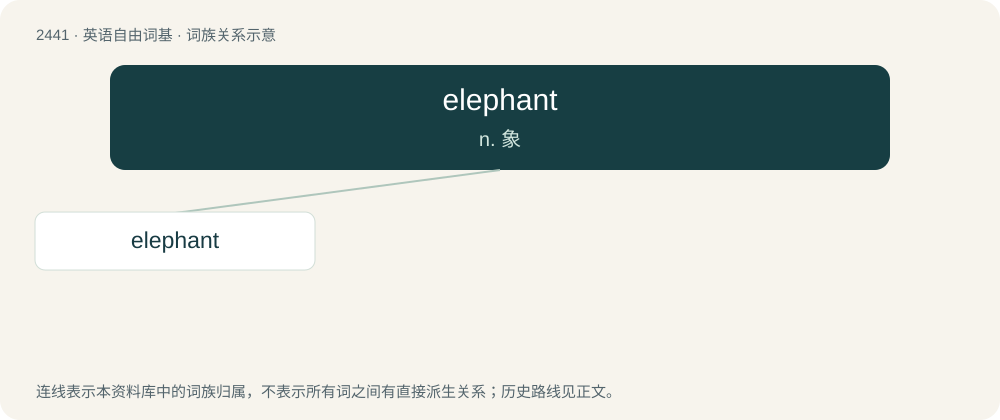

# 2545 · elephant — n. 象

[总目录](../00_总目录_按常用程度.md)

**类型**：英语自由词基　｜　**来源语言**：见词源记录

## 核心含义与来源

- 核心含义：n. 象
- 英文含义：A large mammal of the family Elephantidae in the order Proboscidea, having a trunk, and native to Africa and Asia.
- 词形：elephant

**来源记录 1**（名词；A large mammal of the family Elephantidae in the order Proboscidea, having a trunk, and native to Africa and Asia.）

From Middle English elefant, elefaunt, from Old French elefant, elefan, olifant, re-latinized in Middle French as elephant, from Latin elephantus, from Ancient Greek ἐλέφᾱς (eléphās) (gen. ἐλέφαντος (eléphantos)). Believed to be derived from an Afroasiatic form such as Proto-Berber \*eḷu (“elephant”) (compare Tamahaq êlu, Tamasheq alu) or Egyptian ꜣbw (“elephant; ivory”). More at ivory. Replaced Middle English olifant (from the aforementioned Old French form, from Vulgar Latin \*olifantus), which replaced Old English elpend (“elephant”).

## 词族图

## 单词速览（常用到不常用）

| 单词 | 音标 | 释义 |
|---|---|---|
| [elephant](#w-1) | 英 /ˈɛlɪfənt/；美 /ˈɛləfənt/ | n. 象 |

## 逐词详解

### 1. elephant

**词性**：名词　｜　**音标**：英 /ˈɛlɪfənt/；美 /ˈɛləfənt/

**中文释义**：n. 象

**英文义项**：A large mammal of the family Elephantidae in the order Proboscidea, having a trunk, and native to Africa and Asia. / Anything huge and ponderous.

**词源与演化**：

From Middle English elefant, elefaunt, from Old French elefant, elefan, olifant, re-latinized in Middle French as elephant, from Latin elephantus, from Ancient Greek ἐλέφᾱς (eléphās) (gen. ἐλέφαντος (eléphantos)). Believed to be derived from an Afroasiatic form such as Proto-Berber \*eḷu (“elephant”) (compare Tamahaq êlu, Tamasheq alu) or Egyptian ꜣbw (“elephant; ivory”). More at ivory. Replaced Middle English olifant (from the aforementioned Old French form, from Vulgar Latin \*olifantus), which replaced Old English elpend (“elephant”).

**例句**：

> Let's play hide and seek. I'll count. One elephant, two elephant, three elephant...

该用例对应义项：used when counting to add length, so that each count takes about one second
