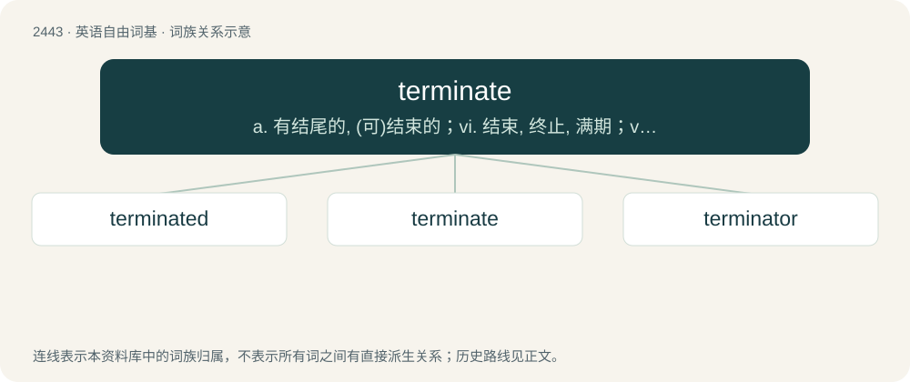

# 2546 · terminate — a. 有结尾的, (可)结束的；vi. 结束, 终止, 满期；vt. 使停止, 使结束, 使终止

[总目录](../00_总目录_按常用程度.md)

**类型**：英语自由词基　｜　**来源语言**：见词源记录

## 核心含义与来源

- 核心含义：a. 有结尾的, (可)结束的；vi. 结束, 终止, 满期；vt. 使停止, 使结束, 使终止
- 英文含义：To end something, especially when left in an incomplete state.
- 词形：terminate

**多个词源／构词路径**：同一拼写可能有不同来源；以下按词性和含义分别列出。

**来源记录 1**（动词；To end something, especially when left in an incomplete state.）

From Middle English terminaten (“to bring to an end; to adjudicate; to end, stop; to border, confine, contain”) from terminat(e) (“bounded”, also used as the past participle of terminaten) + -en (verb-forming suffix), borrowed from Latin terminātus, perfect passive participle of terminō (“to set bounds to, bound, limit, end, close, terminate”) (see -ate (verb-forming suffix)), from terminus (“a bound, limit, end”) + -ō (verb-forming suffix); see term, terminus. Doublet of termine, cognate with French terminer.

**来源记录 2**（形容词；Terminated; limited; bounded; ended.）

From Middle English terminat(e) (“bounded”, also used as the past participle of terminaten), see -ate (adjective-forming suffix) and Etymology 1 for more.

## 词族图

## 单词速览（常用到不常用）

| 单词 | 音标 | 释义 |
|---|---|---|
| [terminated](#w-1) | 英 /ˈtɜːmɪneɪ̯tɪd/；/ˈtɝmɪneɪɾɪd/ | vt.& vi. terminate的过去式；v. 结束( terminate的过去式和过去分词 ); 使终结; 解雇; （公共汽车或火车）到达终点站 |
| [terminate](#w-2) | 英 /ˈtɜːmɪneɪ̯t/；美 /ˈtɝmɪneɪ̯t/ | a. 有结尾的, (可)结束的；vi. 结束, 终止, 满期；vt. 使停止, 使结束, 使终止 |
| [terminator](#w-3) | 英 /ˈtɜː.mɪ.neɪ.tə/；美 /ˈtɝ.mɪˌneɪ.tɚ/ | n. 终结者, 明暗界限；\[计\] 终结器 |

## 逐词详解

### 1. terminated

**词性**：形容词　｜　**音标**：英 /ˈtɜːmɪneɪ̯tɪd/；/ˈtɝmɪneɪɾɪd/

**中文释义**：vt.& vi. terminate的过去式；v. 结束( terminate的过去式和过去分词 ); 使终结; 解雇; （公共汽车或火车）到达终点站

**英文义项**：Having been the subject of termination; ended or destroyed. / Having lost a job or assignment.

**构词拆分**：From terminate + -ed.

**词源与演化**：

From terminate + -ed.

**例句**：

> The abruptly terminated interview.

该用例对应义项：having come or been brought to a conclusion

### 2. terminate

**词性**：动词　｜　**音标**：英 /ˈtɜːmɪneɪ̯t/；美 /ˈtɝmɪneɪ̯t/

**中文释义**：a. 有结尾的, (可)结束的；vi. 结束, 终止, 满期；vt. 使停止, 使结束, 使终止

**英文义项**：To end something, especially when left in an incomplete state. / To conclude.

**词源与演化**：

From Middle English terminaten (“to bring to an end; to adjudicate; to end, stop; to border, confine, contain”) from terminat(e) (“bounded”, also used as the past participle of terminaten) + -en (verb-forming suffix), borrowed from Latin terminātus, perfect passive participle of terminō (“to set bounds to, bound, limit, end, close, terminate”) (see -ate (verb-forming suffix)), from terminus (“a bound, limit, end”) + -ō (verb-forming suffix); see term, terminus. Doublet of termine, cognate with French terminer.

**例句**：

> This train terminates at the next station.

该用例对应义项：Of a mode of transport, to end its journey; or, of a railway line, to reach its terminus.

### 3. terminator

**词性**：名词　｜　**音标**：英 /ˈtɜː.mɪ.neɪ.tə/；美 /ˈtɝ.mɪˌneɪ.tɚ/

**中文释义**：n. 终结者, 明暗界限；\[计\] 终结器

**英文义项**：Someone who terminates or ends something, especially (in later use) an assassin or exterminator. / A text character or string that serves to mark the end of a document or transmission.

**构词拆分**：terminate + -or

**词源与演化**：

\* Partly from post-classical Latin terminator (5th century), from Latin terminō; partly from terminate + -or. \* (android that kills humans): After the 1984 film The Terminator.

**例句**：

> Ziri began walking towards his daughter and her boyfriend like a Terminator.
