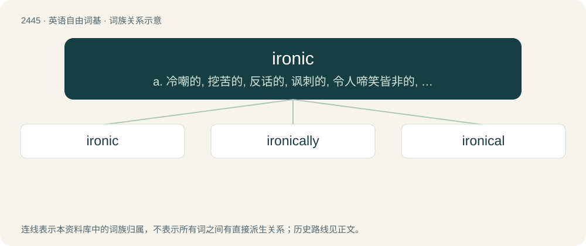

# 2548 · ironic — a. 冷嘲的, 挖苦的, 反话的, 讽刺的, 令人啼笑皆非的, 出乎意料的

[总目录](../00_总目录_按常用程度.md)

**类型**：英语自由词基　｜　**来源语言**：见词源记录

## 核心含义与来源

- 核心含义：a. 冷嘲的, 挖苦的, 反话的, 讽刺的, 令人啼笑皆非的, 出乎意料的
- 英文含义：Characterized by or constituting (any kind of) irony.
- 词形：ironic

**来源记录 1**（形容词；Characterized by or constituting (any kind of) irony.）

Borrowed from Late Latin īrōnicus, from Ancient Greek εἰρωνικός (eirōnikós). Compare Middle French, ironique, equivalent to irony + -ic.

## 词族图

## 单词速览（常用到不常用）

| 单词 | 音标 | 释义 |
|---|---|---|
| [ironic](#w-1) | 英 /aɪˈɹɒn.ɪk/；美 /aɪˈɹɑ.nɪk/ | a. 冷嘲的, 挖苦的, 反话的, 讽刺的, 令人啼笑皆非的, 出乎意料的 |
| [ironically](#w-2) | 英 /aɪˈɹɒnɪkli/；美 /aɪˈɹɑnɪkli/ | adv. 冷嘲地, 挖苦地, 讽刺地, 令人啼笑皆非地 |
| [ironical](#w-3) | 英 /aɪˈɹɒnɪkəl/；美 /aɪˈɹɑnɪkəl/ | a. 讽刺的, 用反语的 |

## 逐词详解

### 1. ironic

**词性**：形容词　｜　**音标**：英 /aɪˈɹɒn.ɪk/；美 /aɪˈɹɑ.nɪk/

**中文释义**：a. 冷嘲的, 挖苦的, 反话的, 讽刺的, 令人啼笑皆非的, 出乎意料的

**英文义项**：Characterized by or constituting (any kind of) irony. / Odd or coincidental; strange.

**构词拆分**：irony + -ic

**词源与演化**：

Borrowed from Late Latin īrōnicus, from Ancient Greek εἰρωνικός (eirōnikós). Compare Middle French, ironique, equivalent to irony + -ic.

**例句**：

> It's ironic that we are eating a sandwich in Sandwich, Massachusetts.

该用例对应义项：Odd or coincidental; strange.

### 2. ironically

**词性**：副词　｜　**音标**：英 /aɪˈɹɒnɪkli/；美 /aɪˈɹɑnɪkli/

**中文释义**：adv. 冷嘲地, 挖苦地, 讽刺地, 令人啼笑皆非地

**英文义项**：In an ironic manner; in a way displaying irony. / Used to draw attention to an ironic aspect of a situation being described.

**构词拆分**：ironic + -ally

**词源与演化**：

From ironic + -ally.

**例句**：

> Ironically, the automated checkout system ended up costing more in repairs than the workers it was meant to replace.

该用例对应义项：Used to draw attention to an ironic aspect of a situation being described.

### 3. ironical

**词性**：形容词　｜　**音标**：英 /aɪˈɹɒnɪkəl/；美 /aɪˈɹɑnɪkəl/

**中文释义**：a. 讽刺的, 用反语的

**英文义项**：Characterized by or constituting (any kind of) irony. / Given to the use of irony; sarcastic.

**构词拆分**：ironic + -al

**词源与演化**：

From ironic + -al. Attested since the 1570s.

**例句**：

> It was ironical that the well-planned scheme failed so completely.

该用例对应义项：characterized by often poignant difference or incongruity between what is expected and what actually is
