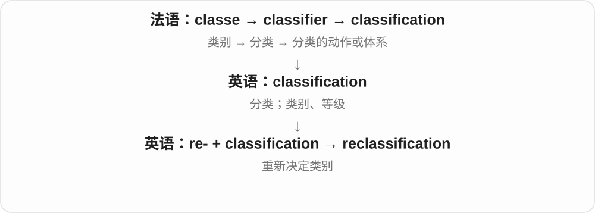
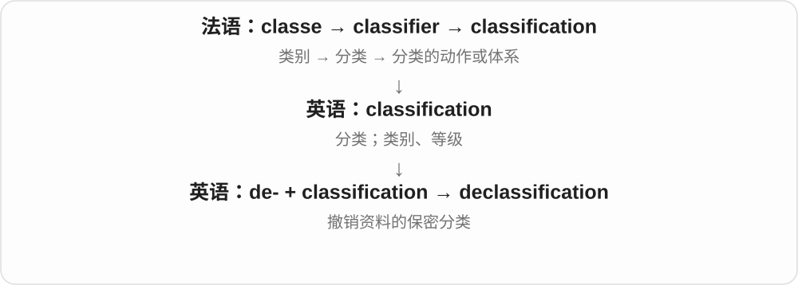

# 2550 · classification — 分类；分级；机密化

[逐词精讲目录](../00_逐词精讲目录.md) · [总目录](../00_总目录_按常用程度.md)

## 核心词根与来源

classification 联系 classify 的分类、定级；reclassification 重新分类，declassification 则常说解除机密等级。不同领域的 class 不能只用学校班级义理解。

**CLASSIFICATION：按标准把对象放入类别或等级**

同一批资料可以按主题分类，也可能被定为机密。

- **建立或改变类别**：classification · reclassification
- **解除机密等级**：declassification

## 词形与演化规律

re- 再次，de- 在 declassification 中是撤销相关等级；名词共同含分类动作成分。

## 单词速览（按词族由简到繁）

同一基础词的相关扩展放在一起，先读基础形式，再读扩展；各组之间优先读常用的。具体词源关系见各词讲解。

| 单词 | 音标 | 核心意思 |
|---|---|---|
| [classification](#w-1) | 英、美 /ˌklæsɪfɪˈkeɪʃən/ | 分类；分类体系；所归的类别、等级 |
| [reclassification](#w-2) | 英、美 /ˌriːklæsɪfɪˈkeɪʃən/ | 重新分类；类别调整 |
| [declassification](#w-3) | 英、美 /ˌdiːklæsɪfɪˈkeɪʃən/ | 解除保密等级；解密过程 |

## 逐词讲解

### 1. classification — 分类；分类体系；所归的类别、等级

**音标**：英、美 /ˌklæsɪfɪˈkeɪʃən/

**先抓住这个画面**

不仅是把东西分开，还说明“按什么分、分成哪几类、这个东西落在哪一类”。

**怎么拆**

借自法语 classification；现代与 classify 对应，-fication 这部分反映使成某类的名词形式。

**怎么变成今天的意思**

既可指过程，也可指结果或体系。a classification system 是一整套分类规则；a film classification 可指影片的适龄等级。

**常见搭配与例句**

a classification system；the classification of species；a new classification。

> The library uses a standard classification system.

图书馆使用一套标准分类体系。

> New evidence may change the classification of this animal.

新证据可能改变这种动物的分类。

**别混淆**

category 是某一个格子；classification 可以是整个分格办法，也可以是归类结果。

### 2. reclassification — 重新分类；类别调整

**音标**：英、美 /ˌriːklæsɪfɪˈkeɪʃən/

**先抓住这个画面**

把“换一个分类位置”这件事作为一个过程或决定来谈。

**怎么拆**

re- + classification；与 reclassify 配套。

**怎么变成今天的意思**

a reclassification 可以是一项具体调整；不加冠词时也能泛指重新分类过程。常用于研究报告或正式管理文件。

**常见搭配与例句**

the reclassification of；a proposed reclassification；undergo reclassification。

> The reclassification places the species in a different genus.

重新分类后，这个物种被划入另一个属。

> Staff were informed of the proposed job reclassification.

员工已获知拟议中的岗位重新分类方案。

**别混淆**

reclassification 改分类；reorganization 改组织方式，范围更广。

### 3. declassification — 解除保密等级；解密过程

**音标**：英、美 /ˌdiːklæsɪfɪˈkeɪʃən/

**先抓住这个画面**

重点看撤下保密标签的整套过程、决定或结果。

**怎么拆**

de- + classification；与 declassify 配套的名词。

**怎么变成今天的意思**

可以有 declassification review“解密审查”；审查可能只同意解密部分内容。不要把它理解为密码破解技术。

**常见搭配与例句**

a declassification review；the declassification of records；declassification policy。

> Declassification allowed historians to examine the old correspondence.

档案解密让历史学者得以研究这些旧信件。

> The review resulted in the partial declassification of the report.

审查后，报告被部分解密。

**别混淆**

declassification 是行政或制度上的解密；decryption 是技术上的解密。

## 这一组要分清什么

declassification 不一定是取消所有分类，而常是解除机密；reclassification 可以使等级升高或降低。

## 串起来练习

The archive announced the declassification of records that had undergone reclassification.

档案馆宣布解密曾重新定级的文件。
