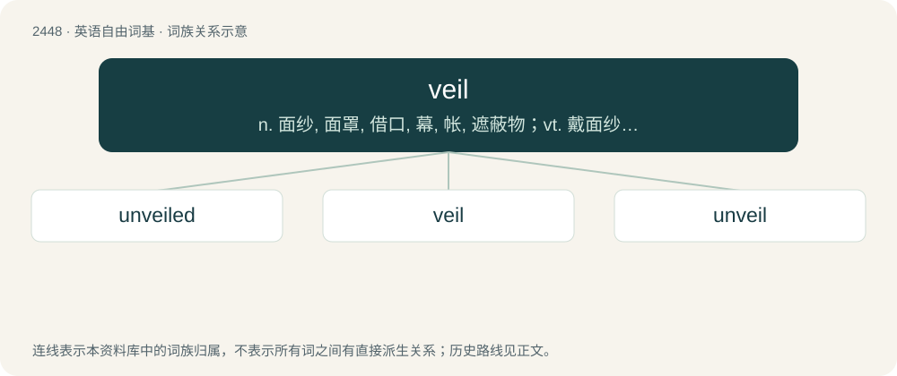

# 2551 · veil — n. 面纱, 面罩, 借口, 幕, 帐, 遮蔽物；vt. 戴面纱, 隐藏, 遮蔽, 掩饰；vi. 蒙上面纱

[总目录](../00_总目录_按常用程度.md)

**类型**：英语自由词基　｜　**来源语言**：见词源记录

## 核心含义与来源

- 核心含义：n. 面纱, 面罩, 借口, 幕, 帐, 遮蔽物；vt. 戴面纱, 隐藏, 遮蔽, 掩饰；vi. 蒙上面纱
- 英文含义：Something hung up or spread out to hide or protect the face, or hide an object from view; usually of gauze, crepe, or similar diaphanous material.
- 词形：veil

**来源记录 1**（名词；Something hung up or spread out to hide or protect the face, or hide an object from view; usually of gauze, crepe, or similar diaphanous material.）

From Middle English veil, veyl, from Anglo-Norman and Old Northern French veil (“sail, veil, shroud”) (Francien Old French voil, French voile), Latin vēlum (“cloth, covering”). Displaced Middle English scleire, scleyre, sleyre, slyre (“veil”) (compare German Schleier). Doublet of velum and voile.

## 词族图

## 单词速览（常用到不常用）

| 单词 | 音标 | 释义 |
|---|---|---|
| [unveiled](#w-1) | /.ʌnˈveild/ | a. 裸露的；公布于众的 |
| [veil](#w-2) | 英 /veɪl/ | n. 面纱, 面罩, 借口, 幕, 帐, 遮蔽物；vt. 戴面纱, 隐藏, 遮蔽, 掩饰；vi. 蒙上面纱 |
| [unveil](#w-3) | /ʌnˈveɪl/ | vt. 揭开, 揭幕, 除去...的面纱；vi. 显露, 除去面纱 |

## 逐词详解

### 1. unveiled

**词性**：形容词　｜　**音标**：/.ʌnˈveild/

**中文释义**：a. 裸露的；公布于众的

**英文义项**：Not wearing, or not covered by, a veil.

**构词拆分**：un- + veil + -ed

**词源与演化**：

From Middle English unveiled, vnueylyd, equivalent to un- + veil + -ed.

**例句**：

> A new generation of unveiled women in Iran.

该用例对应义项：revealed; especially by having a veil removed

### 2. veil

**词性**：名词　｜　**音标**：英 /veɪl/

**中文释义**：n. 面纱, 面罩, 借口, 幕, 帐, 遮蔽物；vt. 戴面纱, 隐藏, 遮蔽, 掩饰；vi. 蒙上面纱

**英文义项**：Something hung up or spread out to hide or protect the face, or hide an object from view; usually of gauze, crepe, or similar diaphanous material. / Anything that partially obscures a clear view.

**词源与演化**：

From Middle English veil, veyl, from Anglo-Norman and Old Northern French veil (“sail, veil, shroud”) (Francien Old French voil, French voile), Latin vēlum (“cloth, covering”). Displaced Middle English scleire, scleyre, sleyre, slyre (“veil”) (compare German Schleier). Doublet of velum and voile.

**用法示例／搭配（非完整句）**：

> an altar veil

该用例对应义项：A covering for a person or thing; as, a caul (especially over the head)

### 3. unveil

**词性**：动词　｜　**音标**：/ʌnˈveɪl/

**中文释义**：vt. 揭开, 揭幕, 除去...的面纱；vi. 显露, 除去面纱

**英文义项**：To remove a veil from; to uncover; to reveal something hidden. / To show, especially for the first time.

**构词拆分**：un- + veil

**词源与演化**：

From Middle English \*unveilen (suggested by past participle unveiled, vnueylyd (“unveiled”)). Equivalent to un- + veil. Ultimately from Latin velum (whence also English voile, English reveal, Russian вуа́ль (vuálʹ), Russian завуали́ровать (zavualírovatʹ) (compare typologically)). Also compare typologically uncloak, unmask, Russian разобла́чать (razobláčatʹ) (akin to облаче́ние (oblačénije)).

**例句**：

> The car company are going to unveil the new sports car model next month.

该用例对应义项：To show, especially for the first time.
