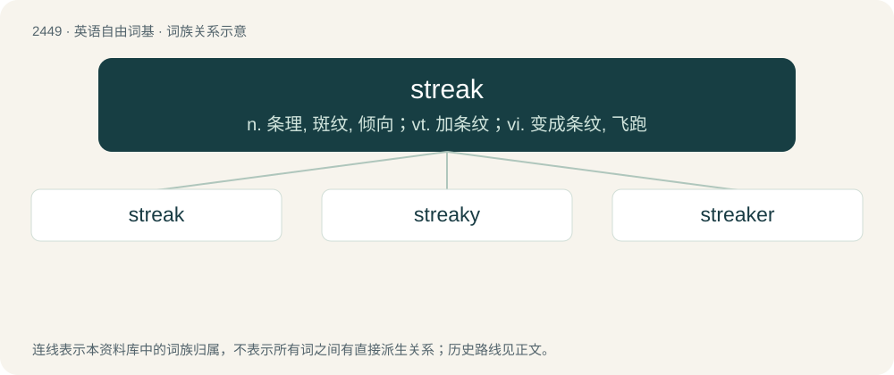

# 2553 · streak — n. 条理, 斑纹, 倾向；vt. 加条纹；vi. 变成条纹, 飞跑

[总目录](../00_总目录_按常用程度.md)

**类型**：英语自由词基　｜　**来源语言**：见词源记录

## 核心含义与来源

- 核心含义：n. 条理, 斑纹, 倾向；vt. 加条纹；vi. 变成条纹, 飞跑
- 英文含义：An irregular line, as is left from smearing or motion.
- 词形：streak

**来源记录 1**（名词；An irregular line, as is left from smearing or motion.）

From Middle English streke, from Old English strica, from Proto-Germanic \*strikiz, from Proto-Indo-European \*streyg- (“line”). Related to North Frisian strijck, Old Saxon striki, Middle Low German streke, Low German streek, Danish streg, Swedish streck, Norwegian Bokmål and Norwegian Nynorsk strek, Icelandic stryk, strykr, Dutch streek, Afrikaans streek, Old High German strih, German Strich, Gothic 𐍃𐍄𐍂𐌹𐌺𐍃 (striks).

## 词族图

## 单词速览（常用到不常用）

| 单词 | 音标 | 释义 |
|---|---|---|
| [streak](#w-1) | /stɹiːk/ | n. 条理, 斑纹, 倾向；vt. 加条纹；vi. 变成条纹, 飞跑 |
| [streaky](#w-2) | /ˈstɹiːki/ | a. 有条纹的, 有斑点的, 容易变的 |
| [streaker](#w-3) | 美 /ˈstɹikɚ/ | n. (1970年代出现的)裸跑者 |

## 逐词详解

### 1. streak

**词性**：名词　｜　**音标**：/stɹiːk/

**中文释义**：n. 条理, 斑纹, 倾向；vt. 加条纹；vi. 变成条纹, 飞跑

**英文义项**：An irregular line, as is left from smearing or motion. / A band, line or stripe.

**词源与演化**：

From Middle English streke, from Old English strica, from Proto-Germanic \*strikiz, from Proto-Indo-European \*streyg- (“line”). Related to North Frisian strijck, Old Saxon striki, Middle Low German streke, Low German streek, Danish streg, Swedish streck, Norwegian Bokmål and Norwegian Nynorsk strek, Icelandic stryk, strykr, Dutch streek, Afrikaans streek, Old High German strih, German Strich, Gothic 𐍃𐍄𐍂𐌹𐌺𐍃 (striks).

**例句**：

> I was on a winning streak until the fourth game, when I was dealt terrible cards.

该用例对应义项：A continuous series of like events.

### 2. streaky

**词性**：形容词　｜　**音标**：/ˈstɹiːki/

**中文释义**：a. 有条纹的, 有斑点的, 容易变的

**英文义项**：Having streaks. / Used to describe a shot where the ball deflects off the edge of the bat, but is not caught by the slips or wicket-keeper and instead results in runs for the batsman.

**构词拆分**：From streak + -y.

**词源与演化**：

From streak + -y.

**用法示例／搭配（非完整句）**：

> Jones has always been a streaky hitter

该用例对应义项：Having alternating periods of good and bad performances; inconsistent.

### 3. streaker

**词性**：名词　｜　**音标**：美 /ˈstɹikɚ/

**中文释义**：n. (1970年代出现的)裸跑者

**英文义项**：One who runs naked through a public place as a prank. / A dolphin of species Stenella coeruleoalba.

**构词拆分**：From streak + -er.

**词源与演化**：

From streak + -er.
