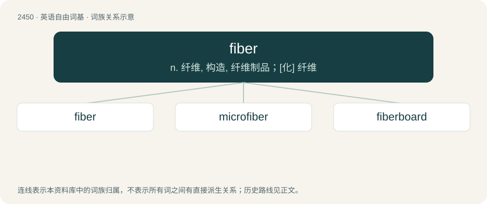

# 2554 · fiber — n. 纤维, 构造, 纤维制品；\[化\] 纤维

[总目录](../00_总目录_按常用程度.md)

**类型**：英语自由词基　｜　**来源语言**：见词源记录

## 核心含义与来源

- 核心含义：n. 纤维, 构造, 纤维制品；\[化\] 纤维
- 英文含义：A single elongated piece of a given material, roughly round in cross-section, often twisted with other fibers to form thread.
- 词形：fiber

**来源记录 1**（名词；A single elongated piece of a given material, roughly round in cross-section, often twisted with other fibers to form thread.）

From French fibre, from Old French fibre, from Latin fibra.

## 词族图

## 单词速览（常用到不常用）

| 单词 | 音标 | 释义 |
|---|---|---|
| [fiber](#w-1) | 英 /ˈfaɪ.bə/；美 /ˈfaɪ.bɚ/ | n. 纤维, 构造, 纤维制品；\[化\] 纤维 |
| [microfiber](#w-2) | /maɪkˈrəʊfɪbər/ | 微纤维 |
| [fiberboard](#w-3) | /bɒrd/ | n. 纤维板 |

## 逐词详解

### 1. fiber

**词性**：名词　｜　**音标**：英 /ˈfaɪ.bə/；美 /ˈfaɪ.bɚ/

**中文释义**：n. 纤维, 构造, 纤维制品；\[化\] 纤维

**英文义项**：A single elongated piece of a given material, roughly round in cross-section, often twisted with other fibers to form thread. / A material in the form of fibers.

**词源与演化**：

From French fibre, from Old French fibre, from Latin fibra.

**例句**：

> Under this map, any two values in the fiber of a given point on the circle differ by 2π.

该用例对应义项：The preimage of a given point in the range of a map.

### 2. microfiber

**词性**：名词　｜　**音标**：/maɪkˈrəʊfɪbər/

**中文释义**：微纤维

**英文义项**：Very fine synthetic fiber; cloth made of such fiber.

**构词拆分**：From micro- + fiber.

**词源与演化**：

From micro- + fiber.

**例句**：

> The spilled wine hadn't stained the microfiber couch.

该用例对应义项：Very fine synthetic fiber; cloth made of such fiber.

### 3. fiberboard

**词性**：名词　｜　**音标**：/bɒrd/

**中文释义**：n. 纤维板

**英文义项**：A material made from wood chips or shavings, which are compressed and bonded with resin and formed into stiff sheets, and used in building or making furniture.

**构词拆分**：From fiber + board.

**词源与演化**：

From fiber + board.
