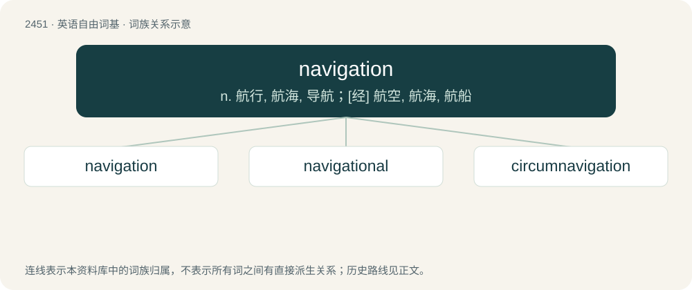

# 2555 · navigation — n. 航行, 航海, 导航；\[经\] 航空, 航海, 航船

[总目录](../00_总目录_按常用程度.md)

**类型**：英语自由词基　｜　**来源语言**：见词源记录

## 核心含义与来源

- 核心含义：n. 航行, 航海, 导航；\[经\] 航空, 航海, 航船
- 英文含义：The theory, practice and technology of charting a course for a road vehicle, ship, aircraft, or spaceship.
- 词形：navigation

**来源记录 1**（名词；The theory, practice and technology of charting a course for a road vehicle, ship, aircraft, or spaceship.）

Borrowed from Middle French navigation, from Latin nāvigātiōnem, accusative singular of nāvigātiō (“sailing, navigation”), from nāvigō (“sail”). Morphologically navigate + -ion.

## 词族图

## 单词速览（常用到不常用）

| 单词 | 音标 | 释义 |
|---|---|---|
| [navigation](#w-1) | /nævɪˈɡeɪʃən/ | n. 航行, 航海, 导航；\[经\] 航空, 航海, 航船 |
| [navigational](#w-2) |  | \[计\] 导航的；\[经\] 船舶的 |
| [circumnavigation](#w-3) |  | n. 环绕航行 |

## 逐词详解

### 1. navigation

**词性**：名词　｜　**音标**：/nævɪˈɡeɪʃən/

**中文释义**：n. 航行, 航海, 导航；\[经\] 航空, 航海, 航船

**英文义项**：The theory, practice and technology of charting a course for a road vehicle, ship, aircraft, or spaceship. / Traffic or travel by vessel, especially commercial shipping.

**构词拆分**：navigate + -ion

**词源与演化**：

Borrowed from Middle French navigation, from Latin nāvigātiōnem, accusative singular of nāvigātiō (“sailing, navigation”), from nāvigō (“sail”). Morphologically navigate + -ion.

**用法示例／搭配（非完整句）**：

> An ocean-going yachtsman must be competent at night navigation

该用例对应义项：The theory, practice and technology of charting a course for a road vehicle, ship, aircraft, or spaceship.

### 2. navigational

**词性**：形容词

**中文释义**：\[计\] 导航的；\[经\] 船舶的

**英文义项**：Pertaining to navigation.

**构词拆分**：From navigation + -al.

**词源与演化**：

From navigation + -al.

**例句**：

> Where did you put my navigational instruments?

### 3. circumnavigation

**词性**：名词

**中文释义**：n. 环绕航行

**英文义项**：The act of circumnavigating, or sailing round.

**构词拆分**：circum- + navigation

**词源与演化**：

From circum- + navigation.

**例句**：

> He began his circumnavigation of the world in a sailing boat.
