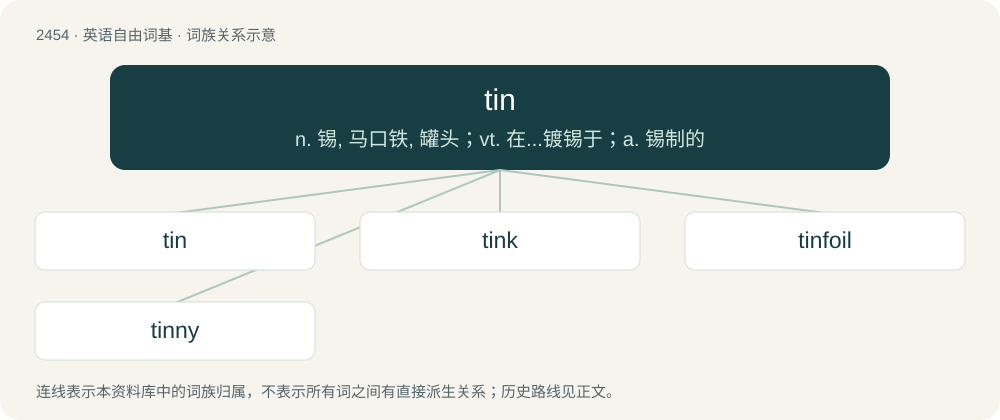

# 2557 · tin — n. 锡, 马口铁, 罐头；vt. 在...镀锡于；a. 锡制的

[总目录](../00_总目录_按常用程度.md)

**类型**：英语自由词基　｜　**来源语言**：见词源记录

## 核心含义与来源

- 核心含义：n. 锡, 马口铁, 罐头；vt. 在...镀锡于；a. 锡制的
- 英文含义：A malleable, ductile, metallic element, resistant to corrosion, with atomic number 50 and symbol Sn.
- 词形：tin

**来源记录 1**（名词；A malleable, ductile, metallic element, resistant to corrosion, with atomic number 50 and symbol Sn.）

From Middle English tin, from Old English tin, from Proto-West Germanic \*tin, from Proto-Germanic \*tiną.

## 词族图

## 单词速览（常用到不常用）

| 单词 | 音标 | 释义 |
|---|---|---|
| [tin](#w-1) | /tɪn/ | n. 锡, 马口铁, 罐头；vt. 在...镀锡于；a. 锡制的 |
| [tink](#w-2) | /ˈtɪŋk/ | vi.& n.(发)丁当声,(发)丁零声 |
| [tinfoil](#w-3) | /ˈtinfɒil/ | n. 锡箔 |
| [tinny](#w-4) | 英 /ˈtɪni/ | a. 锡的, 含锡的, 像锡的 |

## 逐词详解

### 1. tin

**词性**：名词　｜　**音标**：/tɪn/

**中文释义**：n. 锡, 马口铁, 罐头；vt. 在...镀锡于；a. 锡制的

**英文义项**：A malleable, ductile, metallic element, resistant to corrosion, with atomic number 50 and symbol Sn. / Iron or steel sheet metal that is coated with tin as an anticorrosion protectant.

**词源与演化**：

From Middle English tin, from Old English tin, from Proto-West Germanic \*tin, from Proto-Germanic \*tiną.

**例句**：

> empty tins, cans, and plastic containers are recycled in the blue bins.

该用例对应义项：An airtight container, made of tin-coated steel (called tinplate or tin), (formerly) tin, aluminium, or another metal, used to preserve food, or hold a liquid or some other product.

### 2. tink

**词性**：动词　｜　**音标**：/ˈtɪŋk/

**中文释义**：vi.& n.(发)丁当声,(发)丁零声

**英文义项**：To emit a high-pitched sharp or metallic noise.

**构词拆分**：tin + -k

**词源与演化**：

From Middle English tinken, possibly from Old English \*tincian, equivalent to tin + -k. Compare Dutch tinken (“to tink, toll, strike the bells of a clock”), German Low German tinken (“to tink”). Compare also English ting.

**例句**：

> Jimmy heard the bells tink.

该用例对应义项：To emit a high-pitched sharp or metallic noise.

### 3. tinfoil

**词性**：名词　｜　**音标**：/ˈtinfɒil/

**中文释义**：n. 锡箔

**英文义项**：A thin, pliable sheet of tin or an alloy of tin and lead, used as a protective wrapping. / Aluminium foil.

**构词拆分**：tin + foil

**词源与演化**：

From tin + foil.

**例句**：

> Tom wears a tinfoil hat to protect his brain from harmful radiation.

### 4. tinny

**词性**：形容词　｜　**音标**：英 /ˈtɪni/

**中文释义**：a. 锡的, 含锡的, 像锡的

**英文义项**：Of or pertaining to or resembling tin. / Pertaining to the thinness and cheapness of tin or similar-looking metals, in contrast to a heavier, more valuable metal.

**构词拆分**：tin + -y

**词源与演化**：

From tin + -y.

**例句**：

> The piano was not simply out of tune, but had become downright tinny.

该用例对应义项：Pertaining to a thin, unpleasant sound recalling that of tin being rapped.
