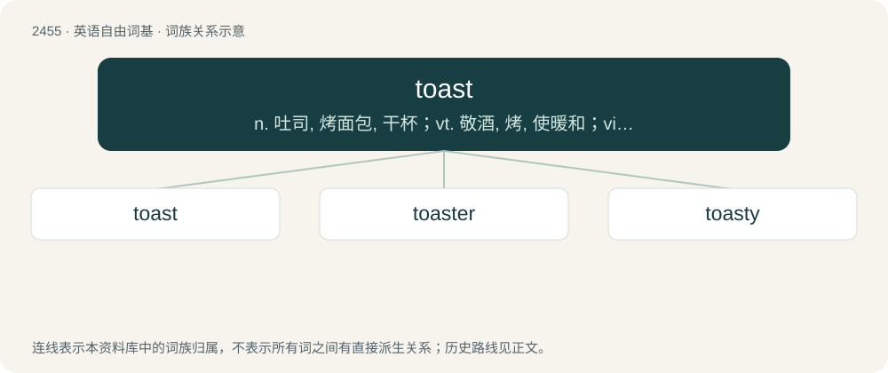

# 2558 · toast — n. 吐司, 烤面包, 干杯；vt. 敬酒, 烤, 使暖和；vi. 烤, 烘

[总目录](../00_总目录_按常用程度.md)

**类型**：英语自由词基　｜　**来源语言**：见词源记录

## 核心含义与来源

- 核心含义：n. 吐司, 烤面包, 干杯；vt. 敬酒, 烤, 使暖和；vi. 烤, 烘
- 英文含义：Bread that has been toasted (cooked lightly by browning).
- 词形：toast

**多个词源／构词路径**：同一拼写可能有不同来源；以下按词性和含义分别列出。

**来源记录 1**（名词；Bread that has been toasted (cooked lightly by browning).）

From Middle English tost, from the verb tosten (see below). Etymology 1 sense 3 is according to the Oxford English Dictionary a figurative application of etymology 1 sense 1 dating to 1674. It began as an epithet for a lady being supposed to flavour a bumper like a spiced toast placed in that drink. (In this context, a bumper is a drinking vessel filled to the brim.)

**来源记录 2**（动词；To cook lightly by browning by means of direct exposure to a fire or other heat source.）

From Middle English tosten, from Old French toster (“to roast, grill”), from Late Latin tostō, -āre, frequentative of torreō (“to burn, grill”) from its perfect passive participle tostus (“grilled, burnt”).

## 词族图

## 单词速览（常用到不常用）

| 单词 | 音标 | 释义 |
|---|---|---|
| [toast](#w-1) | 英 /təʊst/；美 /toʊst/ | n. 吐司, 烤面包, 干杯；vt. 敬酒, 烤, 使暖和；vi. 烤, 烘 |
| [toaster](#w-2) | 英 /ˈtəʊ̯s.təː/；/ˈtoʊ̯s.tɚ/ | n. 烤面包器, 烤面包炉, 祝酒人 |
| [toasty](#w-3) | 美 /ˈtoʊsti/ | a. 温暖舒适的 |

## 逐词详解

### 1. toast

**词性**：名词　｜　**音标**：英 /təʊst/；美 /toʊst/

**中文释义**：n. 吐司, 烤面包, 干杯；vt. 敬酒, 烤, 使暖和；vi. 烤, 烘

**英文义项**：Bread that has been toasted (cooked lightly by browning). / A proposed salutation (e.g. saying "cheers") while drinking alcohol.

**词源与演化**：

From Middle English tost, from the verb tosten (see below). Etymology 1 sense 3 is according to the Oxford English Dictionary a figurative application of etymology 1 sense 1 dating to 1674. It began as an epithet for a lady being supposed to flavour a bumper like a spiced toast placed in that drink. (In this context, a bumper is a drinking vessel filled to the brim.)

**例句**：

> The metal frame survived the fire, but the plastic and rubber bits are toast.

该用例对应义项：Something that is irreparably damaged or used up, especially when destroyed by heat or fire; something which has been burnt to a crisp or incinerated.

### 2. toaster

**词性**：名词　｜　**音标**：英 /ˈtəʊ̯s.təː/；/ˈtoʊ̯s.tɚ/

**中文释义**：n. 烤面包器, 烤面包炉, 祝酒人

**英文义项**：An electrical device for toasting food, typically sliced bread. / A toasting fork.

**构词拆分**：toast + -er (agent noun suffix)

**词源与演化**：

From toast + -er (agent noun suffix) or -er (patient suffix).

**例句**：

> Clean out the toaster's crumb tray regularly to prevent a fire hazard.

### 3. toasty

**词性**：形容词　｜　**音标**：美 /ˈtoʊsti/

**中文释义**：a. 温暖舒适的

**英文义项**：Resembling or characteristic of toast. / Pleasantly warm.

**构词拆分**：toast + -y

**词源与演化**：

From toast + -y.

**例句**：

> A kind spider knit Nemesio a nice, toasty scarf for the coming winter.
